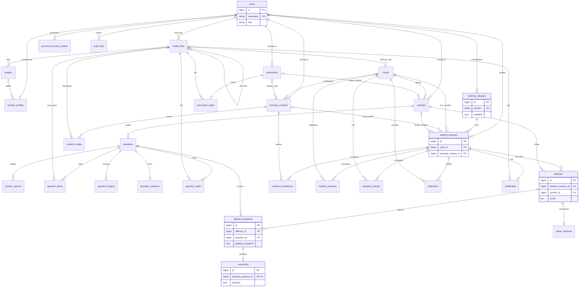

# Database.md - Reka Bentuk Pangkalan Data Di-BiTaRa

## Ketetapan aktif — akses kod dan sesi (22 Oktober 2026)

Rujukan utama ialah [Dokumentasi Lengkap Sistem v2](docs/references/Dokumentasi_Lengkap_Sistem_Di-BiTaRa.pdf), 8 halaman. [Pemetaan enhancement](docs/access-session-enhancement.md) menetapkan fail, perbezaan dan peraturan semasa. Semua bahagian akaun Pelajar serta timer per zon di bawah ialah sejarah versi terdahulu dan tidak boleh digunakan sebagai flow semasa.

Pelajar: Masukkan Kod → sesi sebenar tanpa akaun → Zon 1 (nama/kelas pilihan dan avatar) → Zon 2 (nota/audio automatik) → Zon 3 (3 cabaran) → Zon 4 (2 cabaran) → Zon 5 (3 Imlak dan refleksi) → Pasport, sijil, Tamat Sesi. Top navbar: Papan Pemuka | Kuiz & Aktiviti | Pasport & Pencapaian. Tiada profil, daftar, login, kata laluan atau dropdown akaun Pelajar. Pentadbir menggunakan log masuk biasa, mengurus Kod Akses dan Keputusan / Sesi.

Satu jam bermula selepas countdown Cabaran 1 Zon 3 dan diteruskan tanpa reset hingga refleksi Zon 5. Countdown hanya setiap cabaran Zon 3/4. Had audio Imlak tiga kali. Data dimiliki learner_sessions → access_codes; student_journeys.user_id kosong bagi sesi baharu. Akaun, perjalanan, cap, masa, snapshot dan sijil sejarah dikekalkan.

Versi 1.0 | 20 Oktober 2026 | Skema cadangan, bukan migrasi yang telah dijalankan.

Rujukan: [Plan.md](Plan.md) untuk dasar, [Module.md](Module.md) untuk tingkah laku dan [Prototype.md](Prototype.md) untuk skrin. Asas entiti mengikuti R1 hlm. 6-7 dalam Plan; jadual tambahan menyokong versi, bukti kemajuan, seret dan lepas serta sambung permainan. Hanya role `pelajar` dan `admin`.

## 1. Gambaran keseluruhan dan konvensyen

MySQL/MariaDB dengan InnoDB, utf8mb4 dan FK sebenar. Versi enjin dipilih semasa pembangunan; aplikasi tetap mengesahkan semua kekangan perniagaan walaupun enjin tidak menyokong CHECK yang diperlukan. Tarikh disimpan UTC, dipaparkan Asia/Kuala_Lumpur. ID dalaman BIGINT UNSIGNED tidak bermakna pengguna diberi kebenaran akses kepada rekod itu.

Konvensyen di bawah **merupakan sebahagian kamus data setiap jadual**, bukan medan tersirat yang boleh diabaikan:

| Kod | Field | Jenis | Kunci | Nullable | Default | Makna |
|---|---|---|---|---|---|---|
| I | id | BIGINT UNSIGNED | PK, auto increment | Tidak | AUTO_INCREMENT | Identiti rekod |
| T | created_at | DATETIME(3) | - | Tidak | CURRENT_TIMESTAMP(3) | Masa ciptaan |
| T | updated_at | DATETIME(3) | - | Tidak | CURRENT_TIMESTAMP(3) | Masa terakhir dikemas kini aplikasi |
| S | deleted_at | DATETIME(3) | indeks jika penapis kerap | Ya | NULL | Padam lembut |

Setiap seksyen menyatakan set medan bersama yang terpakai. Semua medan lain dinyatakan satu persatu. `—` pada Default bermaksud **tiada default; nilai wajib diberi**. `NULL` bermaksud benar-benar boleh tiada. BOOLEAN diwakili TINYINT(1) 0/1; JSON memerlukan objek/larik sah dan skema aplikasi. Kod ENUM diwakili VARCHAR dengan senarai dibenarkan supaya migrasi jenis baharu terkawal. FK lalai `ON UPDATE RESTRICT ON DELETE RESTRICT`, kecuali dinyatakan dalam §5. Tidak menyimpan video atau rangka tangan dalam mana-mana jadual.

## 2. Inventori jadual

| Kumpulan | Jadual | Tujuan |
|---|---|---|
| Identiti | users, student_profiles, avatars, account_recovery_tokens | Akaun dua peranan, kosmetik dan pemulihan |
| Kurikulum | zones, learning_contents, activities, instructions, questions, answer_options | Lima zon serta CRUD bahan/kuiz |
| Jenis soalan | question_items, question_targets, question_solutions | Token, sasaran dan kunci jawapan berstruktur |
| Media | media_files, content_media, question_audio, instruction_audio | Pustaka dan pautan media/audio |
| Versi | learning_releases, student_journeys | Keluaran kurikulum tetap dan ikatan murid |
| Penilaian | attempts, attempt_questions, responses, game_sessions | Cubaan, salinan soalan, jawapan dan checkpoint |
| Pencapaian | content_completions, student_progress, passport_stamps, reflections, certificates | Bukti belajar, ringkasan, pasport, refleksi dan sijil |
| Operasi | audit_logs | Jejak Admin baca sahaja |

Jumlah: 29 jadual aplikasi. Sesi menggunakan pemacu fail untuk setempat dan Redis jika produksi memerlukannya; baris gilir Redis atau pemprosesan segerak untuk skala awal. Oleh itu jadual Laravel `sessions`, `jobs`, `failed_jobs` atau `cache` bukan keperluan skema asas ini. Jika memilih pemacu pangkalan data kemudian, tambahkan migrasi infrastruktur rasmi yang berpadanan dan dokumentasikan sebelum pelaksanaan. `account_recovery_tokens` meliputi kedua-dua emel dan kod pemulihan; jangan menggandakan aliran dengan jadual token lain tanpa sebab.

## 3. Kamus data

### 3.1 users

Set bersama: I, T, S. Akaun disahaktif secara biasa; padam lembut tidak membenarkan kod pengguna digunakan semula.

| Field | Jenis | Kunci/rujukan | Nullable | Default | Peraturan |
|---|---|---|---|---|---|
| display_name | VARCHAR(100) | - | Tidak | — | Nama paparan minimum |
| username | VARCHAR(50) | UNIQUE | Tidak | — | Kod pengguna, bentuk huruf kecil kanonik |
| email | VARCHAR(254) | UNIQUE | Ya | NULL | Pilihan bagi Pelajar; dinormalisasi |
| password | VARCHAR(255) | - | Tidak | — | Hash, bukan teks asal/PIN biasa |
| role | VARCHAR(16) | indeks | Tidak | pelajar | pelajar/admin; ditetapkan pelayan |
| status | VARCHAR(16) | indeks | Tidak | active | active/inactive |
| remember_token | VARCHAR(100) | - | Ya | NULL | Token ingat saya yang diputar |
| last_login_at | DATETIME(3) | - | Ya | NULL | Masa log masuk berjaya |

### 3.2 student_profiles

Set bersama: I, T. Satu profil hanya untuk pengguna role Pelajar.

| Field | Jenis | Kunci/rujukan | Nullable | Default | Peraturan |
|---|---|---|---|---|---|
| user_id | BIGINT UNSIGNED | FK users.id, UNIQUE | Tidak | — | Hubungan satu-ke-satu |
| avatar_id | BIGINT UNSIGNED | FK avatars.id | Ya | NULL | Dipilih dan disahkan hanya di Zon 1 |
| avatar_confirmed_at | TIMESTAMP | — | Ya | NULL | Masa pengesahan avatar di Zon 1 |
| aircraft_color | VARCHAR(16) | - | Tidak | yellow | yellow/blue/pink/orange |
| onboarding_status | VARCHAR(16) | - | Tidak | pending | pending/skipped/completed |
| onboarding_step | TINYINT UNSIGNED | - | Tidak | 1 | 1-4 |
| onboarding_completed_at | DATETIME(3) | - | Ya | NULL | Hanya apabila completed |
| reduced_motion | BOOLEAN | - | Tidak | 0 | Pilihan gerakan minimum |
| audio_enabled | BOOLEAN | - | Tidak | 1 | Tidak bermaksud automula audio |

### 3.3 avatars

Set bersama: I, T, S.

| Field | Jenis | Kunci/rujukan | Nullable | Default | Peraturan |
|---|---|---|---|---|---|
| code | VARCHAR(40) | UNIQUE | Tidak | — | Pengenal katalog stabil |
| name | VARCHAR(100) | - | Tidak | — | Nama Bahasa Melayu |
| media_file_id | BIGINT UNSIGNED | FK media_files.id | Tidak | — | Imej sedia |
| sort_order | SMALLINT UNSIGNED | indeks | Tidak | 0 | Susunan katalog |
| is_active | BOOLEAN | - | Tidak | 1 | Boleh dipilih oleh murid baharu |

### 3.4 account_recovery_tokens

Set bersama: I. Tiada updated_at kerana token hanya digunakan/dibatalkan; used_at menjejak penggunaan.

| Field | Jenis | Kunci/rujukan | Nullable | Default | Peraturan |
|---|---|---|---|---|---|
| user_id | BIGINT UNSIGNED | FK users.id | Tidak | — | Pemilik |
| token_hash | CHAR(64) | UNIQUE | Tidak | — | SHA-256 token rawak berentropi tinggi |
| kind | VARCHAR(16) | - | Tidak | email_reset | email_reset/backup_code |
| created_at | DATETIME(3) | - | Tidak | CURRENT_TIMESTAMP(3) | Masa keluaran |
| expires_at | DATETIME(3) | indeks | Ya | NULL | Emel wajib tamat 30 minit; backup boleh NULL |
| used_at | DATETIME(3) | - | Ya | NULL | Digunakan/dibatalkan, sekali guna |

### 3.5 zones

Set bersama: I, T. Lima baris tetap, tidak boleh menambah/menghapus zon melalui UI asas.

| Field | Jenis | Kunci/rujukan | Nullable | Default | Peraturan |
|---|---|---|---|---|---|
| code | VARCHAR(8) | UNIQUE | Tidak | — | Z1..Z5 |
| name | VARCHAR(120) | - | Tidak | — | Nama tetap dalam Plan |
| sequence | TINYINT UNSIGNED | UNIQUE | Tidak | — | 1..5 |
| description | TEXT | - | Ya | NULL | Penerangan ringkas |
| stamp_title | VARCHAR(100) | - | Tidak | — | Label cap dalam manifest |
| stamp_media_id | BIGINT UNSIGNED | FK media_files.id | Ya | NULL | Ilustrasi cap |
| is_active | BOOLEAN | - | Tidak | 1 | Kelengkapan terbit tetap disemak |

### 3.6 learning_contents

Set bersama: I, T, S. Nota ialah jenis `note`; bantuan/pengenalan juga kandungan, bukan kod teks tetap.

| Field | Jenis | Kunci/rujukan | Nullable | Default | Peraturan |
|---|---|---|---|---|---|
| zone_id | BIGINT UNSIGNED | FK zones.id | Ya | NULL | NULL hanya bagi bantuan umum |
| instruction_id | BIGINT UNSIGNED | FK instructions.id | Ya | NULL | Arahan pilihan |
| title | VARCHAR(180) | - | Tidak | — | Tajuk |
| kind | VARCHAR(20) | - | Tidak | note | note/help/introduction |
| body | LONGTEXT | - | Tidak | — | HTML tersanitasi |
| sort_order | SMALLINT UNSIGNED | - | Tidak | 0 | Susunan dalam zon |
| is_required | BOOLEAN | - | Tidak | 1 | Bantuan umum mesti 0 |
| status | VARCHAR(16) | - | Tidak | draft | draft/published/inactive |
| revision | INT UNSIGNED | - | Tidak | 1 | Meningkat bagi setiap simpan perubahan |
| created_by | BIGINT UNSIGNED | FK users.id | Tidak | — | Admin |
| updated_by | BIGINT UNSIGNED | FK users.id | Tidak | — | Admin terakhir |

### 3.7 activities

Set bersama: I, T, S. Satu rekod mewakili kuiz, simulasi, misi tangan atau imlak.

| Field | Jenis | Kunci/rujukan | Nullable | Default | Peraturan |
|---|---|---|---|---|---|
| zone_id | BIGINT UNSIGNED | FK zones.id | Tidak | — | Zon aktiviti |
| instruction_id | BIGINT UNSIGNED | FK instructions.id | Ya | NULL | Arahan utama |
| title | VARCHAR(180) | - | Tidak | — | Tajuk |
| kind | VARCHAR(24) | - | Tidak | quiz | quiz/simulation/hand_mission/dictation |
| passing_percent | DECIMAL(5,2) | - | Tidak | 80.00 | >0 hingga 100 |
| is_required | BOOLEAN | - | Tidak | 1 | Menyumbang syarat zon |
| sort_order | SMALLINT UNSIGNED | - | Tidak | 0 | Susunan |
| settings | JSON | - | Tidak | — | Objek ikut skema §4, guna {} jika kosong |
| status | VARCHAR(16) | - | Tidak | draft | draft/published/inactive |
| revision | INT UNSIGNED | - | Tidak | 1 | Semakan optimistik |
| created_by | BIGINT UNSIGNED | FK users.id | Tidak | — | Admin |
| updated_by | BIGINT UNSIGNED | FK users.id | Tidak | — | Admin |

### 3.8 instructions

Set bersama: I, T, S. Boleh digunakan semula oleh nota dan aktiviti.

| Field | Jenis | Kunci/rujukan | Nullable | Default | Peraturan |
|---|---|---|---|---|---|
| title | VARCHAR(180) | - | Tidak | — | Tajuk pengurusan |
| body | TEXT | - | Tidak | — | Arahan murid |
| screen_key | VARCHAR(60) | indeks | Ya | NULL | Konteks skrin dibenarkan, misalnya zone4.camera |
| status | VARCHAR(16) | - | Tidak | draft | draft/published/inactive |
| revision | INT UNSIGNED | - | Tidak | 1 | Versi sumber |
| created_by | BIGINT UNSIGNED | FK users.id | Tidak | — | Admin |
| updated_by | BIGINT UNSIGNED | FK users.id | Tidak | — | Admin |

### 3.9 questions

Set bersama: I, T, S.

| Field | Jenis | Kunci/rujukan | Nullable | Default | Peraturan |
|---|---|---|---|---|---|
| activity_id | BIGINT UNSIGNED | FK activities.id | Tidak | — | Aktiviti induk |
| prompt | TEXT | - | Tidak | — | Teks soalan, bukan kunci imlak |
| type | VARCHAR(24) | - | Tidak | objective | objective/drag_drop/fill_blank/sentence_order/dictation |
| max_marks | SMALLINT UNSIGNED | - | Tidak | 10 | >0 |
| sort_order | SMALLINT UNSIGNED | - | Tidak | 0 | Susunan |
| public_config | JSON | - | Tidak | — | Slot paparan dan tetapan tanpa jawapan betul |
| feedback_correct | TEXT | - | Ya | NULL | Teks penjelasan |
| feedback_incorrect | TEXT | - | Ya | NULL | Petunjuk selepas hantar |
| status | VARCHAR(16) | - | Tidak | draft | draft/published/inactive |
| revision | INT UNSIGNED | - | Tidak | 1 | Versi sumber |

### 3.10 answer_options

Set bersama: I, T. Pilihan objektif; disalin ke manifest versi sebelum perubahan/pemadaman.

| Field | Jenis | Kunci/rujukan | Nullable | Default | Peraturan |
|---|---|---|---|---|---|
| question_id | BIGINT UNSIGNED | FK questions.id | Tidak | — | Soalan objektif |
| option_key | VARCHAR(40) | UNIQUE(question_id, option_key) | Tidak | — | ID stabil dalam snapshot |
| text | TEXT | - | Tidak | — | Teks pilihan |
| is_correct | BOOLEAN | - | Tidak | 0 | Jangan hantar kepada Pelajar |
| sort_order | SMALLINT UNSIGNED | - | Tidak | 0 | Susunan |

### 3.11 question_items

Set bersama: I, T. Token seret dan lepas/susun ayat; teks sama dibezakan melalui item_key.

| Field | Jenis | Kunci/rujukan | Nullable | Default | Peraturan |
|---|---|---|---|---|---|
| question_id | BIGINT UNSIGNED | FK questions.id | Tidak | — | Pemilik |
| item_key | VARCHAR(40) | UNIQUE(question_id, item_key) | Tidak | — | Token stabil |
| text | VARCHAR(255) | - | Tidak | — | Perkataan/frasa |
| media_file_id | BIGINT UNSIGNED | FK media_files.id | Ya | NULL | Imej pilihan |
| max_uses | TINYINT UNSIGNED | - | Tidak | 1 | Had penggunaan token |
| sort_order | SMALLINT UNSIGNED | - | Tidak | 0 | Susunan awal |

### 3.12 question_targets

Set bersama: I, T. Ruang sasaran token/isi tempat kosong.

| Field | Jenis | Kunci/rujukan | Nullable | Default | Peraturan |
|---|---|---|---|---|---|
| question_id | BIGINT UNSIGNED | FK questions.id | Tidak | — | Pemilik |
| target_key | VARCHAR(40) | UNIQUE(question_id, target_key) | Tidak | — | ID slot |
| label | VARCHAR(100) | - | Tidak | — | Label boleh diakses |
| capacity | TINYINT UNSIGNED | - | Tidak | 1 | Bilangan token diterima |
| sort_order | SMALLINT UNSIGNED | - | Tidak | 0 | Turutan paparan |

### 3.13 question_solutions

Set bersama: I, T. Kunci bukan objektif disimpan di pelayan; objektif menggunakan answer_options.

| Field | Jenis | Kunci/rujukan | Nullable | Default | Peraturan |
|---|---|---|---|---|---|
| question_id | BIGINT UNSIGNED | FK questions.id, UNIQUE | Tidak | — | Satu konfigurasi penilaian per soalan |
| answer_key | JSON | - | Tidak | — | Pemetaan slot/token, urutan atau senarai teks diterima |
| normalization | JSON | - | Tidak | — | NFC, case_fold, trim, collapse_spaces, ignore_punctuation; tidak membuang semua ruang |
| scoring_mode | VARCHAR(20) | - | Tidak | all_or_nothing | Markah penuh atau 0 bagi v1 |

### 3.14 media_files

Set bersama: I, T, S. Tiada kandungan binari disimpan dalam DB.

| Field | Jenis | Kunci/rujukan | Nullable | Default | Peraturan |
|---|---|---|---|---|---|
| kind | VARCHAR(16) | - | Tidak | — | audio/image/certificate |
| title | VARCHAR(180) | - | Tidak | — | Nama pengurusan |
| disk | VARCHAR(40) | - | Tidak | private | Pemacu storan |
| path | VARCHAR(512) | UNIQUE(disk, path) | Tidak | — | Kunci fail rawak, bukan URL awam |
| original_name | VARCHAR(255) | - | Tidak | — | Dipaparkan selepas escaping |
| mime_type | VARCHAR(100) | - | Tidak | — | Disahkan kandungan sebenar |
| size_bytes | BIGINT UNSIGNED | - | Tidak | — | >0 |
| duration_ms | INT UNSIGNED | - | Ya | NULL | Wajib audio selepas ready |
| width | INT UNSIGNED | - | Ya | NULL | Imej |
| height | INT UNSIGNED | - | Ya | NULL | Imej |
| alt_text | VARCHAR(255) | - | Ya | NULL | Wajib bagi imej bermakna |
| source | VARCHAR(20) | - | Tidak | upload | upload/recording/generated |
| license_note | TEXT | - | Ya | NULL | Sumber/hak penggunaan |
| checksum | CHAR(64) | indeks | Tidak | — | SHA-256 fail |
| status | VARCHAR(16) | - | Tidak | processing | processing/ready/failed/inactive |
| failure_reason | VARCHAR(255) | - | Ya | NULL | Mesej operasi yang ditapis |
| parent_media_id | BIGINT UNSIGNED | FK media_files.id | Ya | NULL | Asal bagi audio derivatif |
| created_by | BIGINT UNSIGNED | FK users.id | Tidak | — | Admin; penjana sijil menggunakan akaun sistem Admin terkawal |

### 3.15 content_media

Set bersama: I, T. Many-to-many nota dan media, termasuk ilustrasi/audio penerangan/lagu.

| Field | Jenis | Kunci/rujukan | Nullable | Default | Peraturan |
|---|---|---|---|---|---|
| learning_content_id | BIGINT UNSIGNED | FK learning_contents.id | Tidak | — | Nota |
| media_file_id | BIGINT UNSIGNED | FK media_files.id | Tidak | — | Fail sedia |
| purpose | VARCHAR(20) | - | Tidak | illustration | illustration/narration/song |
| sort_order | SMALLINT UNSIGNED | - | Tidak | 0 | Urutan |

UNIQUE(learning_content_id, media_file_id, purpose). Satu narration utama setiap nota disahkan aplikasi ketika terbit.

### 3.16 question_audio

Set bersama: I, T. Hubungan audio soalan; satu audio utama setiap peranan.

| Field | Jenis | Kunci/rujukan | Nullable | Default | Peraturan |
|---|---|---|---|---|---|
| question_id | BIGINT UNSIGNED | FK questions.id | Tidak | — | Soalan |
| media_file_id | BIGINT UNSIGNED | FK media_files.id | Tidak | — | kind audio dan ready ketika terbit |
| purpose | VARCHAR(20) | - | Tidak | prompt | prompt/dictation |
| transcript | TEXT | - | Ya | NULL | Imlak disembunyikan sebelum hantar; bantuan teks mengikut mod |

UNIQUE(question_id, purpose). Audio sama boleh dikongsi oleh beberapa soalan.

### 3.17 instruction_audio

Set bersama: I, T.

| Field | Jenis | Kunci/rujukan | Nullable | Default | Peraturan |
|---|---|---|---|---|---|
| instruction_id | BIGINT UNSIGNED | FK instructions.id, UNIQUE | Tidak | — | Satu suara utama setiap arahan |
| media_file_id | BIGINT UNSIGNED | FK media_files.id | Tidak | — | Audio sedia |

### 3.18 learning_releases

Set bersama: I, T. Keluaran kurikulum merangkumi lima zon; manifest dan aturan tidak boleh diubah selepas terbit.

| Field | Jenis | Kunci/rujukan | Nullable | Default | Peraturan |
|---|---|---|---|---|---|
| version | VARCHAR(40) | UNIQUE | Tidak | — | Contoh 1.0.0 |
| title | VARCHAR(180) | - | Tidak | — | Nama keluaran |
| status | VARCHAR(16) | indeks | Tidak | draft | draft/published/retired/withdrawn |
| manifest | JSON | - | Tidak | — | Salinan lengkap kandungan, unit wajib, soalan, jawapan, arahan, media dan rujukan ID |
| scoring_policy | JSON | - | Tidak | — | Dasar Plan §8 termasuk formula/skema versi |
| checksum | CHAR(64) | - | Tidak | — | Hash manifest+dasar |
| published_at | DATETIME(3) | indeks | Ya | NULL | Wajib bagi keluaran pernah terbit |
| published_by | BIGINT UNSIGNED | FK users.id | Ya | NULL | Admin semasa terbit |

Satu keluaran `published` menerima perjalanan baharu; keluaran `retired` kekal untuk perjalanan lama. Transaksi penerbitan menserialkan pertukaran keluaran semasa (lock rekod keluaran terbit sedia ada dan kunci aplikasi penerbitan), mengelakkan dua keluaran semasa. `withdrawn` memerlukan tindakan pemulihan yang jelas untuk murid terkesan.

### 3.19 student_journeys

Set bersama: I, T. Menentukan keluaran kurikulum yang diikuti dan identiti pasport.

| Field | Jenis | Kunci/rujukan | Nullable | Default | Peraturan |
|---|---|---|---|---|---|
| user_id | BIGINT UNSIGNED | FK users.id | Tidak | — | Pelajar sahaja |
| learning_release_id | BIGINT UNSIGNED | FK learning_releases.id | Tidak | — | Tidak bertukar secara senyap |
| status | VARCHAR(16) | - | Tidak | active | active/completed/archived |
| started_at | DATETIME(3) | - | Tidak | CURRENT_TIMESTAMP(3) | Mula perjalanan |
| completed_at | DATETIME(3) | - | Ya | NULL | Syarat lima zon dipenuhi |
| last_zone_id | BIGINT UNSIGNED | FK zones.id | Ya | NULL | Pintasan sambung |
| last_content_id | BIGINT UNSIGNED | FK learning_contents.id | Ya | NULL | Nota terakhir, bukan bukti selesai |
| last_activity_id | BIGINT UNSIGNED | FK activities.id | Ya | NULL | Aktiviti terakhir |

UNIQUE(user_id, learning_release_id). Hanya satu perjalanan berstatus active per murid melalui transaksi dan lock users; v1 tiada pindah keluaran automatik.

### 3.20 attempts

Set bersama: I, T. Murid dan keluaran diperoleh melalui perjalanan; tidak menduplikasi user_id.

| Field | Jenis | Kunci/rujukan | Nullable | Default | Peraturan |
|---|---|---|---|---|---|
| student_journey_id | BIGINT UNSIGNED | FK student_journeys.id | Tidak | — | Pemilik dan keluaran |
| activity_id | BIGINT UNSIGNED | FK activities.id | Tidak | — | Mesti ada dalam manifest perjalanan |
| attempt_no | INT UNSIGNED | UNIQUE(journey, activity, attempt_no) | Tidak | — | Turutan bermula 1 |
| status | VARCHAR(20) | - | Tidak | in_progress | in_progress/completed/abandoned |
| input_mode | VARCHAR(24) | - | Tidak | pointer | pointer/touch/keyboard/hand/assisted_text |
| activity_snapshot | JSON | - | Tidak | — | Tajuk, zon, ambang, arahan dan tetapan dari manifest |
| score | INT UNSIGNED | - | Tidak | 0 | Dikira pelayan |
| max_score | INT UNSIGNED | - | Tidak | — | Jumlah markah soalan, >0 |
| percentage | DECIMAL(5,2) | - | Ya | NULL | Paparan dibundarkan; lulus dari pecahan asal |
| passed | BOOLEAN | - | Tidak | 0 | Hanya completed boleh lulus |
| started_at | DATETIME(3) | - | Tidak | CURRENT_TIMESTAMP(3) | Masa mula |
| completed_at | DATETIME(3) | - | Ya | NULL | Masa selesai |

Lock pasangan perjalanan-aktiviti ketika mencipta cubaan; satu in_progress setiap pasangan melalui transaksi. Kiraan attempt_no turut dalam lock yang sama.

### 3.21 attempt_questions

Set bersama: I, T. Soalan yang benar-benar dipilih untuk cubaan; kunci penilaian tidak terdedah pada Pelajar.

| Field | Jenis | Kunci/rujukan | Nullable | Default | Peraturan |
|---|---|---|---|---|---|
| attempt_id | BIGINT UNSIGNED | FK attempts.id | Tidak | — | Cubaan |
| question_id | BIGINT UNSIGNED | FK questions.id | Tidak | — | Identiti sumber dipelihara |
| position | SMALLINT UNSIGNED | - | Tidak | — | Susunan sebenar |
| question_snapshot | JSON | - | Tidak | — | Teks, jenis, token/slot/pilihan, media, revision dari manifest |
| grading_snapshot | JSON | - | Tidak | — | Jawapan betul, normalisasi, rubrik; pelayan sahaja |
| max_marks | SMALLINT UNSIGNED | - | Tidak | — | >0 |

UNIQUE(attempt_id, question_id), UNIQUE(attempt_id, position). Snapshot diwujudkan sekali daripada manifest yang sama dengan cubaan, bukan sumber draf semasa.

### 3.22 responses

Set bersama: I, T. Satu respons bagi satu soalan cubaan; boleh draf kemudian muktamad.

| Field | Jenis | Kunci/rujukan | Nullable | Default | Peraturan |
|---|---|---|---|---|---|
| attempt_question_id | BIGINT UNSIGNED | FK attempt_questions.id, UNIQUE | Tidak | — | Cubaan dan question_id diperoleh melalui ini |
| idempotency_key | CHAR(36) | UNIQUE | Tidak | — | UUID untuk simpan/hantar selamat |
| payload | JSON | - | Tidak | — | Input mengikut jenis §4 |
| is_correct | BOOLEAN | - | Ya | NULL | NULL sewaktu draf |
| awarded_marks | SMALLINT UNSIGNED | - | Tidak | 0 | 0..max_marks, pelayan sahaja |
| input_mode | VARCHAR(24) | - | Tidak | pointer | Mod sebenar respons |
| submitted_at | DATETIME(3) | - | Ya | NULL | NULL = draf; selepas isi tidak boleh edit |
| feedback | TEXT | - | Ya | NULL | Penjelasan keputusan |

Tidak menggandakan question_id dan attempt_id di sini: laluan FK `responses → attempt_questions → attempts/questions` mengelakkan respons dipaut kepada soalan daripada aktiviti lain.

### 3.23 game_sessions

Set bersama: I, T. Sambung keadaan kokpit atau permainan tangan, bukan sumber markah.

| Field | Jenis | Kunci/rujukan | Nullable | Default | Peraturan |
|---|---|---|---|---|---|
| attempt_id | BIGINT UNSIGNED | FK attempts.id, UNIQUE | Tidak | — | Satu sesi permainan per cubaan |
| mode | VARCHAR(20) | - | Tidak | cockpit | cockpit/hand_mission |
| phase | VARCHAR(24) | - | Tidak | briefing | briefing/takeoff/navigation/calibration/playing/landing/completed |
| checkpoint | JSON | - | Tidak | — | Slot draf, indeks soalan, laluan dan kosmetik yang dibenarkan |
| input_mode | VARCHAR(24) | - | Tidak | pointer | hand/touch/keyboard/pointer |
| calibration_settings | JSON | - | Ya | NULL | Sensitiviti/tahan sahaja; tiada imej atau koordinat tangan |
| version | INT UNSIGNED | - | Tidak | 1 | Lock optimistik bagi checkpoint |
| last_saved_at | DATETIME(3) | - | Tidak | CURRENT_TIMESTAMP(3) | Simpan terkini |

### 3.24 content_completions

Set bersama: I, T. Bukti murid menekan Sudah Baca bagi nota wajib/pilihan dalam keluaran.

| Field | Jenis | Kunci/rujukan | Nullable | Default | Peraturan |
|---|---|---|---|---|---|
| student_journey_id | BIGINT UNSIGNED | FK student_journeys.id | Tidak | — | Perjalanan |
| learning_content_id | BIGINT UNSIGNED | FK learning_contents.id | Tidak | — | Mesti wujud dalam manifest |
| completed_at | DATETIME(3) | - | Tidak | CURRENT_TIMESTAMP(3) | Bukti bacaan |

UNIQUE(student_journey_id, learning_content_id).

### 3.25 student_progress

Set bersama: I, T. Ringkasan per zon yang boleh dibina semula, bukan bukti tunggal kelulusan.

| Field | Jenis | Kunci/rujukan | Nullable | Default | Peraturan |
|---|---|---|---|---|---|
| student_journey_id | BIGINT UNSIGNED | FK student_journeys.id | Tidak | — | Pemilik melalui perjalanan |
| zone_id | BIGINT UNSIGNED | FK zones.id | Tidak | — | Zon |
| status | VARCHAR(20) | - | Tidak | locked | locked/available/in_progress/completed |
| required_units | SMALLINT UNSIGNED | - | Tidak | — | Dari manifest, >0 |
| completed_units | SMALLINT UNSIGNED | - | Tidak | 0 | <= required_units |
| progress_percent | DECIMAL(5,2) | - | Tidak | 0.00 | Unit selesai / unit wajib |
| best_score | INT UNSIGNED | - | Tidak | 0 | Jumlah terbaik aktiviti wajib zon |
| completed_at | DATETIME(3) | - | Ya | NULL | Semua syarat zon dipenuhi |

UNIQUE(student_journey_id, zone_id). Skor terbaik per aktiviti dikira daripada attempts; bukan maksimum satu cubaan antara semua aktiviti zon.

### 3.26 passport_stamps

Set bersama: I. Cap tidak boleh disunting selepas dianugerahkan; pembetulan melalui proses diaudit.

| Field | Jenis | Kunci/rujukan | Nullable | Default | Peraturan |
|---|---|---|---|---|---|
| student_journey_id | BIGINT UNSIGNED | FK student_journeys.id | Tidak | — | Perjalanan dan pemilik |
| zone_id | BIGINT UNSIGNED | FK zones.id | Tidak | — | Zon selesai |
| title_snapshot | VARCHAR(100) | - | Tidak | — | Nama cap dari manifest |
| awarded_at | DATETIME(3) | - | Tidak | CURRENT_TIMESTAMP(3) | Masa anugerah |

UNIQUE(student_journey_id, zone_id). Pasport ialah gabungan jadual; tidak perlu passport table tambahan.

### 3.27 reflections

Set bersama: I, T. Tidak menambah mata.

| Field | Jenis | Kunci/rujukan | Nullable | Default | Peraturan |
|---|---|---|---|---|---|
| student_journey_id | BIGINT UNSIGNED | FK student_journeys.id | Tidak | — | Perjalanan |
| zone_id | BIGINT UNSIGNED | FK zones.id | Tidak | — | V1 hanya Zon 5 |
| emotion | VARCHAR(24) | - | Tidak | — | very_happy/happy/neutral/challenging/need_help |
| note | VARCHAR(500) | - | Ya | NULL | Catatan pilihan |
| submitted_at | DATETIME(3) | - | Tidak | CURRENT_TIMESTAMP(3) | Bukti unit refleksi selesai |

UNIQUE(student_journey_id, zone_id).

### 3.28 certificates

Set bersama: I, T. Satu sijil per perjalanan, fail boleh dijana semula pada rekod sama.

| Field | Jenis | Kunci/rujukan | Nullable | Default | Peraturan |
|---|---|---|---|---|---|
| student_journey_id | BIGINT UNSIGNED | FK student_journeys.id, UNIQUE | Tidak | — | Kelayakan ikut keluaran |
| certificate_number | VARCHAR(60) | UNIQUE | Tidak | — | Dijana pelayan |
| recipient_name | VARCHAR(100) | - | Tidak | — | Salinan nama ketika layak |
| media_file_id | BIGINT UNSIGNED | FK media_files.id | Ya | NULL | PDF persendirian, NULL sehingga ready |
| status | VARCHAR(16) | - | Tidak | pending | pending/ready/failed |
| qualified_at | DATETIME(3) | - | Tidak | CURRENT_TIMESTAMP(3) | Masa syarat disahkan |
| issued_at | DATETIME(3) | - | Ya | NULL | Masa PDF berjaya |
| failure_reason | VARCHAR(255) | - | Ya | NULL | Ralat ditapis |

### 3.29 audit_logs

Set bersama: I. Append-only; tiada updated_at atau deleted_at.

| Field | Jenis | Kunci/rujukan | Nullable | Default | Peraturan |
|---|---|---|---|---|---|
| admin_user_id | BIGINT UNSIGNED | FK users.id | Ya | NULL | NULL hanya tugas sistem, bukan Admin tanpa identiti |
| action | VARCHAR(40) | indeks | Tidak | — | create/update/delete/publish/deactivate/media_replace dan tindakan dibenarkan |
| entity_type | VARCHAR(60) | indeks bersama | Tidak | — | Jenis dalam senarai dibenarkan |
| entity_id | BIGINT UNSIGNED | indeks bersama | Ya | NULL | Pengenal audit, bukan FK polimorfik |
| before_data | JSON | - | Ya | NULL | Perubahan ditapis; elak salin kunci soalan penuh |
| after_data | JSON | - | Ya | NULL | Data ditapis |
| request_id | CHAR(36) | indeks | Tidak | — | Korelasi permintaan/tugas |
| created_at | DATETIME(3) | indeks | Tidak | CURRENT_TIMESTAMP(3) | Masa peristiwa |

## 4. Skema JSON dan kontrak permainan

JSON tidak menggantikan FK yang sudah dinyatakan. Aplikasi mengesahkan rujukan dalam JSON berada dalam soalan, aktiviti dan keluaran yang sama. Skema mempunyai `schema_version: 1`; sebarang versi lain ditolak sehingga migrasi/renderer disediakan.

| Medan | Struktur minimum dan peraturan |
|---|---|
| activities.settings | `schema_version`, `renderer` (standard/cockpit/hand), `shuffle_questions` boolean, `allow_alternative_input` boolean; `flight` untuk scene, checkpoint; `hand` untuk dwell_ms dan pinch_threshold; jangan simpan jawapan betul di sini |
| questions.public_config | `schema_version`, paparan slot/ayat dengan placeholder, hint umum; tiada kunci atau flag is_correct |
| question_solutions.answer_key | Drag-drop: `accepted_items_by_target` peta target_key → senarai item_key; susun ayat: `accepted_orders` larik urutan item_key; fill-blank: `accepted_text_by_target`; imlak: `accepted_texts` |
| question_solutions.normalization | `unicode: NFC`, `case_fold: true`, `trim: true`, `collapse_spaces: true`, `ignore_punctuation: false` lalai. Tiada pilihan membuang semua ruang |
| learning_releases.manifest | `schema_version`, lima zon, nama/label cap, unit wajib, snapshot nota/aktiviti/arahan/soalan/pilihan/token/target/kunci dan senarai media ID; bantuan umum pilihan; manifest penuh hanya Admin/pelayan |
| learning_releases.scoring_policy | Skor penuh/0, purata kemajuan lima zon, syarat cap/sijil, kaedah normalisasi; checksum mengikat versi |
| responses.payload | Objektif `option_key`; drag-drop `placements` target_key → item_key; fill-blank `values` target_key → teks; susun ayat `ordered_item_keys`; imlak `text`. Tiada score/pass/user_id dipercayai |
| game_sessions.checkpoint | `schema_version`, `question_position`, `path_checkpoint`, `draft_placements`, `cosmetics`; nilai markah/kelulusan dihitung semula pelayan |

Pemetaan token kepada sasaran ialah many-to-many logik dalam JSON kunci satu soalan, bukan relation yang memerlukan query silang bagi v1. Jika kelak memerlukan analitik pemetaan token, normalkan kepada jadual `question_target_items` melalui perubahan skema yang didokumenkan. Jangan mewujudkan jadual tambahan itu sekarang tanpa kamus data.

Imlak bantuan teks direkod pada input_mode, bukan dianggap pendengaran tulen. Audio transcript tidak dihantar kepada mod imlak biasa sebelum hantar. Snapshot pelayan penuh mesti diproyeksikan kepada payload awam yang membuang kunci jawapan, normalization sensitif, flag betul dan transkrip tersembunyi.

## 5. Hubungan dan integriti

### 5.1 One-to-One

- users 1 → 0..1 student_profiles (Admin tiada profil murid).
- questions 1 → 0..1 question_solutions (wajib jenis bukan objektif).
- instructions 1 → 0..1 instruction_audio.
- attempts 1 → 0..1 game_sessions (wajib sesi permainan Zon 3/4).
- attempt_questions 1 → 0..1 responses (sebelum jawab boleh tiada).
- student_journeys 1 → 0..1 certificates (selepas layak).

### 5.2 One-to-Many dan Many-to-Many

users → banyak journeys/media/audit/token; avatars → banyak profiles; zones → banyak nota/aktiviti/progress/cap/refleksi; instructions → banyak nota/aktiviti; activities → banyak questions/attempts; questions → banyak options/items/targets/attempt_questions/question_audio; release → banyak journeys; journey → banyak attempts/completions/progress/stamps/reflections; attempt → banyak attempt_questions.

Many-to-many: users ↔ learning_releases melalui student_journeys; journey ↔ zones melalui student_progress/passport_stamps; journey ↔ learning_contents melalui content_completions; learning_contents ↔ media_files melalui content_media; questions ↔ media_files melalui question_audio. instructions ↔ media_files secara penggunaan semula tetapi satu audio aktif setiap arahan melalui instruction_audio.

### 5.3 Peraturan pemadaman dan konsistensi

- Sumber kandungan, soalan dan media yang pernah masuk manifest tidak dipadam fizikal. Padam lembut/nyahaktif mengekalkan ID serta fail versi lama. Index FK sahaja tidak mengenal pasti rujukan JSON: servis media perlu menyemak manifest terbit dan snapshot cubaan sebelum pemadaman fizikal.
- FK RESTRICT untuk users, zones, releases, journeys, activities, questions, media dan rekod pencapaian melindungi sejarah. Proses anonimisasi/pemadaman data murid mesti eksplisit dan diaudit; bukan cascade automatik akaun.
- `account_recovery_tokens.user_id` boleh CASCADE hanya dalam proses pemadaman akaun fizikal terkawal. `student_profiles.avatar_id` boleh SET NULL jika avatar benar-benar dipadam; selain itu gunakan nyahaktif.
- Anak draf (pilihan/token/sasaran/pautan audio) boleh dipadam dalam transaksi selepas semakan penggunaan; manifest dan attempt snapshot tetap mengekalkan salinan. questions sendiri kekal jika pernah dirujuk attempt_questions.
- Setiap created_by/updated_by/published_by mesti pengguna Admin aktif ketika tindakan. FK sahaja tidak memastikan role; policy dan validasi aplikasi diperlukan.
- Sumber soalan mesti dalam activity_snapshot dan release murid. Respons mesti sepadan attempt_question, token/pilihan mestilah ID dalam snapshot. Tidak percaya ID yang dihantar klien.
- Markah respons <= markah soalan; jumlah score <= max_score; peratus 0-100; required_units >0; completed_units <= required_units. Max markah/ambang tidak boleh diubah bagi keluaran terbit.

## 6. Indeks yang dicadangkan

PK dan semua UNIQUE di §3 diwujudkan. MySQL menyediakan indeks sokongan FK; tambahkan indeks komposit berasaskan query sebenar, elak pendua awalan yang sama.

| Jadual | Indeks tambahan | Tujuan |
|---|---|---|
| users | (role, status, deleted_at) | Penapisan peranan/akaun |
| learning_contents | (zone_id, status, deleted_at, sort_order) | Senarai nota Admin dan susunan |
| activities | (zone_id, status, deleted_at, sort_order) | Senarai aktiviti |
| instructions | (status, deleted_at), (screen_key, status) | Arahan aktif/screen |
| questions | (activity_id, status, deleted_at, sort_order) | Soalan aktiviti |
| answer_options/question_items/question_targets | (question_id, sort_order) setiap jadual | Susunan pembina soalan |
| media_files | (kind, status, deleted_at, created_at), (checksum) | Pustaka dan kesan fail pendua |
| student_journeys | (user_id, status), (learning_release_id, status) | Sambung dan kesan keluaran |
| attempts | (student_journey_id, activity_id, status, score), (activity_id, completed_at) | Terbaik/lulus dan sejarah |
| responses | (submitted_at) hanya jika tugas operasi memerlukan | Bersih draf/analitik; pemilikan melalui JOIN |
| student_progress | (student_journey_id, status) | Papan pemuka |
| certificates | (status, qualified_at) | Tugas penjanaan/ulang gagal |
| audit_logs | (created_at, id), (admin_user_id, created_at), (entity_type, entity_id, created_at), (action, created_at) | Penapis audit dan paginasi stabil |

Carian tajuk awal menggunakan carian terhad/paginasi; FULLTEXT hanya selepas profiling dan pengujian bahasa. Indeks tidak perlu pada semua medan JSON; keluarkan medan query kerap kepada lajur sebenar jika diperlukan kemudian.

## 7. Transaksi kritikal

1. **Daftar:** users + profile + hash kod pemulihan dalam satu transaksi; pengikatan perjalanan apabila keluaran tersedia menggunakan UNIQUE user-release.
2. **Mula cubaan:** lock journey, semak zon dan keluaran; guna cubaan berjalan sedia ada atau cipta attempt_no baharu bersama attempt_questions snapshot. Kunci server tidak keluar dalam respons.
3. **Hantar jawapan:** lock attempt/attempt_question, semak pemilikan dan submitted_at, nilai dengan grading_snapshot, simpan respons dan score. Kunci idempoten/unik menjamin penghantaran berulang tidak mengubah skor.
4. **Tamat aktiviti:** semak semua respons dihantar, kira pecahan sebenar dan lulus; kemas kini kemajuan dari bukti, beri cap melalui UNIQUE journey-zone dan buka zon seterusnya dalam transaksi sama.
5. **Tamat perjalanan:** semak semua cap + refleksi + aktiviti wajib, tandakan completed dan upsert satu sijil pending. Tugas PDF selepas commit; gagal boleh diulang tanpa sijil berganda.
6. **Terbit:** sahkan bahasa/soalan/media, bina snapshot lengkap dan checksum, tukar keluaran semasa dalam lock penerbitan dan tulis audit bersama transaksi. Satu keluaran mesti mempunyai semua lima zon dan unit wajib sah.

## 8. ERD Mermaid

Medan utama dalam rajah diringkaskan untuk keterbacaan; kamus §3 menetapkan semua field, default dan nullable. Garis menunjukkan kardinaliti maksimum; syarat role/versi/JSON diterangkan dalam §4-7.

## 9. Seed, keselamatan dan semakan skema

Seed lima zon mengikut nama tepat Plan; avatar katalog dan satu akaun Admin melalui proses terkawal. Kandungan contoh kekal draf sehingga disemak bahasa dan media. Jangan seed akaun murid sebenar atau kata laluan umum untuk produksi. Simpan audio/PDF di storan, bukan base64 dalam JSON. Sandaran mesti merangkumi DB, semua media yang dirujuk versi lama dan kunci konfigurasi operasi.

Sebelum migrasi dibangunkan, semak semua FK, UNIQUE dan status, uji rollback transaksi, penghantaran serentak, pemulihan sandaran, pemilikan respons serta penjanaan semula ringkasan kemajuan. Uji bahawa payload Pelajar tidak mengandungi `is_correct`, `answer_key`, `grading_snapshot` atau manifest penuh. Pentadbir UI tidak mempunyai fungsi mengubah audit atau skor murid secara terus.

## Penyelarasan pelaksanaan UI — 20 Oktober 2026

Reka bentuk semula tidak menambah jadual atau menukar skema. Profil Admin menggunakan `users.display_name`, `users.email`, `users.password` dan `audit_logs` (tindakan `profile_update`, `password_update`). Peranan/status tidak boleh disunting melalui borang profil. Senarai pengguna tidak memaparkan hash kata laluan atau token. Senarai sijil ditapis melalui pemilik `student_journeys.user_id`, kerana jadual `certificates` tidak mempunyai `user_id` terus. Kuiz dan modul lain yang belum dilaksanakan tidak menghasilkan rekod palsu daripada pratonton UI.

### Paparan Pasport & Pencapaian gabungan
Tiada perubahan skema. `PassportOverview` menggabungkan student_journeys, student_progress, passport_stamps, attempts, content_completions dan certificates untuk perjalanan Pelajar sendiri. Tahap, pangkat dan enam lencana ialah nilai terbitan bacaan sahaja (dasar v1, bukan rekod award kekal). Tajuk percubaan diambil daripada activity_snapshot; sejarah markah tidak menambah jumlah terbaik. Status sijil ready dan media_files ready/application-pdf diperlukan sebelum fail private boleh disampaikan. Penjanaan fail baharu tidak dilakukan oleh paparan ini.

### Data pendaftaran akaun
ID Pelajar ialah users.username; Nama Pengguna ialah users.display_name. Akaun dan profil dicipta terus dalam transaksi tanpa avatar. student_profiles.avatar_id dan avatar_confirmed_at kekal NULL sehingga pengesahan Zon 1. Receipt sesi 20 minit mengandungi user_id; tiada draf kata laluan. Kod pemulihan hanya disimpan sebagai hash.

### Menu Pelajar dipermudah — keputusan terkini 21 Oktober 2026
Top navbar kekal Papan Pemuka | Kuiz & Aktiviti | Pasport & Pencapaian. Dropdown hanya Profil & Avatar, Bantuan, Tutorial dan Log Keluar. Tetapan, Kemajuan Saya dan Sijil Digital dibuang daripada menu/dropdown Pelajar. Kemajuan kekal pada dashboard; sijil kekal dalam Pasport & Pencapaian. Menu Admin tidak berubah. Keputusan ini mengatasi senarai dropdown terdahulu.

### Rekod masa zon — migrasi 21 Oktober 2026

`student_progress`: tambah `countdown_started_at`, `timing_started_at`, `timing_finished_at` (datetime(3), nullable), `duration_seconds` (unsigned bigint, nullable), `timing_is_partial` (boolean, lalai false). `student_journeys`: tambah `total_duration_seconds` (unsigned bigint, nullable). Nilai null bermaksud tiada rekod; bukan sifar saat.

Semua mula/penyiapan dikunci melalui baris perjalanan dalam transaksi. Waktu mula disimpan sekali sahaja dengan milisaat. Tempoh penuh disimpan sekali ketika zon selesai; jumlah penuh hanya tersedia jika rekod Zon 2, 3 dan 4 lengkap dan tiada masa sambungan. Rekod lama tidak diisi semula secara andaian. Migrasi hanya menambah lajur, mengekalkan data kemajuan sedia ada.

### Struktur akhir zon, kuiz dan masa — 21 Oktober 2026

| Zon | Kandungan | Kuiz | Kira detik | Timer |
| --- | --- | --- | --- | --- |
| 1 — Balai Pelepasan | Pengenalan, objektif, persediaan | Tidak | Tidak | Tidak |
| 2 — Taklimat Penerbangan | Nota, konsep, contoh, audio | Tidak | Ya | Ya |
| 3 — Simulasi Penerbangan | Betul / Salah, Seret dan Lepas | Ya | Ya | Ya |
| 4 — Cabaran Kecemasan | Susun Ayat, Isi Tempat Kosong | Ya | Ya | Ya |
| 5 — Balai Ketibaan & Imlak | Aktiviti Imlak dan refleksi akhir | Tidak | Tidak | Tidak |

Zon 1 dan 2 dibuka terus tanpa popup kira detik atau timer. Zon 3, 4 dan 5 menggunakan 3 → 2 → 1 → Mula sebelum mula kali pertama. Memilih tab hanya melihat katalog; kandungan sebenar zon bermasa dikunci sehingga POST mula diterima selepas tiga saat. Persediaan akaun, profil dan avatar melengkapkan Zon 1; nota wajib melengkapkan Zon 2; Zon 3 dan 4 memerlukan nota serta semua aktiviti wajib lulus. Zon 5 memerlukan nota, Imlak dan refleksi untuk sijil.

Timer bermula selepas kira detik dan berhenti sebaik syarat zon dipenuhi; Zon 2 berhenti selepas nota wajib terakhir. Masa diteruskan merentas halaman/sesi, tidak direset atau ditimpa oleh aktiviti ulangan. Pasport hanya memaparkan Masa Zon 2, Masa Zon 3, Masa Zon 4 dan **Jumlah Masa Keseluruhan = Zon 3 + Zon 4 + Zon 5**. Jumlah tersedia sebaik ketiga-tiga rekod lengkap, tanpa menunggu Zon 5. Tiada markah penalti berdasarkan masa. Masa lama yang tidak dapat disahkan tidak direka; masa sambungan dilabel dan dikecualikan daripada jumlah penuh.

Dasar bersama: `ZoneStructure` (timer/countdown 2–4, kuiz 3–4). Penerbitan dan CRUD Pentadbir menolak aktiviti soalan pada Zon 1/2 serta kuiz pada Zon 5. Kurikulum baharu mempunyai 6 aktiviti dan 36 soalan sumber (Zon 3: 20 Betul/Salah + satu klasifikasi; Zon 4: 5 susun ayat + 5 isi kosong; Zon 5: 5 Imlak). Syarat Pakar Kuiz ialah lulus 2 kuiz berbeza.

Migrasi `2026_10_21_000002_correct_zone_structure` mengarkib kuiz lama Zon 1/2 tanpa memadam cubaan/jawapan sejarah, mengelaskan Imlak sebagai aktiviti, mengosongkan semua masa/countdown Zon 1/5 dan mengira semula kemajuan serta jumlah Zon 2–4. Masa Zon 2 lama diselaraskan dengan waktu nota wajib terakhir jika boleh disahkan. Snapshot terbit asal dikekalkan untuk audit; pembacaan manifest menggunakan dasar struktur semasa. Jangan anggap kuiz lama dalam snapshot sebagai syarat zon aktif.

Pengesahan: 50 ujian / 1,184 assertions lulus dan build Vite berjaya. Ujian meliputi perjalanan lima zon, Zon 1/5 tanpa timer/countdown, countdown tiga saat tepat, Zon 2 tamat melalui nota, jumlah 2–4, pemilikan, rekod lama, migrasi berulang dan larangan CRUD yang tidak sah. Ini menggantikan keseluruhan struktur masa/kuiz terdahulu.

### Perincian perjalanan pelajar — Balai Pelepasan hingga Imlak

**Bersedia → Belajar → Uji Kefahaman → Aplikasi → Imlak & Tamat**

Zon 1 ialah persediaan identiti: akaun aktif berdaftar (ID), maklumat diri (nama dan profil), serta avatar juruterbang aktif yang telah dipilih. Pendaftaran mencipta profil tanpa avatar. Selepas log masuk, Balai Pelepasan menyediakan maklumat diri, grid dan pratonton avatar serta butang pengesahan Sedia untuk Berlepas. Apabila ketiga-tiga syarat lengkap, cap Zon 1 diberi dan Zon 2 dibuka. Membaca nota sahaja tidak boleh melengkapkan Zon 1. Zon 1 tiada nota, kuiz, countdown atau timer. Mengubah profil/arkib avatar kemudian tidak menarik balik cap yang telah diperoleh.

Zon 2 memfokuskan nota visual dan audio konsep di-/di tanpa countdown atau timer. Sudah Baca dan Teruskan membuka pengesahan OK sebelum cap Zon 2 dan Zon 3 dibuka.

Zon 3 ialah simulasi kokpit dengan Betul/Salah serta Seret dan Lepas sahaja, berdasarkan Soalan Zon 3.pdf. Zon 4 ialah aplikasi bahasa melalui Susun Ayat serta Isi Tempat Kosong berdasarkan Soalan Zon 4.pdf; kamera/pengesanan tangan pilihan dan klik/sentuh/papan kekunci kekal tersedia. Kedua-duanya menggunakan countdown dan timer, berhenti apabila semua syarat wajib dan kelulusan dipenuhi.

Zon 5 mempunyai popup ketibaan, countdown dan timer. Tiga soalan Imlak mesti betul sebelum refleksi lima emoji. Timer berhenti selepas refleksi, cap akhir diberikan dan sijil dijana. Jumlah masa = Zon 3 + Zon 4 + Zon 5.

`DepartureReadiness` ialah sumber semakan persediaan. Simpan profil mengemas kini kemajuan dalam transaksi. Migrasi 000003 menjadikan nota Zon 1 pilihan dan menyelaraskan kemajuan tanpa menarik balik cap lama. Penerbitan tidak lagi mewajibkan nota wajib pada Zon 1. Pengesahan: build berjaya; **51 ujian / 1,198 assertions lulus**, termasuk profil tanpa avatar tidak boleh membuka Zon 2 walaupun nota dibaca, simpan avatar membuka zon dan masa tidak dicipta bagi Zon 1.

### Metadata avatar — migrasi 000004

`avatars.gender` (varchar 16 nullable) dan `avatars.role_label` (varchar 80 nullable) menyimpan penapis katalog. Media PNG baharu didaftarkan pada disk brand dengan checksum unik; kod avatar sedia ada dan pilihan dalam student_profiles tidak ditukar. Katalog dipasang sekali melalui migrasi apabila Pentadbir tersedia, atau melalui arahan dibitara:admin/dibitara:install-avatars. Pemasangan semula mengekalkan ID avatar/media dan pilihan Pelajar.

### Aliran akaun dan avatar terkini — 22 Oktober 2026

Pendaftaran Akaun → Pendaftaran Berjaya → Log Masuk → Tutorial / Papan Pemuka → Zon 1 (Maklumat Diri → Pilih Avatar → Pratonton → Sedia untuk Berlepas) → Cap Zon 1 → Zon 2 Dibuka. Tiada avatar dipilih atau disimpan ketika daftar. GET/POST /daftar/avatar dan pemilihan di Profil dibuang. Komponen DeparturePreparation menyimpan pilihan hanya selepas pengesahan; StudentProfile tidak boleh mengubah avatar. avatar_confirmed_at (nullable) merekod pengesahan dalam student_profiles. Migrasi 2026_10_22_000002 mengekalkan avatar lama sebagai disahkan tanpa menarik balik cap. Pilihan tidak aktif/dipadam ditolak pelayan. Zon 1 tiada timer atau countdown. Bahagian ini menggantikan semua aliran pendaftaran tiga langkah terdahulu dalam dokumen ini.

### Tutorial popup berpandu — 22 Oktober 2026

Pelajar log masuk ke /pelajar. Komponen Tutorial membuka modal native hanya untuk onboarding_status=pending, di atas Papan Pemuka sebenar. Enam langkah ialah Papan Pemuka, Kuiz & Aktiviti, Zon Pembelajaran, Pasport & Pencapaian, Notifikasi dan Profil. guided-tour.js mengukur sasaran sebenar, menempatkan kad dalam viewport dan menggelapkan bahagian lain menggunakan empat panel. Pada telefon, menu tersembunyi menyorot hamburger; sasaran zon ialah tajuk kad Zon 1 supaya kad panduan tidak menindih sasaran. Paparan menyokong perubahan saiz dan reduced motion.

Status/kemajuan disimpan dalam student_profiles.onboarding_status/onboarding_step/onboarding_completed_at. Selesai menyimpan completed; Langkau, tutup dan Escape menyimpan skipped. Ulang tutorial bermula pada langkah 1 dan tidak menukar kemajuan zon/markah/avatar. Menutup ulang tutorial tidak menurunkan status completed. /tutorial kini memaparkan Papan Pemuka dengan popup ulangan, bukan skrin arahan berasingan. Pautan Lihat Tutorial Semula tersedia di Profil dan Bantuan. Dropdown kekal Profil/Log Keluar. Native dialog memerangkap fokus, menghalang klik pada latar dan memulangkan fokus apabila ditutup.

Pengesahan: 56 ujian / 1,295 assertions lulus; build Vite berjaya. Semakan QA desktop/telefon mengesahkan auto-buka, keenam-enam sorotan, Sebelumnya/Seterusnya, sambung selepas muat semula, Escape, status kekal selepas tutup, ulangan dari Profil dan Selesai. Bukti: docs/screenshots/guided-tutorial-desktop.png, guided-tutorial-mobile.png, guided-tutorial-mobile-zones.png dan guided-tutorial-profile.png. Bahagian ini menggantikan tutorial halaman penuh terdahulu.

## Rujukan muktamad Kuiz & Aktiviti — PDF 22 Oktober 2026

Rujuk docs/references/latest-learning-flow.md serta salinan PDF asal dalam docs/references/. Bahagian ini menggantikan semua flow/soalan terdahulu yang bercanggah. Pengguna mengesahkan Zon 2 TIADA countdown atau timer. Hanya Zon 3/4/5 menggunakan countdown selepas Faham, timer dan jumlah masa 3+4+5.

Zon 1 tiada nota/kuiz: maklumat diri → avatar → Mari Meneroka → OK → cap dan buka Zon 2. Zon 2 nota visual/audio → Sudah Baca dan Teruskan → OK → cap dan buka Zon 3. Zon 3 ialah 6+6 Betul/Salah dan 10 kad Tarik & Lepas (satu soalan pengelasan). Zon 4 ialah 5 Susun Ayat serta 5 Isi Tempat Kosong dengan semakan pilihan ejaan DAN salinan ayat lengkap; maksud dua peribahasa muncul selepas betul. Zon 5 ialah popup ketibaan, tiga Imlak sebenar (di rumah; bagai dihiris sembilu; ukur baju di badan sendiri), had tiga kali audio setiap soalan, refleksi lima emoji, cap akhir dan sijil. Timer Zon 5 berhenti selepas refleksi dihantar.

Salah tidak membuka soalan seterusnya. Pelajar membetulkan soalan sama sehingga betul; sejarah setiap penghantaran disimpan, markah idempoten dan kunci jawapan tidak bocor sebelum betul. Cabaran dalam satu zon juga berurutan. Migrasi 000003 pada 22 Oktober menambah answer_submissions dan attempt_questions.audio_plays. Pemasangan kandungan menambah keluaran dan perjalanan baharu, mengarkibkan percubaan aktif versi lama sambil mengekalkan semua jawapan, masa, markah, cap, snapshot serta sijil sejarah. Pasport memaparkan sijil lama juga. Jumlah masa lama tidak dikosongkan.

Katalog baharu mengandungi 26 soalan: 12 Betul/Salah, 1 pengelasan 10 kad, 5 Susun Ayat, 5 Isi Tempat Kosong dan 3 Imlak. Semua aset audio Bahasa Melayu tersedia setempat; semua kandungan menyokong CRUD dan penerbitan Admin.

### Jadual tambahan bagi flow PDF

answer_submissions: id, attempt_question_id FK, submission_key UUID unik, payload JSON, is_correct boolean, input_mode, created_at. Jadual responses kekal satu keadaan terkini setiap attempt_question; jawapan salah boleh dibetulkan, sejarah kekal dalam answer_submissions. attempt_questions.audio_plays ialah unsignedTinyInteger lalai 0, maksimum 3 diperiksa dalam transaksi pelayan. Jumlah jadual domain kini 31.
