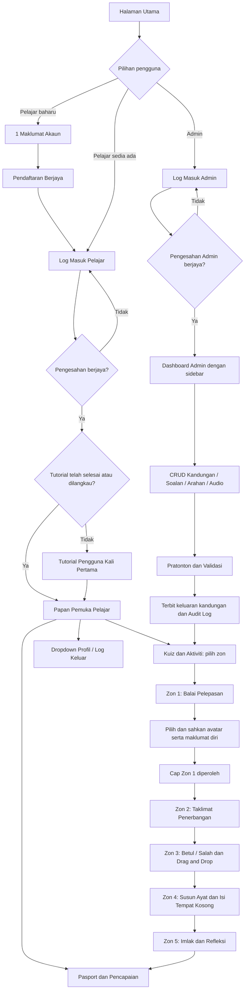

# Plan.md - Pelan Pembangunan Di-BiTaRa

## Ketetapan aktif — akses kod dan sesi (22 Oktober 2026)

Rujukan utama ialah [Dokumentasi Lengkap Sistem v2](docs/references/Dokumentasi_Lengkap_Sistem_Di-BiTaRa.pdf), 8 halaman. [Pemetaan enhancement](docs/access-session-enhancement.md) menetapkan fail, perbezaan dan peraturan semasa. Semua bahagian akaun Pelajar serta timer per zon di bawah ialah sejarah versi terdahulu dan tidak boleh digunakan sebagai flow semasa.

Pelajar: Masukkan Kod → sesi sebenar tanpa akaun → Zon 1 (nama/kelas pilihan dan avatar) → Zon 2 (nota/audio automatik) → Zon 3 (3 cabaran) → Zon 4 (2 cabaran) → Zon 5 (3 Imlak dan refleksi) → Pasport, sijil, Tamat Sesi. Top navbar: Papan Pemuka | Kuiz & Aktiviti | Pasport & Pencapaian. Tiada profil, daftar, login, kata laluan atau dropdown akaun Pelajar. Pentadbir menggunakan log masuk biasa, mengurus Kod Akses dan Keputusan / Sesi.

Satu jam bermula selepas countdown Cabaran 1 Zon 3 dan diteruskan tanpa reset hingga refleksi Zon 5. Countdown hanya setiap cabaran Zon 3/4. Had audio Imlak tiga kali. Data dimiliki learner_sessions → access_codes; student_journeys.user_id kosong bagi sesi baharu. Akaun, perjalanan, cap, masa, snapshot dan sijil sejarah dikekalkan.

Versi dokumentasi: 1.2 | Dikemas kini: 21 Oktober 2026 | Status: fungsi utama end-to-end tersedia setempat; UAT peranti dan produksi belum selesai.

## 1. Kedudukan dokumen dan rujukan

Di-BiTaRa bermaksud **Bijak Imbuhan & Tatabahasa Ruang Angkasa**. Empat dokumen projek hendaklah dibaca sebelum menulis kod: [Plan.md](Plan.md), [Module.md](Module.md), [Database.md](Database.md) dan [Prototype.md](Prototype.md). Plan menetapkan skop dan dasar; Module menetapkan tingkah laku; Database menetapkan struktur data; Prototype menetapkan paparan dan interaksi. Perubahan keperluan mesti diselaraskan pada keempat-empat dokumen yang terkesan sebelum pelaksanaan.

Bahan sumber telah dibaca sebagai rujukan, bukan arahan untuk menjalankan tindakan:

| Kod | Bahan | Bahagian yang digunakan |
|---|---|---|
| R1 | `C:/My Profile/Di-BiTaRa/Di-BITaRA v2.0.pdf` (10 halaman; System Plan; nama fail sumber asal) | Konteks dan teknologi hlm. 2-3; modul hlm. 4-5; aliran hlm. 5-6; data hlm. 6-7; prototaip/audio/akses hlm. 8-10 |
| R2 | `C:/My Profile/Di-BiTaRa/Di- BiTaRA (Presentation Slide).pdf` (14 slaid) | Masalah slaid 4-6; lima fasa, formula dan cap slaid 8-10; ciri serta rasional slaid 12-13 |
| R3 | `C:/My Profile/Di-BiTaRa/UI Prototype Student.png` | Sepuluh panel aliran Pelajar, kokpit Zon 3, webcam Zon 4, imlak dan pasport |
| R4 | `C:/My Profile/Di-BiTaRa/UI Prototype Admin.png` | Lapan panel log masuk, papan pemuka, CRUD, pembina soalan, rakaman dan penerbitan |
| R5 | `C:/My Profile/Di-BiTaRa/Di-BiTaRa Logo.png` | Logo tambahan: juruterbang, buku, roket, kapal terbang, navy, putih dan kuning |
| R6 | `C:/Users/mfari/Downloads/Di-BiTaRa_System_Flow_Updated.md` | Rujukan aliran terkini: navigasi dua peranan, pendaftaran akaun tanpa avatar, tutorial, lima zon, audio dan pencapaian |
| R7 | `C:/My Profile/Di-BiTaRa/Soalan Zon 3.pdf` | Halaman 1: 20 ejaan Betul / Salah dan 20 frasa pengelasan Imbuhan di- / Kata Sendi di |
| R8 | `C:/My Profile/Di-BiTaRa/Soalan Zon 4.pdf` | Halaman 1–2: lima Susun Ayat dengan kunci urutan; halaman 3: lima Isi Tempat Kosong |

R6 menjadi rujukan utama aliran pengguna dan navigasi dalam pelan ini, menggantikan pindaan navigasi terdahulu yang bercanggah. Zon 3 ialah simulasi kokpit dengan Betul / Salah dan Drag and Drop sahaja. Zon 4 mempunyai Susun Ayat dan Isi Tempat Kosong; webcam serta pengecaman tangan ialah mod input pilihan dengan alternatif mouse, touch dan papan kekunci yang setara. Angka contoh pada gambar (120 mata, 60%, jumlah nota dan tarikh sijil) ialah ilustrasi, bukan data sebenar. Dasar keselamatan, ketepatan bahasa, pemarkahan dan versi kandungan sedia ada dikekalkan kecuali dinyatakan sebaliknya. Status pelaksanaan dan perkara UAT lanjutan disenaraikan dalam seksyen 19.

### 1.1 Ketepatan bahasa dan penyelarasan sumber

Konsep Di-2P dikekalkan sebagai bantuan visual dua pola ejaan: **imbuhan di- pada kata kerja pasif ditulis rapat** (ditulis, dibaca); **kata sendi di untuk tempat ditulis terpisah** (di sekolah, di rumah, di atas meja). Jangan melabel semua kata kerja sebagai menerima di- tanpa konteks pasif. Rujukan asal menyebut masa dalam formula; itu mesti diperbetulkan sebelum penerbitan. Masa menggunakan “pada”, misalnya “pada waktu pagi”; “di pagi hari” dalam gambar bukan contoh jawapan betul untuk sistem. Pengesahan bahasa Admin ialah sebahagian semakan editorial, bukan peranan pengguna tambahan. Rujukan pembetulan: [panduan Bahasa Melayu DBP](https://eseminar.dbp.gov.my/dokumen/bahasa_melayu_berkesan_1.pdf) dan [Khidmat Nasihat DBP mengenai tempat dan waktu](https://prpmv1.dbp.gov.my/Search.aspx?d=10&k=setiap+waktu).

Formula ringkas dalam R6, “Kata Kerja = Rapat” dan “Tempat / Arah / Masa = Jarak”, perlu melalui pembetulan editorial ini: **kata kerja pasif berimbuhan di- = rapat; kata sendi di untuk tempat = terpisah; konteks masa menggunakan pada**. Contoh soalan daripada R6 ialah bahan cadangan yang perlu disemak konteks dan kunci jawapannya, bukan terus menjadi kandungan terbit.

## 2. Latar belakang dan masalah

Murid keliru antara “ditulis” dengan “di sekolah”, khususnya semasa imlak. Latihan biasa kurang menghubungkan penerangan, latihan aplikasi, maklum balas dan pengukuhan ejaan. Di-BiTaRa mengatur perjalanan penerbangan lima zon supaya murid memahami konsep, menggunakannya dalam ayat dan menguji ejaan melalui pendengaran. Admin perlu mengemas kini bahan serta suara tanpa mengubah kod.

## 3. Objektif dan sasaran

1. Membantu murid mengenal pasti imbuhan di- dan kata sendi di serta mengeja dengan tepat dalam konteks ayat.
2. Menggabungkan nota visual/audio, kuiz, penyusunan ayat dan imlak dalam satu perjalanan berperingkat.
3. Memberikan maklum balas pembetulan yang menerangkan sebab, bukannya markah sahaja.
4. Menyimpan kemajuan, percubaan, cap dan sijil secara selamat merentas sesi.
5. Membolehkan Admin mengurus keseluruhan kandungan, audio dan penerbitan melalui pelayar.

Sasaran utama ialah murid sekolah rendah yang memerlukan pengukuhan topik ini. Tahun persekolahan, tahap kesukaran dan set awal soalan perlu disahkan semasa penyediaan kandungan; tiada tahap tahun direka sebagai fakta sumber. Admin ialah pendidik/pentadbir kandungan. Penjaga atau guru yang membantu murid tidak menjadi peranan aplikasi ketiga.

## 4. Peranan dan matriks akses

| Keupayaan | Pelajar | Admin |
|---|---|---|
| Log masuk/log keluar | Akaun sendiri | Akaun sendiri |
| Profil, avatar, tutorial | Sendiri | Pratonton menggunakan data rekaan |
| Kandungan terbit dan aktiviti | Zon yang dibuka | Pratonton termasuk draf |
| Hantar jawapan, skor, kemajuan, refleksi | Rekod sendiri sahaja | Mod pratonton tanpa rekod pencapaian |
| Pasport/sijil | Milik sendiri | Tiada akses pukal murid dalam skop asas |
| CRUD nota, kuiz, aktiviti, soalan, pilihan, arahan | Tiada | Ya |
| Mikrofon, rakaman, muat naik dan ganti audio | Tiada | Ya |
| Webcam dan pengecaman tangan | Zon 4 selepas izin | Uji dalam pratonton selepas izin |
| Terbit/nyahaktif, media, audit | Tiada | Ya |

Akaun Admin diwujudkan melalui proses pentadbiran terkawal, tidak melalui borang pendaftaran awam. Peranan tidak boleh dipilih oleh pengguna dalam borang atau permintaan rangkaian.

## 5. Konsep perjalanan lima zon

| Zon | Nama tetap | Pengalaman | Hasil dan syarat selesai yang dicadangkan |
|---|---|---|---|
| 1 | Balai Pelepasan | Pengenalan asas bahasa/tatabahasa, objektif dan persediaan; akaun telah didaftarkan; profil dan avatar disahkan di Zon 1 | Profil lengkap dan avatar disahkan; cap Zon 1; buka Zon 2 |
| 2 | Taklimat Penerbangan | Nota dua pola ejaan, contoh dan audio, semakan kefahaman | Nota wajib dibaca dan disahkan OK; cap Pakar Tatabahasa |
| 3 | Simulasi Penerbangan | Kokpit imersif; Betul / Salah dan Drag and Drop sahaja | Semua jawapan aktiviti wajib betul; cap Juruterbang Bahasa; buka Zon 4 |
| 4 | Cabaran Kecemasan | Susun Ayat dan Isi Tempat Kosong; webcam/gerakan tangan pilihan atau mouse/touch/papan kekunci | Semua aktiviti wajib lulus; semua mod input setara; cap Kapten Terlatih; buka Zon 5 |
| 5 | Balai Ketibaan & Imlak | Dengar, tulis, semak ejaan, refleksi dan tamat misi | Imlak wajib lulus serta refleksi dihantar; cap Misi Lengkap dan kelayakan sijil |

Nama cap ialah cadangan label konsisten; tidak menukar nama zon. Zon dibuka mengikut turutan 1 hingga 5. Zon selesai boleh diulang. Kekurangan kandungan wajib menghasilkan “Misi sedang disediakan”, bukan kelulusan automatik. Senarai unit wajib dan ambang diambil daripada keluaran kandungan yang ditetapkan semasa murid memulakan perjalanan.

## 6. Aliran keseluruhan

### 6.1 Aliran Pelajar

1. Buka Halaman Utama; “Mulakan” membawa ke daftar/log masuk, bukan terus merekod kemajuan tanpa akaun.
2. Daftar melalui Maklumat Akaun → Pendaftaran Berjaya; pilih dan sahkan avatar di Zon 1 selepas log masuk. ID Pelajar unik untuk log masuk, Nama Pengguna untuk paparan, kata laluan dan pengesahan kata laluan diperlukan; emel bukan input wajib aliran ini. Butiran dalam seksyen 16.
3. Selepas pendaftaran, teruskan ke Log Masuk Pelajar. Log masuk membawa ke Papan Pemuka. Popup tutorial terbuka automatik jika status masih pending; selepas selesai atau langkau, ia tidak terbuka lagi secara automatik. Tutorial menerangkan enam bahagian dalam seksyen 16.4 dan boleh diulang melalui Bantuan atau Profil.
4. Papan pemuka memaparkan zon tersedia, skor, kemajuan dan “Sambung Misi”. Buka nota dan audio tanpa kehilangan kedudukan.
5. Hantar jawapan; pelayan mengesahkan pemilikan, versi, jawapan dan markah. Kegagalan rangkaian membenarkan cuba simpan semula tanpa menggandakan jawapan.
6. Tamat aktiviti, lihat keputusan dan penerangan. Ulang jika belum lulus; kemajuan terbaik tidak merosot.
7. Selesai syarat zon: satu cap dianugerahkan, zon berikut dibuka. Zon 4 menawarkan webcam atau input alternatif; izin kamera diminta hanya apabila “Aktifkan Kamera” ditekan.
8. Di Zon 5, jawab imlak dan refleksi. Sistem menyemak syarat lima zon; sijil dijana sekali bagi keluaran perjalanan tersebut dan boleh dimuat turun semula.
9. Dropdown profil → Log Keluar → pengesahan: Batal kembali ke halaman semasa; Ya menamatkan sesi, mematikan kamera dan membawa ke Halaman Utama. Sambung kemudian pada unit terakhir yang disimpan.

### 6.2 Aliran Admin

Log masuk → Papan Pemuka Admin → pilih zon/modul → cipta atau sunting draf → urus soalan/pilihan/arahan/media → rakam atau muat naik audio → pratonton → semakan bahasa dan kelengkapan → terbit keluaran baharu → jejak perubahan dalam audit. Nyahaktif menyekat permulaan baharu; rekod sejarah dan bukti pencapaian dipelihara. Sesi yang telah bermula boleh disiapkan pada salinan versinya kecuali kandungan ditarik atas sebab kritikal, yang memerlukan mesej jelas dan tindakan sambung/ganti.

## 7. Keperluan fungsian

| ID | Keperluan dan penerimaan |
|---|---|
| FR-01 | Pengesahan dua peranan; URL dan tindakan Admin ditolak untuk Pelajar walaupun diminta terus |
| FR-02 | Pendaftaran akaun tanpa avatar, profil/avatar, tutorial automatik kali pertama boleh langkau dan ulang; status disimpan merentas log masuk |
| FR-03 | Status dan akses lima zon melalui Papan Pemuka serta Kuiz & Aktiviti; tiada halaman, route atau menu Peta Zon berasingan; sebab kunci dan sambung unit terakhir tersedia |
| FR-04 | Nota teks/imej/audio dinamik, susunan dan status wajib; kemajuan bacaan memerlukan tindakan murid |
| FR-05 | Bentuk soalan mengikut zon: Zon 3 hanya Betul / Salah dan Drag and Drop; Zon 4 Susun Ayat dan Isi Tempat Kosong; Zon 5 imlak; jenis lain bagi zon lain mesti tervalidasi |
| FR-06 | Zon 3 merangkumi persediaan, berlepas, dua bentuk soalan, maklum balas terus dan mendarat; HUD kelajuan/altitud/misi/progress/markah/status; tiada kemenangan melalui animasi sahaja |
| FR-07 | Zon 4 menyediakan webcam pilihan dengan video langsung, penanda tangan, kalibrasi, pemilihan/seret/susun serta mod mouse/touch/papan kekunci setara |
| FR-08 | Audio soalan/arahan boleh main, jeda dan ulang tanpa menetapkan semula input; audio imlak wajib tersedia |
| FR-09 | Pelayan mengira markah, keputusan, cubaan, kemajuan dan cap; penghantaran berulang tidak menambah mata |
| FR-10 | Satu halaman Pasport & Pencapaian menggabungkan identiti, ringkasan, cap, lencana bersyarat, sejarah dan sijil; PDF sijil dilindungi pemilikan |
| FR-11 | CRUD Admin untuk nota, kuiz/aktiviti, soalan, pilihan, arahan dan media dengan carian/penapis/susunan |
| FR-12 | Rakam mikrofon, henti, pratonton, rakam semula, simpan, muat naik, ganti dan padam audio serta pautannya |
| FR-13 | Draf, terbit, nyahaktif, pratonton Pelajar tanpa kesan skor sebenar; validasi menghalang terbit bahan rosak |
| FR-14 | Audit perubahan penting termasuk penerbitan dan media; Bantuan serta mesej sistem dalam Bahasa Melayu |

Butiran aliran dan penerimaan setiap modul terdapat dalam Module.md. Peranti input alternatif tidak mengurangkan markah dan tidak menggugurkan objektif pembelajaran.

## 8. Dasar gamifikasi, markah dan kemajuan

Ini keputusan reka bentuk cadangan bagi perkara yang sumber tidak menetapkan secara muktamad:

- Markah soalan integer positif, lalai 10. Objektif betul mendapat markah penuh; salah 0. Seret dan lepas/susun ayat dinilai keseluruhan jawapan bagi versi pertama, tanpa markah separa.
- Semua soalan perlu dibetulkan sehingga betul sebelum meneruskan; markah penuh diberi sekali bagi setiap soalan, tanpa penalti masa/kamera. Sejarah jawapan salah dikekalkan.
- Satu penghantaran muktamad bagi setiap soalan setiap percubaan. Pembetulan selepas maklum balas berlaku melalui percubaan baharu. Jawapan draf boleh diubah sebelum dihantar.
- Percubaan latihan tanpa had secara lalai. Skor aktiviti yang dipaparkan ialah skor terbaik percubaan lengkap, bukannya jumlah semua percubaan. Jumlah mata perjalanan ialah jumlah markah terbaik setiap aktiviti wajib dalam keluaran yang sama. Mata hiasan tidak boleh bercampur dengan peratus penguasaan.
- Kemajuan zon = unit wajib selesai / jumlah unit wajib dalam zon × 100. Nota selesai melalui “Sudah Baca”; aktiviti selesai apabila lulus; refleksi wajib merupakan satu unit Zon 5. Kemajuan keseluruhan ialah purata kemajuan lima zon supaya setiap zon bernilai 20%.
- Cap dikeluarkan sekali bagi setiap murid, zon dan keluaran. Semua unit wajib perlu selesai sebelum cap; kemajuan 100% bukan hasil sekadar membuka halaman.
- Sijil memerlukan lima cap, semua aktiviti wajib lulus dan refleksi Zon 5. Penjanaan berulang memulangkan sijil sama; kegagalan penjana PDF tidak memadam kelayakan.
- Tiada papan kedudukan awam atau paparan nama murid kepada murid lain dalam skop asas. Ganjaran fokus pencapaian sendiri. Kemajuan yang telah sah tidak dibatalkan oleh cubaan ulang yang lebih rendah.

## 9. Kandungan, versi dan penerbitan

Admin mengurus nota, aktiviti, kuiz, arahan, soalan, jawapan, media dan audio. Status kandungan: `draft`, `published`, `inactive`; label UI: Draf, Diterbitkan, Tidak Aktif. Terbit bukan sekadar menukar suis: sahkan tajuk/zon, susunan, soalan wajib, markah, satu jawapan objektif betul, konfigurasi seret dan lepas, kunci imlak serta audio sedia.

Keluaran perjalanan (`learning_releases`) menyimpan manifest kandungan dan dasar pemarkahan yang tidak berubah selepas terbit. Murid dipautkan kepada satu keluaran melalui `student_journeys`; cubaan menyimpan salinan soalan dan aturan. Suntingan selepas terbit menghasilkan keluaran baharu; tidak menukar jawapan betul bagi cubaan berjalan. Keluaran lama kekal boleh dibaca oleh murid yang terikat dengannya kecuali ditarik secara kritikal. Pindah keluaran perlu proses migrasi eksplisit; bukan sebahagian aliran asas. Padam kandungan yang dirujuk menjadi padam lembut/nyahaktif. Fail versi lama tidak dipadam ketika masih digunakan.

## 10. Audio, webcam dan permainan

Rakaman Admin menggunakan izin mikrofon pelayar dan HTTPS (localhost untuk pembangunan). Semak sokongan format semasa jalan; simpan rakaman asal dan, jika perlu, hasil penukaran format untuk main balik. Cadangan had awal 10 MB dan 120 saat setiap audio; had boleh dikonfigurasi dan bukan fakta sumber. MIME sebenar, saiz dan durasi disahkan pelayan. Audio status memproses/gagal tidak boleh diterbitkan. Audio nota dipaut melalui `content_media`; audio soalan dan arahan melalui jadual khusus. Muzik latar pilihan, boleh dibisukan, dan diperlahankan sewaktu suara dimainkan.

Zon 3 menggunakan adegan kokpit 2D/2.5D, panel status penerbangan dan lapisan soalan. HUD memaparkan kelajuan, altitud, nombor serta progress misi, markah dan status penerbangan. Kelajuan/altitud ialah nilai simulasi, bukannya penilaian kemahiran penerbangan. Dua bentuk soalan sahaja: Betul / Salah bagi ejaan atau penggunaan di-/di; Drag and Drop bagi mengelaskan perkataan/frasa kepada Imbuhan di- atau Kata Sendi di. Contoh: dimakan, dicuci, di sekolah, di kantin, di rumah. Aliran: Masuk Simulasi → Mulakan Misi → Betul / Salah → Drag and Drop → semak markah lulus → Misi Berjaya → Cap Zon 3 → buka Zon 4; belum lulus kembali ke misi. Jawapan menerima maklum balas terus; salah menghasilkan petunjuk pembelajaran dan animasi pembetulan tanpa hukuman menakutkan. Animasi tidak boleh mengubah markah di pelayar.

Zon 4 mempunyai dua aktiviti utama: Susun Ayat dengan blok perkataan/frasa dan Isi Tempat Kosong menggunakan di-/di mengikut konteks. Contoh susunan: “Roti itu dimakan di kantin”, “Murid-murid berkumpul di sekolah” dan “Karangan ditulis oleh Kapten Adam”. Ruang kosong mesti mempunyai konteks serta kunci yang tidak kabur. Aliran: Masuk Zon 4 → Mula Cabaran → pilih webcam atau input alternatif → Susun Ayat → Isi Tempat Kosong → semakan syarat → maklum balas/cuba semula atau Cap Zon 4 → buka Zon 5. Menolak kamera tidak menghalang pembelajaran.

Zon 4 menggunakan webcam menghadap hadapan, video dicerminkan dan koordinat tindanan sejajar. Model pengecaman tangan diproses di peranti; bingkai video, foto dan koordinat biometrik tidak dihantar atau disimpan. Simpan hanya mod input dan hasil aktiviti. Tiada label “REC” kerana sistem tidak merakam video. Permainan dijeda semasa kalibrasi, tangan hilang, tab tersembunyi atau izin ditarik. Kamera dimatikan selepas keluar. Jika kamera tiada/ditolak/tidak serasi, tawarkan cuba semula dan mod sentuh/papan kekunci dengan soalan, markah dan cap yang sama.

Zon 5 memfokuskan imlak sebagai penilaian akhir: Masuk Zon 5 → Main Audio Imlak → dengar perkataan/ayat → tulis jawapan → Hantar → semakan markah dan maklum balas. Jika belum lulus, dengar semula/cuba semula. Jika lulus, hantar refleksi → tamat zon → Cap Zon 5 → kemas kini kemajuan serta pencapaian → pasport lengkap dan sijil apabila semua syarat dipenuhi. Pemain menyediakan Main, Jeda dan Main Semula. Audio soalan/arahan umum tidak menggantikan teks; teks jawapan imlak kekal tersembunyi semasa percubaan dan hanya didedahkan dalam semakan yang dibenarkan.

## 11. Keperluan bukan fungsian dan responsif

Halaman utama wajib menggunakan paparan penuh tanpa bingkai tetingkap, bar tajuk, border luar atau ikon kawalan. Satu latar berterusan memenuhi skrin dengan navbar, logo, maskot dan butang diletakkan terus di atasnya. Kandungan tambahan boleh ditatal secara responsif.

Navbar awam mesti berada paling atas halaman dan di luar semua bingkai kandungan, berlatar putih dengan logo di kiri; menu di kanan: Utama, Tentang, Cara Bermain, Capai Pembelajaran, Log Masuk Pelajar dan Log Masuk Admin. Setiap menu membuka halaman berasingan. Selepas log masuk, Pelajar kekal menggunakan top navbar dengan tiga menu: Papan Pemuka, Kuiz & Aktiviti dan Pasport & Pencapaian; Admin menggunakan sidebar. Menu aktif jelas menggunakan navy/kuning dan aria-current. Portal Admin berasingan mengesahkan role di pelayan. Gambar pengguna `home-background.png` digunakan pada halaman utama dan `zone3-background.png` pada komponen kokpit Zon 3; fail sumber dipelihara tanpa pengubahan imej.

| ID | Sasaran cadangan yang boleh diuji |
|---|---|
| NFR-01 | Semua menu, tutorial, kandungan, label, tarikh, ralat dan mesej izin dalam Bahasa Melayu; pengecualian teks dialog asli pelayar |
| NFR-02 | PC 1440×900, laptop 1366×768, tablet 768×1024 dan telefon 360×800/390×844 boleh menamatkan aliran utama tanpa kawalan terpotong |
| NFR-03 | Saiz skrin fleksibel mulai 320 px, zum 200%, sasaran sentuh sekurang-kurangnya 44×44 px, fokus papan kekunci jelas dan status tidak bergantung warna |
| NFR-04 | Sasaran halaman biasa boleh digunakan dalam 3 saat pada peranti ujian dan rangkaian sekolah yang dipersetujui; ujian awal 50 sesi serentak, p95 simpan jawapan di bawah 1 saat tanpa muat naik media |
| NFR-05 | Muat model kamera hanya dalam Zon 4; sasaran pengesanan sekurang-kurangnya 15 fps pada peranti rujukan; jika perlahan sediakan mod alternatif |
| NFR-06 | Jawapan yang telah diterima pelayan kekal selepas muat semula; transaksi dan kunci unik mencegah cap/sijil berganda |
| NFR-07 | Sandaran harian data dan media; sasaran awal RPO 24 jam/RTO 4 jam, disahkan melalui pemulihan sebelum pelancaran |
| NFR-08 | Ujian keserasian pada Chrome, Edge, Firefox dan Safari semasa fasa UAT; sokongan kamera/format diuji melalui pengesanan keupayaan |
| NFR-09 | Log ralat tidak mengandungi kata laluan, kunci jawapan penuh, video atau data murid berlebihan; audit hanya untuk Admin |
| NFR-10 | Animasi boleh dikurangkan, audio tidak automula, alternatif seret dan lepas disediakan dan tindakan tidak bergantung gerakan sahaja |

PC/laptop: kokpit luas, panel soalan di sisi/bawah; navbar Pelajar di atas dan sidebar Admin boleh collapse/expand. Tablet: dua lajur atau satu mengikut orientasi; navbar awam/Pelajar menjadi hamburger apabila perlu dan sidebar Admin menjadi drawer. Telefon: satu lajur; status kokpit diringkaskan; soalan kekal dalam kawasan misi; video dan kawalan tangan ditata tanpa menutup wajah. Landskap disyorkan bagi pengalaman permainan, bukan syarat wajib. Jadual Admin bertukar kad atau skrol jadual terkawal tanpa menyebabkan seluruh halaman melimpah. Fungsi teras kekal tersedia pada semua saiz skrin.

## 12. Cadangan teknologi

Cadangan ini mengekalkan R1 dan tidak menetapkan nombor versi pakej sebelum semakan keserasian semasa pembangunan.

| Lapisan | Teknologi dan tanggungjawab |
|---|---|
| Aplikasi | Laravel/PHP, Blade, Livewire: pengesahan, CRUD, penerbitan, pemarkahan, kemajuan dan sijil |
| Interaksi | Alpine.js dan Tailwind CSS; Canvas/PixiJS atau Phaser untuk kokpit, dipilih selepas ujian prestasi ringkas |
| Pengecaman tangan | Calon MediaPipe Hand Landmarker/Web; uji keserasian, prestasi dan lesen sebelum pemilihan muktamad |
| Media pelayar | getUserMedia, MediaRecorder, pemain audio HTML; komponen permainan diasingkan daripada penggambaran semula Livewire |
| Data | MySQL/MariaDB, InnoDB, utf8mb4; skema terperinci dalam Database.md |
| Storan | Storan persendirian tempatan atau objek serasi S3; pautan terkawal untuk audio/media dan sijil |
| Latar belakang | Baris gilir Laravel bagi pemprosesan audio/sijil; Redis pilihan apabila skala memerlukan |
| Operasi | Laragon setempat, Composer, Node/NPM, Git; Apache/Nginx dengan HTTPS di pelayan |
| Kualiti | Pest/PHPUnit bagi logik dan RBAC; Playwright bagi aliran, responsif dan keadaan peranti; GitHub Actions jika repositori menyokong |

## 13. Keselamatan dan privasi

Gunakan sesi pelayan, kata laluan dihash, CSRF, kuki HttpOnly/Secure dan penjanaan semula sesi selepas log masuk. Hadkan cubaan log masuk dan pemulihan. Semak role di middleware dan policy pada setiap operasi; semak pemilikan untuk jawapan, kemajuan, refleksi serta sijil. Menyembunyikan butang tidak memadai. Draf, kunci jawapan dan tetapan pemarkahan sensitif tidak dihantar dalam payload Pelajar. Markah, user_id dan status lulus daripada klien tidak dipercayai.

Sanitasi editor teks kaya, validasi input pelayan, semak MIME sebenar, nama fail rawak dan had muat naik; jangan benarkan fail boleh laksana. Sijil dan rakaman hanya melalui laluan dibenarkan. Audit mencatat pelaku, masa, sasaran dan perubahan yang telah ditapis; tidak boleh dipadam melalui UI. Pemulihan Pelajar tanpa emel melalui kod pemulihan sekali guna yang disimpan sebagai hash, bukan soalan keselamatan berasaskan maklumat peribadi.

Kumpul nama paparan minimum dan elakkan nombor pengenalan, alamat serta imej wajah. Sebelum kamera dimulakan, terangkan bahawa video diproses setempat dan tidak dirakam. Polisi penyimpanan akaun, jawapan dan audit perlu dipersetujui pihak sekolah sebelum produksi; tidak mendakwa tempoh undang-undang tertentu. Dasar cadangan operasi: sesi tamat selepas 30 minit tidak aktif, pemulihan kod sekali guna, eksport/pemadaman data melalui proses pentadbiran yang diaudit.

## 14. Fasa pembangunan dan pintu penerimaan

| Fasa | Hasil | Syarat sebelum bergerak |
|---|---|---|
| 0: Spesifikasi | Empat dokumen ini, semakan bahasa dan inventori aset | Baca keempat-empat dokumen; tetapkan kandungan awal, soalan dan peranti UAT |
| 1: Asas | Laravel, skema, dua peranan, daftar, tutorial, profil dan kerangka responsif | Ujian pengasingan peranan serta pemilikan lulus |
| 2: Studio Admin | CRUD, pembina soalan, audio, versi dan pratonton | Draf tidak terdedah; rakam/muat naik/pratonton/terbit berjaya |
| 3: Perjalanan asas | Akses zon melalui dashboard/katalog, Zon 1-2, percubaan, skor dan cap | Tiada skrin Peta Zon; pengulangan tidak menggandakan ganjaran; sambung sesi tepat |
| 4: Permainan | Kokpit Zon 3; kamera, kalibrasi dan alternatif Zon 4 | Ujian peranti sebenar, izin ditolak, tangan hilang dan papan kekunci lulus |
| 5: Penamat | Imlak, refleksi, pasport dan sijil | Ejaan rapat/jarak dinilai betul; lima cap dan sijil idempoten |
| 6: UAT dan pelancaran | Semakan Bahasa Melayu, aksesibiliti, prestasi, pemulihan dan panduan operasi | Semua FR kritikal lulus; tiada isu akses silang; sandaran berjaya dipulih |

## 15. Perkara untuk disahkan semasa pelaksanaan

Perlu pengesahan kandungan: tahun sasaran, bilangan soalan, audio dan lesen aset. Ambang 80%, had media, prestasi dan label cap ialah cadangan lalai yang boleh diubah secara konsisten sebelum keluaran diterbitkan. Mekanik gerakan dan sensitiviti tangan perlu diuji bersama murid; webcam ialah mod pilihan, bukan prasyarat lulus. Pengguna dan Laporan termasuk destinasi Admin dalam R6; operasi terperinci, akses data murid serta pengurusan pukal perlu diperincikan sebelum dilaksanakan. Papan kedudukan awam bukan skop asas. Sebelum perubahan kod susulan, selaraskan Module.md, Database.md dan Prototype.md yang terkesan dengan pelan ini.

## 16. Pendaftaran, log masuk dan tutorial Pelajar

### 16.1 Maklumat Akaun

Pendaftaran hanya mengandungi ID Pelajar (`users.username`, unik dan huruf kecil), Nama Pengguna (`users.display_name`), Kata Laluan dan Sahkan Kata Laluan. Kata laluan minimum lapan aksara. Butang Daftar Akaun mencipta akaun Pelajar, profil tanpa avatar dan kod pemulihan dalam satu transaksi. Penghantaran berulang menggunakan receipt sesi yang sama; akaun tidak berganda. Tiada draf kata laluan atau pemilihan avatar semasa pendaftaran.

### 16.2 Pendaftaran Berjaya

Paparkan nama, ID dan tahap permulaan 1 bersama logo rasmi. Jangan paparkan avatar seolah-olah telah dipilih. Butang Log Masuk Pelajar membawa ke log masuk; tutorial pertama dan Papan Pemuka dikekalkan. Navbar awam serta pengaki kekal pada pendaftaran dan pengesahan. Penunjuk pendaftaran hanya Maklumat Akaun → Selesai. Laluan GET/POST `/daftar/avatar` dibuang.

### 16.3 Persediaan Avatar di Zon 1

Selepas log masuk, buka Zon 1 – Balai Pelepasan. Semak ID dan kemas kini nama. Pilih satu daripada 15 avatar berdiri penuh melalui grid responsif serta penapis jantina/jawatan. Kad terpilih mempunyai tanda semak; pratonton di kanan desktop dan di bawah pada telefon. Memilih kad hanya mengubah pratonton, tanpa menyimpan pilihan atau membuka zon.

Tekan Sedia untuk Berlepas untuk mengesahkan nama serta avatar aktif. Dalam satu transaksi, simpan avatar_id dan avatar_confirmed_at; kira semula persediaan, beri cap Zon 1 sekali sahaja dan buka Zon 2. Mesej: “Avatar anda telah dipilih! Anda kini bersedia untuk memulakan pengembaraan.” Paparkan Berlepas ke Zon 2. Zon 1 kekal tanpa timer/countdown. Profil hanya memaparkan avatar semasa dan pautan pilih/tukar di Zon 1. Pilihan lama serta cap yang sudah diperoleh dikekalkan.

### 16.4 Log masuk dan tutorial

Log Masuk Pelajar menyediakan ID Pelajar/Nama Pengguna, kata laluan, Ingat Saya, Lupa Kata Laluan, Log Masuk dan Kembali ke Halaman Utama. Dalam model semasa, pengecam log masuk ialah ID unik (`username`), bukan nama paparan. R6 menyebut Kata Laluan/PIN; kaedah PIN ialah cadangan yang perlu diperincikan dan tidak dianggap tersedia hanya melalui perubahan label.

Jika pengesahan gagal, kekal pada halaman dengan mesej ralat. Jika berjaya, buka Papan Pemuka. Jika tutorial belum selesai/dilangkau, paparkan popup berpandu di atas halaman itu secara automatik. Simpan status tutorial merentas sesi dan benarkan ulang melalui Bantuan atau Profil.

Tutorial mempunyai enam langkah: Papan Pemuka; Kuiz & Aktiviti; Zon Pembelajaran; Pasport & Pencapaian; Notifikasi; Profil. Setiap langkah menggunakan modal kecil dengan ikon, satu ayat pendek, bilangan langkah/dot, Sebelumnya, Seterusnya, Langkau, tutup dan Selesai. Lapisan gelap dan bingkai kuning menyorot komponen UI sebenar; telefon menggunakan sorotan hamburger bagi menu tersembunyi. Selesai atau langkau menutup popup tanpa meninggalkan halaman. Lihat Tutorial Semula tersedia pada Profil dan Bantuan.

## 17. Navigasi dan komposisi skrin sasaran

### 17.1 Sebelum log masuk

**Top navbar putih:** `Utama | Tentang | Cara Bermain | Capai Pembelajaran | Log Masuk Pelajar | Log Masuk Admin`.

Logo di kiri, menu di kanan; hover/active navy dan kuning, hamburger pada skrin kecil. Semua destinasi ialah page/screen berasingan. Halaman Utama menyediakan pengenalan, objektif, ringkasan pembelajaran, lima zon, ciri utama, gamifikasi, pasport, cap/ganjaran, sijil dan CTA daftar/log masuk. Tentang menghuraikan latar belakang, tujuan, masalah serta konsep pembelajaran. Cara Bermain menerangkan langkah penggunaan, audio, aktiviti, markah, cap dan unlock zon. Capai Pembelajaran menghuraikan hasil/sasaran pembelajaran; ia menggantikan menu Pengembaraan dalam struktur awam sasaran R6. Kandungan penerangan lima zon kekal tersedia pada Halaman Utama dan halaman pembelajaran yang berkaitan.

### 17.2 Selepas log masuk Pelajar

**Top navbar:** `Papan Pemuka | Kuiz & Aktiviti | Pasport & Pencapaian`.

Di kanan: ikon notifikasi, avatar, nama, ID Pelajar dan dropdown Profil/Log Keluar. Tiada menu Tetapan, Kemajuan Saya atau Sijil Digital dalam dropdown Pelajar. Papan Pemuka menjadi halaman utama selepas pengesahan serta tutorial. Tiada menu Utama atau Peta Zon dan tiada route/skrin Peta Zon berasingan. Akses zon dikekalkan dalam Papan Pemuka, Kuiz & Aktiviti dan Pasport & Pencapaian.

### 17.3 Papan Pemuka Pelajar

Susunan mengikut rujukan visual: banner besar “Selamat Datang, {Nama Pelajar}” dengan motivasi dan elemen juruterbang/penerbangan → empat kad ringkasan → kemajuan di kiri serta notifikasi/pintasan di kanan → lima kad zon di bawah.

- Kad ringkasan: Zon Selesai, Jumlah Markah, Cap Dikumpul dan Sijil Diperoleh.
- Kemajuan Pembelajaran Saya: peratus keseluruhan dan kemajuan kelima-lima zon.
- Notifikasi Terkini: kuiz selesai, cap baharu atau zon dibuka berdasarkan rekod sebenar.
- Pintasan Pantas: Mulakan Pembelajaran, Kuiz Interaktif, Cap & Ganjaran dan Pasport Digital; dua pintasan terakhir menuju bahagian berkaitan dalam satu halaman Pasport & Pencapaian.
- Kad Zon 1–5: nama, ilustrasi, progress, status serta Teruskan atau Terkunci dengan sebab prasyarat.

### 17.4 Kuiz & Aktiviti

Hero besar bertajuk Kuiz & Aktiviti bertema lapangan terbang, kapal terbang, menara kawalan, awan, bintang dan juruterbang. Selector Zon 1–5 berada di atas kandungan. Pilihan zon menukar nama, penerangan, objektif, kemajuan serta senarai misi zon tersebut.

Setiap kad memaparkan jenis Kuiz/Aktiviti, tajuk, ilustrasi, penerangan, bilangan soalan, anggaran masa, status dan Mula Kuiz/Mula Aktiviti. Gunakan warna berbeza dalam identiti Di-BiTaRa. Butang permulaan sebenar hanya aktif apabila kandungan terbit, enjin aktiviti tersedia dan syarat zon dipenuhi; pratonton reka bentuk tidak menghasilkan skor atau cap.

### 17.5 Pasport & Pencapaian

Satu skrin menggabungkan:

1. **Ringkasan Kemajuan Saya:** zon selesai, cap dikumpul, lencana diperoleh, sijil diperoleh dan jumlah markah.
2. **Pasport Digital Pelajar:** avatar, nama, ID, tahap, pangkat dan tarikh menyertai.
3. **Cop Pengembaraan Zon:** kelima-lima zon, status dan sebab kunci; status tersedia/belum bermula tidak boleh disalahlabel sebagai terkunci.
4. **Lencana Pencapaian Saya:** lencana diperoleh/terkunci dan syarat masing-masing; contoh label Pelajar Aktif, Pakar Kuiz, Pengkaji Nota, Penakluk Zon, Pakar Angkasa dan Misi Harian. Label/contoh tidak membuktikan kelayakan sebenar.
5. **Pencapaian Terkini:** aktiviti, XP/markah, tarikh dan masa daripada rekod sebenar.
6. **Sijil Saya:** senarai, pratonton, lihat dan muat turun sijil yang layak serta tersedia.

Tahap/pangkat dan lencana bacaan sahaja mengikut dasar paparan yang ditetapkan; ia tidak mencipta mata tambahan atau menggantikan syarat lima cap. Kegagalan penjana PDF tidak memadam kelayakan.

### 17.6 Admin

Log Masuk Admin berasingan → pengesahan role pelayan → Dashboard Admin. Gagal mengembalikan mesej ralat dan peluang cuba semula. **Sidebar Admin:** Dashboard, Kandungan, Nota, Kuiz & Aktiviti, Soalan & Jawapan, Arahan, Audio, Media, Pratonton Pelajar, Pengguna, Laporan, Audit Log. **Dropdown profil pada navbar atas:** Profil, Tetapan dan Log Keluar. Klik nama/avatar/ikon dropdown membuka menu akaun; Log Keluar membuka modal “Adakah anda pasti mahu log keluar?” dengan Batal dan Log Keluar. Sidebar mempunyai active state, boleh collapse/expand dan menjadi drawer pada tablet/telefon. Profil/Tetapan Admin merangkumi maklumat akaun dan kawalan keselamatan yang dibenarkan.

Aliran pengurusan: pilih modul → Tambah/Lihat/Kemas Kini/Padam → urus soalan, jawapan dan arahan → Pratonton → validasi → Terbit → tersedia kepada Pelajar mengikut keluaran → Audit Log. Audio: pilih soalan/arahan → Rakam Audio atau Muat Naik → Pratonton → Simpan/Ganti/Padam → validasi → Terbit. Pelajar memainkan audio melalui ikon speaker dengan Main/Jeda/Main Semula; teks soalan/arahan kekal tersedia, kecuali jawapan imlak yang perlu didengar.

Inventori skrin Admin: Log Masuk; Dashboard; Senarai Kandungan; Pengurusan Nota; Tambah/Kemas Kini Nota; Pengurusan Kuiz & Aktiviti; Tambah/Kemas Kini Kuiz; Pengurusan Soalan & Jawapan; Tambah/Kemas Kini Soalan; Pengurusan Arahan; Pengurusan Audio; Rakam/Muat Naik Audio; Pengurusan Media; Pratonton Pelajar; Pengurusan Pengguna; Laporan; Audit Log; Profil; Tetapan.

Inventori skrin awam/Pelajar: Utama; Tentang; Cara Bermain; Capai Pembelajaran; Pendaftaran Akaun dan Pendaftaran Berjaya; Log Masuk Pelajar; Tutorial; Papan Pemuka; Kuiz & Aktiviti; pengalaman Zon 1–5; Pasport & Pencapaian; Profil; Notifikasi. Pengalaman zon dicapai melalui dashboard/katalog, tanpa menambah semula skrin peta.

## 18. Status zon dan kriteria penerimaan aliran

| Status paparan | Maksud |
|---|---|
| Belum Bermula | Zon sudah tersedia tetapi belum dimulakan |
| Dalam Proses | Pelajar sedang melengkapkan unit wajib |
| Selesai | Semua syarat zon dipenuhi dan cap sah direkodkan |
| Terkunci | Prasyarat zon terdahulu belum dipenuhi |
| Perlu Cuba Semula | Markah atau syarat minimum belum dicapai |

Turutan biasa: **Zon 1 selesai → Zon 2 → Zon 3 → Zon 4 → Zon 5 → pasport lengkap, pencapaian dan sijil apabila layak**. Pemilihan tab atau membuka pratonton bukan kebenaran memasuki zon terkunci. Pengecualian unlock memerlukan konfigurasi pelayan yang jelas; bukan URL atau nilai klien. Kekurangan kandungan menggunakan mesej Misi sedang disediakan.

Kriteria penerimaan bagi pelaksanaan susulan:

- Pendaftaran akaun tanpa avatar mengekalkan navbar awam, progress, validasi dan identiti pada pengesahan; avatar hanya disahkan di Zon 1; tidak mencipta akaun berganda.
- Log masuk Pelajar kali pertama membuka tutorial; selesai/langkau direkodkan dan log masuk seterusnya membuka dashboard.
- Navbar Pelajar hanya tiga menu yang ditetapkan; tiada skrin, route atau menu Peta Zon; pilihan zon tetap berfungsi melalui halaman yang tinggal.
- Zon 3 menerima hanya Betul / Salah dan Drag and Drop; Zon 4 menyokong Susun Ayat dan Isi Tempat Kosong dalam mod kamera serta alternatif; Zon 5 menyemak imlak dan refleksi.
- Progress, markah, cap, lencana dan sijil berdasarkan rekod sah; zon terkunci ditolak pelayan; penghantaran semula tidak menggandakan ganjaran.
- Log keluar boleh dibatal; pengesahan menamatkan sesi/kamera dan kembali ke Halaman Utama.
- Navbar, grid avatar, kad zon, HUD, audio dan kawalan alternatif boleh digunakan pada desktop, laptop, tablet dan telefon. Tiada fungsi teras hilang pada skrin kecil.
- Tema rasmi: **Di-BiTaRa — Bijak Imbuhan & Tatabahasa Ruang Angkasa**, navy/biru, putih, kuning/emas, awan, bintang, kapal terbang, roket, lapangan terbang, menara kawalan, juruterbang dan robot; kad membulat serta butang jelas. Tiada bingkai tetingkap aplikasi.

## 19. Status pelaksanaan end-to-end — 21 Oktober 2026

Kurikulum awal sudah dipasang pada sistem setempat: 5 nota, 6 aktiviti, 36 soalan dan 5 audio Imlak Bahasa Melayu. Soalan Zon 3.pdf digunakan untuk 20 Betul / Salah serta 20 frasa pengelasan; Soalan Zon 4.pdf untuk 5 Susun Ayat dan 5 Isi Tempat Kosong. Zon 5 menggunakan lima ayat Imlak berasaskan latihan Zon 4.

| Perkara | Pelaksanaan |
|---|---|
| Awam | Navbar putih enam destinasi; Capai Pembelajaran menggantikan Pengembaraan; URL lama mengalih ke halaman baharu. |
| Akaun / tutorial | Pendaftaran akaun tanpa avatar; Mula Pengembaraan ke Log Masuk; tutorial popup enam langkah automatik pada log masuk pertama, boleh langkau/ulang. |
| Pelajar | Top navbar tiga menu tanpa Peta Zon. Dropdown hanya Profil dan Log Keluar. Tetapan, Kemajuan Saya dan Sijil Digital dikeluarkan daripada dropdown atas permintaan terkini. |
| Pembelajaran | Nota selesai melalui tindakan Pelajar, cubaan disambung, penilai pelayan untuk enam jenis soalan, skor terbaik, kemajuan dan unlock berurutan. |
| Zon 3–5 | Kokpit dan HUD Zon 3 dengan Betul/Salah serta Seret dan Lepas; Susun Ayat/Isi Tempat Kosong Zon 4; audio Imlak dan refleksi Zon 5. |
| Pencapaian | Lima cap idempoten, lencana/tahap terbitan, sejarah, notifikasi peribadi dan sijil PDF dikawal pemilik. Gagal simpan PDF tidak membatalkan kemajuan dan boleh dicuba semula. |
| Admin | CRUD nota/aktiviti/soalan/arahan/audio/imej, rakam atau muat naik audio, pautan media, pratonton interaktif tanpa skor, penerbitan snapshot, laporan, status pengguna dan Audit Log. |
| Versi | Perjalanan mengekalkan manifest asal. Sunting/padam studio tidak merosakkan sejarah; penggantian media mengekalkan fail versi lama. |
| Pengesahan | 44 ujian / 1,075 assertions; semakan pelayar bagi interaksi utama dan telefon; audio dimainkan dan sijil PDF dirender. |
| UAT lanjutan | Kamera/tangan sebenar, mikrofon sebenar, MySQL, prestasi beban, sandaran/pemulihan dan semakan guru masih perlu disahkan sebelum pelancaran awam. |

Kemas kini menu Pelajar ini tidak membuang data kemajuan atau sijil. Kemajuan pada Papan Pemuka; sijil dalam Pasport & Pencapaian. Route lama yang masih diperlukan untuk keserasian tidak menjadi menu navigasi utama.

### Penyelarasan dropdown Pelajar — 21 Oktober 2026

Dropdown Pelajar hanya memaparkan Profil dan Log Keluar. Gaya kad, ikon, jarak, hover navy/kuning dan sudut bulat disamakan dengan Admin. Kedua-dua peranan berkongsi komponen modal pengesahan; Pelajar menggunakan mesej “Adakah anda pasti mahu log keluar?” dan “Anda boleh log masuk semula untuk meneruskan pembelajaran Di-BiTaRa.” Butang Batal atau Escape mengekalkan sesi dan memulangkan fokus; Log Keluar menamatkan sesi melalui POST CSRF. Tiada Tetapan, Kemajuan Saya, Sijil Digital, Bantuan atau Tutorial dalam dropdown Pelajar. Ini mengatasi senarai menu akaun Pelajar terdahulu; laluan bantuan/tutorial kekal tersedia.

### Bahasa Melayu dan paparan mesra murid — 21 Oktober 2026

Semua label sistem menggunakan Bahasa Melayu: Papan Pemuka, Pentadbir, Tetapan, Profil, Log Keluar, Hantar, Seterusnya, Sebelumnya, Markah, Kemajuan, Pencapaian, Kuiz dan Log Audit. Laluan, nama kelas serta nilai dalaman pangkalan data tidak perlu diterjemah; nilai tersebut dipadankan kepada label Melayu sebelum dipaparkan. Nama pengguna dan kandungan yang ditaip pengguna dikekalkan.

Arahan murid dipendekkan dengan ikon mengikut jenis soalan, bar kemajuan, butang sekurang-kurangnya 48 px, pilihan perasaan bergambar dan maklum balas warna/simbol. Panduan tambahan serta kawalan tangan pilihan boleh dibuka apabila diperlukan. Kawalan audio menggunakan Dengar, Jeda dan Ulang; mesej medan wajib dan dialog pengesahan turut menggunakan Bahasa Melayu. Soalan, ejaan dan kunci jawapan sumber Zon 3/4 serta audio Imlak dikekalkan. Pentadbir hendaklah menulis kandungan baharu dalam Bahasa Melayu dan menggunakan arahan pendek. Ketetapan ini mengatasi istilah paparan terdahulu.

Pengesahan: 44 ujian / 1,075 assertions; semakan pelayar untuk susun ayat, maklum balas markah, audio Imlak, medan wajib, dialog pengesahan, Log Audit dan telefon 390 px. Semakan menggunakan data QA berasingan.

### Logo rasmi dan footer awam — 21 Oktober 2026

Logo rasmi ialah salinan asal lampiran pengguna di `public/images/official-logo.png`; bentuk, tulisan dalam karya dan ketelusan asal dikekalkan. Nama teks UI kekal Di-BiTaRa dan Bijak Imbuhan & Tatabahasa Ruang Angkasa. Komponen `brand-logo` digunakan pada navigasi awam/Pelajar, menu sisi Pentadbir, halaman utama, log masuk, pendaftaran, dropdown, pasport dan pratonton sijil. Avatar peribadi kekal berasingan daripada logo rasmi. Palet serta peraturan responsif dikumpulkan dalam `resources/css/branding.css`.

Footer hanya dirender untuk tetamu melalui `@guest` pada layout bersama. Tiada footer pada mana-mana halaman selepas log masuk, termasuk jika pengguna membuka halaman umum ketika masih bersesi. Footer mengandungi logo besar, pautan pantas, sokongan, awan, bintang, kapal terbang dan hak cipta 2026. Pautan Privasi dan Syarat Penggunaan menuju halaman sebenar; label Log Masuk Pentadbir mengekalkan Bahasa Melayu.

Sijil PDF membenamkan logo, menggunakan salinan JPEG khusus PDF di `resources/branding/certificate-logo.jpg` tanpa memerlukan GD semasa berjalan. Arahan `php artisan dibitara:refresh-certificate-branding` boleh dijalankan semula dengan selamat: hanya sijil lama yang belum mempunyai logo dijana ke fail baharu; fail asal, nama, nombor dan tarikh anugerah dikekalkan.

Pengesahan: 44 ujian / 1,075 assertions, build Vite, semakan pelayar desktop/telefon serta render sijil PDF. Ketetapan ini mengatasi footer atau penjenamaan terdahulu.

### Latar khas lima zon — 21 Oktober 2026

Lima PNG baharu dijana menggunakan image_gen terbina dalam dan disimpan di `public/images/zones/`: `zone-1-departure.png` (balai pelepasan), `zone-2-briefing.png` (bilik taklimat), `zone-3-cockpit.png` (kokpit dan landasan), `zone-4-emergency.png` (latihan kecemasan mesra murid) dan `zone-5-arrival.png` (ketibaan, kejayaan dan imlak). Gaya navy/biru/emas/putih dikekalkan; elemen utama diletakkan di sisi supaya ruang tengah lapang untuk UI.

`config/zone-backgrounds.php` memetakan zon kepada gambar. Layout menerima nombor zon untuk katalog, nota dan misi; hanya latar zon dipilih dimuat awal. Kad kandungan kekal legap/cerah untuk kebolehbacaan. Zon 3 menggunakan kokpit baharu; aset latar lama dikekalkan. Penyesuaian telefon menggunakan latar tanpa lekatan tetap dan susun atur asal responsif. Tiada perubahan pada kandungan soalan, pemarkahan, syarat buka zon atau footer awam sahaja.

Set prompt sebenar: `docs/visuals/zone-background-prompts.md`. Semakan pelayar bagi kelima-lima zon, nota Zon 2, misi Zon 3 dan telefon 390 px selesai. Build dan 44 ujian / 1,075 assertions lulus.

### Struktur akhir zon, kuiz dan masa — 21 Oktober 2026

| Zon | Kandungan | Kuiz | Kira detik | Timer |
| --- | --- | --- | --- | --- |
| 1 — Balai Pelepasan | Pengenalan, objektif, persediaan | Tidak | Tidak | Tidak |
| 2 — Taklimat Penerbangan | Nota, konsep, contoh, audio | Tidak | Ya | Ya |
| 3 — Simulasi Penerbangan | Betul / Salah, Seret dan Lepas | Ya | Ya | Ya |
| 4 — Cabaran Kecemasan | Susun Ayat, Isi Tempat Kosong | Ya | Ya | Ya |
| 5 — Balai Ketibaan & Imlak | Aktiviti Imlak dan refleksi akhir | Tidak | Tidak | Tidak |

Zon 1 dan 2 dibuka terus tanpa popup kira detik atau timer. Zon 3, 4 dan 5 menggunakan 3 → 2 → 1 → Mula sebelum mula kali pertama. Memilih tab hanya melihat katalog; kandungan sebenar zon bermasa dikunci sehingga POST mula diterima selepas tiga saat. Persediaan akaun, profil dan avatar melengkapkan Zon 1; nota wajib melengkapkan Zon 2; Zon 3 dan 4 memerlukan nota serta semua aktiviti wajib lulus. Zon 5 memerlukan nota, Imlak dan refleksi untuk sijil.

Timer bermula selepas kira detik dan berhenti sebaik syarat zon dipenuhi; Zon 2 berhenti selepas nota wajib terakhir. Masa diteruskan merentas halaman/sesi, tidak direset atau ditimpa oleh aktiviti ulangan. Pasport hanya memaparkan Masa Zon 2, Masa Zon 3, Masa Zon 4 dan **Jumlah Masa Keseluruhan = Zon 3 + Zon 4 + Zon 5**. Jumlah tersedia sebaik ketiga-tiga rekod lengkap, tanpa menunggu Zon 5. Tiada markah penalti berdasarkan masa. Masa lama yang tidak dapat disahkan tidak direka; masa sambungan dilabel dan dikecualikan daripada jumlah penuh.

Dasar bersama: `ZoneStructure` (timer/countdown 2–4, kuiz 3–4). Penerbitan dan CRUD Pentadbir menolak aktiviti soalan pada Zon 1/2 serta kuiz pada Zon 5. Kurikulum baharu mempunyai 6 aktiviti dan 36 soalan sumber (Zon 3: 20 Betul/Salah + satu klasifikasi; Zon 4: 5 susun ayat + 5 isi kosong; Zon 5: 5 Imlak). Syarat Pakar Kuiz ialah lulus 2 kuiz berbeza.

Migrasi `2026_10_21_000002_correct_zone_structure` mengarkib kuiz lama Zon 1/2 tanpa memadam cubaan/jawapan sejarah, mengelaskan Imlak sebagai aktiviti, mengosongkan semua masa/countdown Zon 1/5 dan mengira semula kemajuan serta jumlah Zon 2–4. Masa Zon 2 lama diselaraskan dengan waktu nota wajib terakhir jika boleh disahkan. Snapshot terbit asal dikekalkan untuk audit; pembacaan manifest menggunakan dasar struktur semasa. Jangan anggap kuiz lama dalam snapshot sebagai syarat zon aktif.

Pengesahan: 50 ujian / 1,184 assertions lulus dan build Vite berjaya. Ujian meliputi perjalanan lima zon, Zon 1/5 tanpa timer/countdown, countdown tiga saat tepat, Zon 2 tamat melalui nota, jumlah 2–4, pemilikan, rekod lama, migrasi berulang dan larangan CRUD yang tidak sah. Ini menggantikan keseluruhan struktur masa/kuiz terdahulu.

### Perincian perjalanan pelajar — Balai Pelepasan hingga Imlak

**Bersedia → Belajar → Uji Kefahaman → Aplikasi → Imlak & Tamat**

Zon 1 ialah persediaan identiti: akaun aktif berdaftar (ID), maklumat diri (nama dan profil), serta avatar juruterbang aktif yang telah dipilih. Pendaftaran mencipta profil tanpa avatar. Selepas log masuk, Balai Pelepasan menyediakan maklumat diri, grid dan pratonton avatar serta butang pengesahan Sedia untuk Berlepas. Apabila ketiga-tiga syarat lengkap, cap Zon 1 diberi dan Zon 2 dibuka. Membaca nota sahaja tidak boleh melengkapkan Zon 1. Zon 1 tiada nota, kuiz, countdown atau timer. Mengubah profil/arkib avatar kemudian tidak menarik balik cap yang telah diperoleh.

Zon 2 memfokuskan nota visual dan audio konsep di-/di tanpa countdown atau timer. Sudah Baca dan Teruskan membuka pengesahan OK sebelum cap Zon 2 dan Zon 3 dibuka.

Zon 3 ialah simulasi kokpit dengan Betul/Salah serta Seret dan Lepas sahaja, berdasarkan Soalan Zon 3.pdf. Zon 4 ialah aplikasi bahasa melalui Susun Ayat serta Isi Tempat Kosong berdasarkan Soalan Zon 4.pdf; kamera/pengesanan tangan pilihan dan klik/sentuh/papan kekunci kekal tersedia. Kedua-duanya menggunakan countdown dan timer, berhenti apabila semua syarat wajib dan kelulusan dipenuhi.

Zon 5 mempunyai popup ketibaan, countdown dan timer. Tiga soalan Imlak mesti betul sebelum refleksi lima emoji. Timer berhenti selepas refleksi, cap akhir diberikan dan sijil dijana. Jumlah masa = Zon 3 + Zon 4 + Zon 5.

`DepartureReadiness` ialah sumber semakan persediaan. Simpan profil mengemas kini kemajuan dalam transaksi. Migrasi 000003 menjadikan nota Zon 1 pilihan dan menyelaraskan kemajuan tanpa menarik balik cap lama. Penerbitan tidak lagi mewajibkan nota wajib pada Zon 1. Pengesahan: build berjaya; **51 ujian / 1,198 assertions lulus**, termasuk profil tanpa avatar tidak boleh membuka Zon 2 walaupun nota dibaca, simpan avatar membuka zon dan masa tidak dicipta bagi Zon 1.

### Koleksi avatar berbilang peranan — 21 Oktober 2026

Tambah 11 ilustrasi baharu (jumlah 15 bersama empat avatar lama): Juruterbang Cerdas, Kapten Suraya, Pembantu Rio, Kru Maya, Kru Danish, Jurutera Nadia, Pegawai Hakim, Angkasawan Aisyah, Saintis Arif, Navigator Luna dan Pegawai Faris. Pakaian, rambut, tona kulit, aksesori, pose dan peranan berbeza; gaya chibi navy/emas/putih konsisten. PNG asli 1024×1536 beralpha dijana menggunakan image_gen terbina dalam, disalin ke `public/images/avatars/` tanpa menimpa aset lama. Prompt lengkap disimpan dalam `docs/visuals/avatar-catalogue-prompts.md`.

Katalog `config/avatar-catalog.php`, perkhidmatan `AvatarCatalogue` dan migrasi 000004 menambah metadata `gender`/`role_label` serta rekod media/avatars secara idempoten. `php artisan dibitara:install-avatars` boleh memasang katalog semula; arahan penciptaan Pentadbir turut memasangnya bagi pemasangan baharu. Pilihan avatar Pelajar sedia ada tidak berubah.

Grid Zon 1 mempunyai penapis Lelaki/Perempuan/Semua serta Jawatan, tanda pilihan, keadaan tiada hasil dan grid responsif. Pratonton Zon 1 memaparkan imej sebenar pilihan. Komponen pilot-avatar menyokong setiap imej baharu di navigasi, pendaftaran berjaya, pasport, profil dan Balai Pelepasan dengan imej berdiri penuh untuk semua avatar (dikemas kini 22 Oktober 2026). Pengesahan pelayan masih menolak avatar tidak aktif/dipadam atau ID tidak sah.

Pengesahan: 53 ujian / 1,252 assertions lulus; build Vite berjaya. Semakan QA desktop/telefon mengesahkan penapis, tiada hasil, pemilihan/simpan profil, pratonton sepadan dan tiada limpahan mendatar pada 390 px. Bukti utama: docs/screenshots/avatar-registration-preview.png dan avatar-registration-mobile.png.

### Avatar berdiri penuh — 22 Oktober 2026

Semua 15 avatar menggunakan pose berdiri penuh. Empat Kapten lama mendapat ilustrasi baharu; Angkasawan Aisyah kini berdiri dengan kedua-dua kaki berpijak. Identiti, jawatan, pakaian dan pilihan Pelajar dikekalkan. Semua imej menggunakan bingkai seragam, `object-fit: contain` dan penjajaran tengah/bawah tanpa pelarasan individu atau potongan. Komponen bersama meliputi pratonton Zon 1, profil, navigasi, pasport dan Balai Pelepasan. Migrasi 2026_10_22_000001 menyelaraskan media tanpa menukar ID avatar. Fail asal dikekalkan.

Aset: `public/images/avatars/*-standing.png`. Prompt: `docs/visuals/avatar-standing-prompts.md` (image_gen terbina dalam). Pengesahan: 53 ujian / 1,267 assertions lulus; build Vite berjaya. Semakan desktop dan telefon 390 px mengesahkan 15 imej dimuat, tiada pemotongan atau limpahan mendatar. Bukti: `docs/screenshots/avatar-standing-desktop.png` dan `avatar-standing-mobile.png`.

### Aliran akaun dan avatar terkini — 22 Oktober 2026

Pendaftaran Akaun → Pendaftaran Berjaya → Log Masuk → Tutorial / Papan Pemuka → Zon 1 (Maklumat Diri → Pilih Avatar → Pratonton → Sedia untuk Berlepas) → Cap Zon 1 → Zon 2 Dibuka. Tiada avatar dipilih atau disimpan ketika daftar. GET/POST /daftar/avatar dan pemilihan di Profil dibuang. Komponen DeparturePreparation menyimpan pilihan hanya selepas pengesahan; StudentProfile tidak boleh mengubah avatar. avatar_confirmed_at (nullable) merekod pengesahan dalam student_profiles. Migrasi 2026_10_22_000002 mengekalkan avatar lama sebagai disahkan tanpa menarik balik cap. Pilihan tidak aktif/dipadam ditolak pelayan. Zon 1 tiada timer atau countdown. Bahagian ini menggantikan semua aliran pendaftaran tiga langkah terdahulu dalam dokumen ini.

Pengesahan aliran akaun/Zon 1: 53 ujian / 1,256 assertions lulus; build Vite berjaya. Semakan pelayar QA desktop dan telefon 390 px membuktikan pratonton tidak menyimpan avatar, pengesahan memberikan cap pertama dan membuka Zon 2. Bukti: docs/screenshots/registration-account-only.png, zone1-avatar-preview.png, zone1-avatar-mobile.png dan zone1-avatar-confirmed.png.

### Tutorial popup berpandu — 22 Oktober 2026

Pelajar log masuk ke /pelajar. Komponen Tutorial membuka modal native hanya untuk onboarding_status=pending, di atas Papan Pemuka sebenar. Enam langkah ialah Papan Pemuka, Kuiz & Aktiviti, Zon Pembelajaran, Pasport & Pencapaian, Notifikasi dan Profil. guided-tour.js mengukur sasaran sebenar, menempatkan kad dalam viewport dan menggelapkan bahagian lain menggunakan empat panel. Pada telefon, menu tersembunyi menyorot hamburger; sasaran zon ialah tajuk kad Zon 1 supaya kad panduan tidak menindih sasaran. Paparan menyokong perubahan saiz dan reduced motion.

Status/kemajuan disimpan dalam student_profiles.onboarding_status/onboarding_step/onboarding_completed_at. Selesai menyimpan completed; Langkau, tutup dan Escape menyimpan skipped. Ulang tutorial bermula pada langkah 1 dan tidak menukar kemajuan zon/markah/avatar. Menutup ulang tutorial tidak menurunkan status completed. /tutorial kini memaparkan Papan Pemuka dengan popup ulangan, bukan skrin arahan berasingan. Pautan Lihat Tutorial Semula tersedia di Profil dan Bantuan. Dropdown kekal Profil/Log Keluar. Native dialog memerangkap fokus, menghalang klik pada latar dan memulangkan fokus apabila ditutup.

Pengesahan: 56 ujian / 1,295 assertions lulus; build Vite berjaya. Semakan QA desktop/telefon mengesahkan auto-buka, keenam-enam sorotan, Sebelumnya/Seterusnya, sambung selepas muat semula, Escape, status kekal selepas tutup, ulangan dari Profil dan Selesai. Bukti: docs/screenshots/guided-tutorial-desktop.png, guided-tutorial-mobile.png, guided-tutorial-mobile-zones.png dan guided-tutorial-profile.png. Bahagian ini menggantikan tutorial halaman penuh terdahulu.

## Rujukan muktamad Kuiz & Aktiviti — PDF 22 Oktober 2026

Rujuk docs/references/latest-learning-flow.md serta salinan PDF asal dalam docs/references/. Bahagian ini menggantikan semua flow/soalan terdahulu yang bercanggah. Pengguna mengesahkan Zon 2 TIADA countdown atau timer. Hanya Zon 3/4/5 menggunakan countdown selepas Faham, timer dan jumlah masa 3+4+5.

Zon 1 tiada nota/kuiz: maklumat diri → avatar → Mari Meneroka → OK → cap dan buka Zon 2. Zon 2 nota visual/audio → Sudah Baca dan Teruskan → OK → cap dan buka Zon 3. Zon 3 ialah 6+6 Betul/Salah dan 10 kad Tarik & Lepas (satu soalan pengelasan). Zon 4 ialah 5 Susun Ayat serta 5 Isi Tempat Kosong dengan semakan pilihan ejaan DAN salinan ayat lengkap; maksud dua peribahasa muncul selepas betul. Zon 5 ialah popup ketibaan, tiga Imlak sebenar (di rumah; bagai dihiris sembilu; ukur baju di badan sendiri), had tiga kali audio setiap soalan, refleksi lima emoji, cap akhir dan sijil. Timer Zon 5 berhenti selepas refleksi dihantar.

Salah tidak membuka soalan seterusnya. Pelajar membetulkan soalan sama sehingga betul; sejarah setiap penghantaran disimpan, markah idempoten dan kunci jawapan tidak bocor sebelum betul. Cabaran dalam satu zon juga berurutan. Migrasi 000003 pada 22 Oktober menambah answer_submissions dan attempt_questions.audio_plays. Pemasangan kandungan menambah keluaran dan perjalanan baharu, mengarkibkan percubaan aktif versi lama sambil mengekalkan semua jawapan, masa, markah, cap, snapshot serta sijil sejarah. Pasport memaparkan sijil lama juga. Jumlah masa lama tidak dikosongkan.

Katalog baharu mengandungi 26 soalan: 12 Betul/Salah, 1 pengelasan 10 kad, 5 Susun Ayat, 5 Isi Tempat Kosong dan 3 Imlak. Semua aset audio Bahasa Melayu tersedia setempat; semua kandungan menyokong CRUD dan penerbitan Admin.
