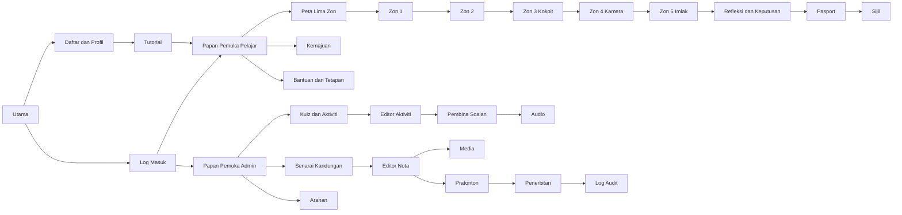

# Prototype.md - Panduan UI/UX dan Prototaip Di-BiTaRa

## Ketetapan aktif — akses kod dan sesi (22 Oktober 2026)

Rujukan utama ialah [Dokumentasi Lengkap Sistem v2](docs/references/Dokumentasi_Lengkap_Sistem_Di-BiTaRa.pdf), 8 halaman. [Pemetaan enhancement](docs/access-session-enhancement.md) menetapkan fail, perbezaan dan peraturan semasa. Semua bahagian akaun Pelajar serta timer per zon di bawah ialah sejarah versi terdahulu dan tidak boleh digunakan sebagai flow semasa.

Pelajar: Masukkan Kod → sesi sebenar tanpa akaun → Zon 1 (nama/kelas pilihan dan avatar) → Zon 2 (nota/audio automatik) → Zon 3 (3 cabaran) → Zon 4 (2 cabaran) → Zon 5 (3 Imlak dan refleksi) → Pasport, sijil, Tamat Sesi. Top navbar: Papan Pemuka | Kuiz & Aktiviti | Pasport & Pencapaian. Tiada profil, daftar, login, kata laluan atau dropdown akaun Pelajar. Pentadbir menggunakan log masuk biasa, mengurus Kod Akses dan Keputusan / Sesi.

Satu jam bermula selepas countdown Cabaran 1 Zon 3 dan diteruskan tanpa reset hingga refleksi Zon 5. Countdown hanya setiap cabaran Zon 3/4. Had audio Imlak tiga kali. Data dimiliki learner_sessions → access_codes; student_journeys.user_id kosong bagi sesi baharu. Akaun, perjalanan, cap, masa, snapshot dan sijil sejarah dikekalkan.


Versi 1.0 | 20 Oktober 2026 | Spesifikasi prototaip untuk dibangunkan, bukan aplikasi atau mockup interaktif yang telah siap.

Catatan pelaksanaan visual (20 Oktober 2026): skrin aplikasi sedia ada kini menggunakan tema ilustrasi yang lebih hampir kepada kedua-dua poster rujukan: bingkai biru bercahaya, bar tajuk navy, awan berlapis, bintang, butang kuning berkilat, kad zon berwarna dan maskot juruterbang. Aset serta prompt direkod dalam [Visual-Assets.md](docs/Visual-Assets.md). Catatan ini tidak menandakan modul permainan yang belum dibangunkan sebagai siap.

Baca bersama [Plan.md](Plan.md), [Module.md](Module.md) dan [Database.md](Database.md). Rujukan visual utama ialah UI Prototype Student.png (10 panel) dan UI Prototype Admin.png (8 panel), bersama logo asal pada laluan R3-R5 dalam Plan. Semua label pengguna menggunakan Bahasa Melayu; istilah teknikal bahasa Inggeris dalam spesifikasi tidak menjadi label UI secara automatik.

## 1. Prinsip visual dan komponen bersama

### 1.1 Identiti

Tema penerbangan dan ruang angkasa: langit navy, awan putih/biru muda, bintang, roket, kapal terbang, juruterbang dan laluan bertitik. Gunakan logo asal dengan nisbah dikekalkan serta teks alternatif “Di-BiTaRa - Bijak Imbuhan & Tatabahasa Ruang Angkasa”. Jangan menggunakan keseluruhan poster prototaip sebagai gambar latar aplikasi; pecahkan kepada komponen responsif yang boleh diakses.

Palet berikut ialah cadangan token hasil pemerhatian visual, bukan pensampelan warna rasmi:

| Token | Warna | Penggunaan |
|---|---|---|
| Navy utama | #082653 | Latar/header/sidebar |
| Navy teks | #102B55 | Teks atas kad putih |
| Biru aksi | #0878E8 | Pautan, fokus, tindakan kedua |
| Kuning misi | #FFD342 | Tindakan utama dengan teks navy |
| Jingga | #FFAD24 | Sorotan/ganjaran |
| Putih | #FFFFFF | Kad dan ruang membaca |
| Biru awan | #EAF5FF | Latar lembut |
| Hijau | #168446 | Kejayaan dengan ikon/teks |
| Merah | #C6283D | Ralat dengan teks pembetulan |

Uji kontras sebelum pelaksanaan; jangan menganggap pasangan warna sentiasa lulus. Teks isi 16-18 px, label minimum 14 px; tajuk Pelajar bulat dan ceria tetapi mudah dibaca, isi menggunakan fon sans serif. Font mesti berlesen dan mempunyai fallback sistem. Kad sudut 16-24 px, bayang ringan, ruang 8/16/24/32 px. Bintang/awan bersifat hiasan, tidak mengganggu teks atau fokus.

### 1.2 Cangkerang dan navigasi

Keperluan navbar global dikemas kini: logo di kiri dan Utama, Pengembaraan, Cara Bermain, Log Masuk serta Log Masuk Admin di kanan untuk pelawat. Header ialah anak terus `body`, berada paling atas sebelum masthead dan di luar semua `.app-window`, termasuk bingkai Log Masuk. Menu menjadi hamburger pada lebar 1100 px dan ke bawah; status log masuk menggantikan pautan pengesahan dengan papan pemuka/profil/log keluar. Log Masuk Admin menggunakan `/log-masuk-admin`, dan pelayan hanya mengesahkan akaun aktif berperanan Admin pada laluan itu.

- **Cangkerang Awam (CA):** navbar global logo, Utama, Pengembaraan, Cara Bermain, Log Masuk dan Log Masuk Admin; berada di luar bingkai kandungan. Footer ringkas; tiada nama murid.
- **Cangkerang Pelajar (CP):** header logo, nama/avatar, mata berlabel, Bantuan dan menu akaun. Navigasi Papan Pemuka, Peta Zon, Pasport, Kemajuan dan Sijil; menjadi bar bawah ringkas atau menu pada telefon. Halaman aktiviti menggunakan header ringkas zon, kemajuan dan Jeda/Kembali supaya ruang permainan luas.
- **Cangkerang Admin (CAD):** header logo + “Admin”, akaun/log keluar. Sidebar Papan Pemuka, Kandungan, Kuiz & Aktiviti, Soalan & Jawapan, Arahan, Audio, Media, Pratonton dan Log Audit. Kandungan putih dengan breadcrumb serta tajuk tindakan. Label “Dashboard” dalam poster dilokalkan kepada “Papan Pemuka”.
- Admin tidak menyamar sebagai murid sebenar. Mod pratonton mempunyai jalur tetap dan avatar rekaan. Tiada navigasi Pelajar ke sidebar Admin.

### 1.3 Kontrak komponen

- **Butang:** satu tindakan utama kuning bagi kawasan kerja; kedua putih/biru; berbahaya merah dengan pengesahan. Saiz sentuh minimum 44×44 px. Status menyimpan melumpuhkan penghantaran pendua, bukan semua navigasi tanpa sebab.
- **Kad:** tajuk, isi dan tindakan konsisten; status dalam teks+ikon, bukan warna sahaja. Skor dan kemajuan datang daripada pelayan, bukan nombor dalam poster.
- **Borang:** label kekal, tanda wajib dan mesej ralat dekat medan; ringkasan ralat membawa fokus ke medan pertama. Jangan guna placeholder sebagai satu-satunya label.
- **Modal/laci:** tajuk, penerangan dan Batal/Teruskan; fokus dikurung sementara, Escape menutup jika selamat, kemudian fokus kembali ke pencetus. Pengesahan diperlukan untuk padam dan meninggalkan perubahan belum disimpan.
- **Audio:** Dengar Arahan/Dengar Soalan, Main/Jeda/Main Semula, durasi, kelantangan dan status. Tiada automula; satu suara pada satu masa; jawapan tidak dipadam apabila audio dimainkan. Ikon tidak muncul jika audio pilihan tiada. Imlak wajib audio mempunyai keadaan gagal khusus.
- **Status bersama:** skeleton ketika muat awal; penunjuk kecil untuk simpan; mesej kejayaan `aria-live` sopan; ralat dengan tindakan pemulihan. Tiada keadaan gagal yang menghasilkan cap atau markah rekaan.
- **Animasi:** pesawat/awan perlahan, sorotan laluan, cap dan konfeti ringkas. Hormati pilihan kurang gerakan; versi statik menyampaikan maklumat sama. Tidak gunakan kelipan kecemasan laju.

### 1.4 Responsif dan aksesibiliti

| Peranti/ujian | Tingkah laku asas |
|---|---|
| PC 1440×900 dan laptop 1366×768 | Had kandungan bacaan sekitar 1200 px; peta mendatar, permainan dua panel, sidebar Admin tetap |
| Tablet 768×1024 dan landskap | Dua lajur jika muat; sidebar laci; panel permainan boleh disusun; tindakan utama sentiasa mudah dicapai |
| Telefon 360×800/390×844, minimum 320 px | Satu lajur, peta vertikal, kad mengganti jadual ringkas, kawalan tidak bertindih dengan papan kekunci/peramban |
| Zum 200% | Teks membalut, navigasi ringkas, tiada teks/butang penting terpotong |
| Input | Tetikus/sentuh/papan kekunci; seret dan lepas mempunyai alternatif pilih token kemudian slot; kamera bukan satu-satunya cara menjawab |

Jangan memaksa orientasi landskap. Untuk permainan, cadangkan landskap tetapi kekalkan mod potret yang boleh digunakan. Ilustrasi bermakna mempunyai teks alternatif; hiasan diabaikan pembaca skrin. Label kemajuan menyebut bilangan dan peratus. Fokus tidak ditutup bar tetap. Ayat tatabahasa ditulis sebagai teks sebenar, bukan dibakar dalam imej.

## 2. Peta skrin dan aliran



Aliran selepas log masuk ditentukan role di pelayan. Daftar kali pertama hanya mencipta akaun, kemudian log masuk dan tutorial; profil serta avatar dilengkapkan dan disahkan di Zon 1 sebelum Zon 2 dibuka. Peta ini menunjukkan laluan berjaya; keadaan belum lulus kembali kepada nota/ulang aktiviti.

## 3. Skrin Umum dan Pelajar

Semua skrin menggunakan kontrak §1. Di bawah, “tiada modal/borang/audio” bermaksud komponen itu sengaja tidak diperlukan pada skrin tersebut, bukan terlupa dalam spesifikasi. Keadaan kosong, memuat, berjaya dan ralat mesti dilaksanakan walaupun data contoh prototaip nampak lengkap.

### S01 - Halaman Utama

Keperluan terkini: halaman utama menggunakan susun atur penuh tanpa `.app-window`, bar tajuk “Halaman Utama”, ikon kawalan, border atau sudut bingkai. Navbar, logo, maskot dan butang berada terus di atas satu latar berterusan yang memenuhi viewport. Masthead pendua di luar bingkai turut digugurkan pada halaman ini. Bahagian seterusnya boleh ditatal; tiada pemotongan kandungan pada telefon.

- **Tujuan/akses:** awam; memperkenalkan Di-BiTaRa dan mengajak memulakan perjalanan.
- **Layout/header/navigasi:** CA, hero langit navy dengan logo, juruterbang, pesawat/roket; teks di kiri dan ilustrasi di kanan; kad empat manfaat di bawah.
- **Komponen/kad:** fokus di-/di, Lima Zon Pembelajaran, Kuiz Interaktif, Kumpul Cap dan Sijil Digital; bahagian Tentang/Cara Bermain sebagai anchor.
- **Butang/borang/modal:** Mulakan → S03 atau S02; Log Masuk → S02; tiada borang atau modal wajib.
- **Audio:** tiada automula; audio pengenalan pilihan dengan kawalan berlabel jika disediakan.
- **Interaksi/animasi:** pesawat bergerak perlahan; CTA berfokus jelas; klik anchor tidak memerangkap fokus.
- **Responsif:** hero bertindan, logo dan teks dahulu; ilustrasi diperkecil dan kad dua lajur/satu lajur.
- **Keadaan:** kosong bahan penerangan → penerangan asas tetap; memuat → placeholder ilustrasi; berjaya → sesi sedia menawarkan Sambung Misi; ralat media → logo/teks alternatif dan CTA kekal.
- **Seterusnya:** S02/S03, Bantuan S16; sesi sah ke S05 atau A01.

### S02 - Log Masuk dan Pemulihan

- **Tujuan/akses:** awam; pengesahan Pelajar/Admin dalam skrin sama.
- **Layout/header/navigasi:** CA ringkas, kad borang putih dan ilustrasi menara kawalan/juruterbang; Kembali ke Utama.
- **Komponen/kad:** ID/kod pengguna atau emel, kata laluan, tunjuk/sembunyi, pautan Lupa Kata Laluan dan Daftar Pelajar. Tiada pemilih role yang memberi kuasa.
- **Butang/borang/modal:** Log Masuk; panel pemulihan emel/kod sandaran; dialog bantuan hanya untuk panduan akaun. Medan kata laluan baharu dan pengesahan selepas token sah.
- **Audio:** tiada pemain; arahan teks jelas.
- **Interaksi/animasi:** Enter menghantar; fokus ke medan bermasalah; spinner kecil ketika hantar.
- **Responsif:** satu kad memenuhi lebar dengan margin selamat; ilustrasi sekunder disembunyikan jika sempit.
- **Keadaan:** kosong → borang bersih; memuat → butang Sedang Log Masuk; berjaya → arah ikut role; ralat → “Maklumat log masuk tidak sah”/had cubaan/token luput tanpa mendedahkan akaun.
- **Seterusnya:** Pelajar baharu S04/S03, Pelajar kembali S05, Admin A01; pemulihan berjaya kembali log masuk.

### S03 - Pendaftaran, Profil dan Avatar

- **Tujuan/akses:** awam untuk daftar Pelajar; Pelajar sah untuk kemas kini sendiri.
- **Layout/header/navigasi:** CA semasa daftar, CP semasa sunting; penanda Daftar → Pilih Avatar → Mula Misi.
- **Komponen/kad:** nama paparan, kod pengguna, emel pilihan, kata laluan/pengesahan semasa daftar; grid avatar juruterbang dan pilihan warna pesawat, pratonton avatar terpilih.
- **Butang/borang/modal:** Daftar dan Teruskan/Simpan Profil; Kembali/Batal; dialog kod pemulihan sekali sahaja selepas daftar; avatar dipilih sebagai radio berlabel.
- **Audio:** tiada rakaman/mikrofon; pemain arahan pilihan mengikut kandungan.
- **Interaksi/animasi:** pilihan ditanda tanda semak+bingkai, bukan warna sahaja; pratonton pesawat berubah; sunting kata laluan menggunakan aliran khusus pengesahan.
- **Responsif:** grid empat avatar menjadi dua; semua pilihan boleh discroll tanpa tindakan utama tertutup.
- **Keadaan:** kosong katalog → avatar lalai dan mesej katalog belum sedia; memuat → skeleton avatar; berjaya → Profil Disimpan; ralat → kod telah digunakan/medan wajib/simpan gagal, input dikekalkan.
- **Seterusnya:** S04 bagi pendaftaran baharu; S05 bagi kemas kini; tiada misi sehingga profil minimum lengkap.

### S04 - Tutorial Pengguna

- **Tujuan/akses:** Pelajar kali pertama atau melalui Bantuan.
- **Layout/header/navigasi:** CP dengan overlay sorotan pada peta, pasport, audio dan permainan; panel juruterbang pemberi panduan.
- **Komponen/kad:** empat langkah, tajuk, teks ringkas, titik kemajuan dan kawasan demo tanpa data murid lain.
- **Butang/borang/modal:** Sebelumnya, Seterusnya, Langkau, Selesai; overlay ialah dialog boleh diakses; tiada input borang.
- **Audio:** Dengar Panduan jika tersedia; main/jeda tidak memindahkan langkah.
- **Interaksi/animasi:** sorotan mengikut sasaran sebenar, gerakan perlahan; jika sasaran tidak kelihatan gunakan kad penerangan bertindan.
- **Responsif:** popover tidak keluar viewport; telefon menggunakan panel bawah dan sorotan di atas.
- **Keadaan:** kosong sasaran → ilustrasi statik; memuat → Tunggu Panduan; berjaya → status completed/skipped disimpan; ralat simpan → Cuba Semula dan teruskan secara selamat tanpa reset kemajuan.
- **Seterusnya:** S05 atau S03 jika profil belum lengkap; ulangan kembali S16.

### S05 - Papan Pemuka Pelajar

- **Tujuan/akses:** Pelajar; titik mula dan sambung perjalanan sendiri.
- **Layout/header/navigasi:** CP, sapaan juruterbang, kad kemajuan di atas, ringkasan peta dan tindakan pantas di bawah.
- **Komponen/kad:** avatar/nama, kemajuan keseluruhan, mata terbaik, cap terkumpul, unit terakhir dan kelayakan sijil.
- **Butang/borang/modal:** Sambung Misi, Buka Peta, Pasport Digital, Kemajuan Saya, Sijil; tiada borang atau modal wajib.
- **Audio:** muzik latar pilihan, lalai tidak bermain; kawalan bunyi mudah dicapai.
- **Interaksi/animasi:** nod zon semasa bercahaya lembut; cap baharu ringkas setelah disahkan pelayan.
- **Responsif:** kad dua lajur menjadi satu; navigasi ringkas di bawah tidak menutup kandungan.
- **Keadaan:** kosong perjalanan → 0%, Mulakan Zon 1 atau Misi Sedang Disediakan; memuat → skeleton tanpa mata palsu; berjaya → kemajuan disegarkan; ralat data → Cuba Semula, jangan andaikan kemajuan 0%.
- **Seterusnya:** S06, unit terakhir S07-S11, S13-S16.

### S06 - Peta Lima Zon

- **Tujuan/akses:** Pelajar; memahami urutan dan syarat pembukaan zon.
- **Layout/header/navigasi:** CP, peta langit/angkasa dengan lima nod, laluan bertitik dan pesawat avatar.
- **Komponen/kad:** nombor/nama zon, label Terkunci/Tersedia/Sedang Berjalan/Selesai, cap dan kemajuan zon; legenda ikon.
- **Butang/borang/modal:** Buka Zon/Sambung/Ulang; nod terkunci membuka dialog sebab dan “Ke Zon Sebelumnya”; tiada borang.
- **Audio:** kawalan bunyi hiasan pilihan; tiada suara automatik.
- **Interaksi/animasi:** pesawat bergerak ke nod dipilih selepas kebenaran disahkan; urutan fokus mengikut zon.
- **Responsif:** peta mendatar pada PC, laluan vertikal pada telefon; teks nama penuh tidak dikecilkan berlebihan.
- **Keadaan:** kosong keluaran → Misi Sedang Disediakan; memuat → lima placeholder; berjaya → nod seterusnya terbuka; ralat akses/versi → sebab serta Kembali/Semak Semula.
- **Seterusnya:** S07-S11 mengikut nod sah, kembali S05.

### S07 - Zon 1: Balai Pelepasan

- **Tujuan/akses:** Pelajar; persediaan, objektif dan nota pengenalan.
- **Layout/header/navigasi:** CP aktiviti; nombor zon serta bilangan nota, ilustrasi balai/menara dan juruterbang; kad kandungan putih.
- **Komponen/kad:** objektif, profil ringkas, avatar, senarai nota wajib, ruang cap Peneroka Nota.
- **Butang/borang/modal:** Tukar Avatar → S03; Sudah Baca; Sebelumnya/Seterusnya; Teruskan ke Taklimat; dialog cap selepas simpan; tiada borang jawapan.
- **Audio:** Dengar Arahan/Penerangan berdekatan teks, kawalan bersama §1.
- **Interaksi/animasi:** nota selesai bertanda; cap dicop selepas semua syarat sah, boleh langkau animasi.
- **Responsif:** avatar/objektif bertindan; ilustrasi tidak memakan ruang bacaan utama.
- **Keadaan:** kosong nota → Misi Sedang Disediakan; memuat → skeleton; berjaya → nota/cap disimpan; ralat → Gagal Menyimpan, cuba semula tanpa menambah cap berganda.
- **Seterusnya:** S08 selepas cap atau S06.

### S08 - Zon 2: Taklimat Penerbangan

- **Tujuan/akses:** Pelajar dengan cap Zon 1; memahami dua pola ejaan.
- **Layout/header/navigasi:** CP aktiviti; dua panel perbandingan di- dan di, indeks nota dan kemajuan.
- **Komponen/kad:** Imbuhan: “ditulis”, “dibaca”; Kata Sendi Tempat: “di sekolah”, “di rumah”; kad Formula Di-2P dan latihan kefahaman. Jangan meniru label masa yang salah dalam poster.
- **Butang/borang/modal:** Sebelumnya, Sudah Baca, Teruskan ke Kuiz, Hantar Jawapan, Ulang; borang pilihan/input mengikut soalan; modal keluar cubaan jika ada draf.
- **Audio:** ikon suara pada setiap arahan/nota/soalan jika tersedia; audio tidak mengosongkan jawapan.
- **Interaksi/animasi:** sorot bahagian rapat/jarak, maklum balas teks dengan contoh; warna panel sahaja tidak menentukan jawapan.
- **Responsif:** perbandingan dua lajur menjadi bertindan dengan tajuk berulang; semua contoh kekal boleh dibaca.
- **Keadaan:** kosong → bahan belum sedia; memuat → nota/soalan placeholder; berjaya → lulus dan cap Pakar Tatabahasa; ralat jawapan → penerangan/cuba aktiviti baharu, ralat simpan → kekalkan input.
- **Seterusnya:** keputusan S12, S09 jika zon selesai atau S06.

### S09 - Zon 3: Simulasi Penerbangan

- **Tujuan/akses:** Pelajar dengan cap Zon 2; menjalankan misi penerbangan sambil mengaplikasi di-/di.
- **Layout/header/navigasi:** ruang kokpit utama, tingkap hadapan menunjukkan landasan/langit, stereng dan instrumen; panel misi/soalan sebahagian papan kawalan, bukan halaman borang biasa.
- **Header/HUD:** Zon 3, nama misi, checkpoint/soalan semasa, markah, kemajuan penerbangan, Jeda dan Kembali ke Peta. Kelajuan/altitud dilabel simulasi; tiada nombor hiasan dianggap penguasaan bahasa.
- **Komponen/kad:** taklimat pra-penerbangan, laluan lima/berapa checkpoint sebenar, panel komunikasi menara, soalan aktif, jawapan dan bar kestabilan visual. Objektif dalam panel radio; seret token ke slot mesej navigasi; isi ruang pada log penerbangan.
- **Butang/borang/modal:** Mula Misi, Hantar Jawapan, Checkpoint Seterusnya, Jeda/Sambung, Keluar Misi; input mengikut jenis; modal jeda merangkumi bunyi, kurang gerakan dan keluar dengan pengesahan draf.
- **Audio:** Dengar Arahan/Dengar Soalan; suara mengurangkan muzik; jeda membekukan audio/animasi. Suara tidak menghalang kekunci menjawab.
- **Interaksi/animasi:** taklimat → berlepas → navigasi soalan → pendaratan. Betul menyalakan laluan/checkpoint; salah memberi petunjuk dan pembetulan tanpa pesawat terhempas. Animasi checkpoint hanya selepas respons pelayan. Pergerakan hiasan tidak memberikan mata.
- **Responsif:** PC tingkap dan instrumen dominan, soalan sebelah/bawah; tablet panel boleh dilipat; telefon tingkap kokpit ringkas di atas, HUD padat dan panel soalan besar di bawah. Potret kekal boleh dimainkan; mod kurang gerakan menggunakan adegan statik.
- **Keadaan:** kosong soalan → taklimat menyatakan misi belum tersedia; memuat → Muatkan Kokpit dengan peratus hanya jika diketahui; berjaya → pendaratan, skor dan cap jika layak; ralat rangkaian → jeda di checkpoint dan Cuba Simpan Semula; ralat grafik → kokpit statik dengan logik misi sama.
- **Seterusnya:** S12 keputusan, Ulang Misi, S10 selepas cap atau S06.

Wireframe susun atur utama:

```text
┌ Logo | Zon 3 | Misi 2/5 | Markah 20 | Jeda ┐
│          TINGKAP KOKPIT / LALUAN MISI       │
│           Pesawat menuju checkpoint       │
├ Instrumen simulasi ─┬ Komunikasi menara ───┤
│ Altitud / Kelajuan  │ [Dengar Soalan]       │
│ Peta laluan         │ Surat itu ____ Ali.  │
│ Stereng visual      │ Pilihan / token      │
│ Kemajuan penerbangan│ [Hantar Jawapan]      │
└────────────────────┴──────────────────────┘
```

### S10 - Zon 4: Webcam dan Pengecaman Tangan

- **Tujuan/akses:** Pelajar dengan cap Zon 3; susun ayat dalam misi kecemasan melalui tangan atau mod alternatif setara.
- **Layout/header/navigasi:** CP aktiviti ringkas; kiri/utama video langsung murid, kanan bank token dan ayat sasaran; HUD kemajuan/markah. Dalam mod kamera, video sebenar sentiasa kelihatan sepanjang aktiviti.
- **Komponen/kad:** kad izin/privasi, kamera bercermin, rangka/penunjuk tangan, tindanan token dan slot, kad soalan, arahan, status pergerakan, keputusan jawapan, kalibrasi dan progress misi. Tidak menggunakan “REC” kerana tiada rakaman video.
- **Butang/borang/modal:** Aktifkan Kamera, Pilih Kamera, Uji Gerakan, Kalibrasi Semula, Hantar Jawapan, Jeda, Gunakan Sentuhan/Papan Kekunci, Cuba Semula, Keluar; modal privasi/keluar; borang token/slot sebagai kawalan semantik.
- **Audio:** Dengar Arahan/Soalan; tiada permintaan mikrofon; maklum balas audio pilihan mempunyai teks setara.
- **Interaksi/animasi:** tangan/penunjuk pada token → cubit/pilih → gerak → lepaskan ke slot → semak susunan → Hantar. Cincin tahan menunjukkan kemajuan pemilihan; toleransi/debounce mengelakkan token dipilih berkali-kali. Maklum balas gerakan berasingan daripada betul/salah bahasa.
- **Responsif:** PC video dan bank token bersebelahan; telefon video di atas dengan bank token/slot di bawah, bukan meletakkan semua teks atas wajah. Overlay mengikut saiz video sebenar dan transform cermin. Butang izin kekal dapat dicapai dalam potret.
- **Keadaan kosong:** belum dimulakan → kad kamera dengan penerangan “Video diproses pada peranti dan tidak dirakam”, tiada permintaan izin automatik; tiada soalan → misi belum tersedia, jangan mula kamera.
- **Keadaan memuat:** Memulakan Kamera/Memuatkan Pengecaman Tangan; butang Batal dan mod alternatif tersedia. Jangan menunjukkan status aktif sebelum video+model siap.
- **Keadaan berjaya:** Kamera Aktif dan Tangan Dikesan; selepas hantar “Ayat tepat” atau penerangan pembetulan; cap Kapten Terlatih hanya selepas semua aktiviti wajib lulus.
- **Keadaan ralat:** izin ditolak, kamera tiada/sibuk, HTTPS tiada, model gagal, tangan hilang, cahaya rendah dan peranti perlahan mempunyai mesej/tindakan khusus seperti matriks di bawah. Jawapan yang diterima kekal.
- **Seterusnya:** S12/S11 selepas cap atau S06; setiap keluar menghentikan semua trek video. Mod sentuh menyembunyikan video yang tidak digunakan dan memberi label mod aktif.

| Keadaan kamera/gerakan | Paparan dan tindakan |
|---|---|
| Belum meminta izin | Aktifkan Kamera dan Gunakan Sentuhan; penerangan privasi |
| Dialog izin terbuka | Menunggu Kebenaran; jangan menindih dialog pelayar |
| Dibenarkan, sedang mula | Penunjuk mula video/model, Batal, mod alternatif |
| Aktif | Video langsung, kamera aktif, penunjuk tangan dan status teks |
| Tiada tangan/terkeluar bingkai | Jeda pemilihan, “Letakkan satu tangan dalam bingkai”; slot sah kekal |
| Dua tangan atau isyarat tidak stabil | “Gunakan satu tangan”, tahan penunjuk atau kalibrasi semula |
| Izin ditolak/ditarik | Panduan tetapan pelayar, Cuba Semula selepas tindakan pengguna, mod alternatif |
| Tiada kamera/peranti sibuk | Sebab khusus, pilih kamera lain jika ada, alternatif |
| Konteks tidak selamat/model gagal/peranti lambat | Penjelasan ringkas, Cuba Semula atau mod sentuh/papan kekunci |
| Jeda/tab tersembunyi | Tindakan permainan dijeda; kembali memerlukan Sambung; jangan hantar jawapan automatik |
| Keluar/selesai | Trek dihentikan dan penunjuk kamera pelayar padam |

```text
┌ Zon 4 | Misi 2/4 | Markah | Jeda ───────────┐
│ Arahan + Dengar Arahan                     │
├ Kamera langsung ───┬ Bank perkataan ───────┤
│ Wajah murid        │ [Adik] [di] [rumah]   │
│ + penunjuk tangan  │ [membaca] [buku]      │
│ Tangan dikesan     │ Slot ayat             │
├───────────────────┴───────────────────────┤
│ Gerakan: Token dipilih | Hantar Jawapan    │
│ Jawapan: Tunggu penghantaran | Kemajuan    │
└───────────────────────────────────────────┘
```

### S11 - Zon 5: Balai Ketibaan & Imlak

- **Tujuan/akses:** Pelajar dengan cap Zon 4; dengar dan tulis ejaan tepat.
- **Layout/header/navigasi:** CP aktiviti; ilustrasi balai ketibaan, kad audio/medan jawapan, kemajuan ayat.
- **Komponen/kad:** arahan “Dengar dan tulis ayat yang didengar”, pemain audio, input teks berbilang baris, status simpan dan keputusan selepas hantar.
- **Butang/borang/modal:** Main/Jeda/Ulang, Hantar Jawapan, Ayat Seterusnya, Bantuan Teks, Keluar; modal pengesahan pilih mod bantuan sebelum percubaan; jawapan asal tidak ditunjukkan sebelum hantar dalam mod biasa.
- **Audio:** gelombang/durasi dengan label masa; muat dahulu tanpa automula; kawalan penuh tidak memadam teks. Bantuan teks direkod dan dilabel.
- **Interaksi/animasi:** sorot beza ejaan rapat/jarak selepas hantar, bukan autocorrect sebelum hantar; animasi ketibaan lembut.
- **Responsif:** kad satu lajur, medan kekal kelihatan semasa papan kekunci telefon dibuka; bar tindakan tidak menutup input.
- **Keadaan:** kosong audio wajib → aktiviti tidak dimulakan; memuat → Memuatkan Audio; berjaya → respons disimpan, ayat seterusnya; ralat audio → Muat Semula/Bantuan Teks, ralat jawapan → penerangan selepas hantar.
- **Seterusnya:** S12 refleksi selepas imlak lulus; ulang imlak jika belum lulus; S06 untuk keluar.

### S12 - Keputusan Aktiviti dan Refleksi

- **Tujuan/akses:** Pelajar; rumusan percubaan semua zon dan refleksi wajib Zon 5.
- **Layout/header/navigasi:** CP; kad keputusan di tengah, ringkasan betul/salah serta tindakan; refleksi hanya pada akhir Zon 5.
- **Komponen/kad:** skor diperoleh/maksimum, peratus, ambang, status, skor terbaik; emoji+label emosi dan catatan pilihan 500 aksara untuk refleksi.
- **Butang/borang/modal:** Ulang Aktiviti, Semak Nota, Ke Peta, Hantar Refleksi, Tamatkan Misi; borang refleksi; dialog cap/tamat selepas simpan; emosi tiada kaitan markah.
- **Audio:** tiada auto main; suara maklum balas pilihan dengan butang Dengar.
- **Interaksi/animasi:** cap/konfeti ringkas boleh dilangkau; fokus ke ringkasan keputusan selepas navigasi.
- **Responsif:** skor dan refleksi bertindan; label emoji jelas dan mudah disentuh.
- **Keadaan:** kosong percubaan → Mulakan Aktiviti; memuat → Mengira Keputusan; berjaya → refleksi/cap disimpan; ralat simpan → catatan kekal, Cuba Hantar Semula; belum lulus ialah status pembelajaran dengan tindakan ulang.
- **Seterusnya:** S06/S13/S15 apabila layak; kembali zon berkaitan untuk ulang.

### S13 - Pasport Digital dan Cap

- **Tujuan/akses:** Pelajar pemilik; melihat identiti juruterbang dan pencapaian lima zon.
- **Layout/header/navigasi:** CP, buku pasport dua halaman pada skrin luas, kad satu halaman pada telefon.
- **Komponen/kad:** nama/avatar, tarikh mula, keluaran perjalanan, lima ruang cap bernombor, nama/tarikh cap dan ringkasan pencapaian.
- **Butang/borang/modal:** Lihat Butiran Cap, Sambung Zon, Lihat Sijil; modal butiran syarat cap; tiada borang.
- **Audio:** tiada pemain wajib; bunyi cop pilihan boleh dibisukan.
- **Interaksi/animasi:** cap baharu dicop sekali secara visual selepas pengesahan; tidak perlu menyelak animasi untuk akses isi.
- **Responsif:** buku menjadi senarai kad; cap tidak terlalu kecil dan nama zon penuh.
- **Keadaan:** kosong cap → siluet+syarat, bukan gagal; memuat → placeholder; berjaya → cap baru dengan tarikh; ralat data → Cuba Semula, jangan menghilangkan cap yang sudah disahkan.
- **Seterusnya:** S06, S14, S15.

### S14 - Kemajuan dan Sejarah Percubaan

- **Tujuan/akses:** Pelajar; menilai perkembangan sendiri tanpa membandingkan murid lain.
- **Layout/header/navigasi:** CP; kemajuan keseluruhan di atas, lima kad zon, sejarah aktiviti boleh dikembangkan.
- **Komponen/kad:** unit wajib selesai/jumlah, peratus zon, skor terbaik aktiviti, percubaan terakhir dan status lulus dengan tarikh.
- **Butang/borang/modal:** penapis zon/aktiviti, Lihat Percubaan, Ulang, Sambung; modal butiran percubaan baca sahaja jika perlu.
- **Audio:** tiada pemain halaman; semakan soalan boleh Dengar jika media tersedia.
- **Interaksi/animasi:** pengembangan butiran, bar kemajuan bukan satu-satunya nilai; kemajuan tidak merosot akibat ulangan rendah.
- **Responsif:** jadual sejarah menjadi kad; penapis membalut; tiada graf besar wajib.
- **Keadaan:** kosong → Belum Ada Percubaan dan Mula Misi; memuat → skeleton; berjaya → ringkasan disegarkan; ralat → Cuba Semula, rekod lama tidak diganti 0.
- **Seterusnya:** aktiviti S08-S11, S06 atau S13.

### S15 - Sijil Digital

- **Tujuan/akses:** Pelajar pemilik; melihat kelayakan dan muat turun PDF sijil.
- **Layout/header/navigasi:** CP; sijil putih berbingkai kuning/navy, logo, nama, tajuk pencapaian, nombor dan tarikh.
- **Komponen/kad:** pratonton sijil serta kad syarat lima cap/refleksi; data nama daripada salinan ketika dianugerahkan.
- **Butang/borang/modal:** Muat Turun Sijil, Kembali ke Pasport; Cuba Jana Semula jika gagal; tiada borang atau kongsi awam.
- **Audio:** tiada wajib; bunyi ganjaran pilihan tidak automula.
- **Interaksi/animasi:** ganjaran ringkas; klik muat turun menggunakan laluan berizin, bukan URL fail awam.
- **Responsif:** pratonton fit lebar boleh dizum; dokumen PDF mengekalkan saiz cetak dan tidak menyalin saiz viewport telefon.
- **Keadaan:** kosong/belum layak → senarai syarat dan Sambung Misi; memuat → Sijil Sedang Disediakan; berjaya → PDF sedia; ralat → Cuba Jana Semula pada rekod sama tanpa membatalkan pencapaian.
- **Seterusnya:** S13 atau S05.

### S16 - Bantuan dan Tetapan Pelajar

- **Tujuan/akses:** bantuan awam dan Pelajar; tetapan sendiri memerlukan log masuk.
- **Layout/header/navigasi:** CA/CP mengikut sesi, kad topik bantuan dan pilihan kebolehgunaan.
- **Komponen/kad:** cara bermain, simbol/audio, formula, kamera/izin, pemulihan sambungan; tetapan bunyi dan kurang gerakan.
- **Butang/borang/modal:** Ulang Tutorial, Simpan Tetapan, Kembali, Log Keluar; togol berlabel; modal log keluar jika aktiviti belum disimpan.
- **Audio:** contoh pemain untuk panduan; tetapan bunyi tidak memaksa audio bermula.
- **Interaksi/animasi:** accordion boleh digunakan papan kekunci; perubahan kurang gerakan segera dipratonton.
- **Responsif:** senarai topik vertikal; kontrol besar dan label jelas.
- **Keadaan:** kosong panduan → bantuan asas tetap; memuat → skeleton topik; berjaya → Tetapan Disimpan; ralat simpan → tetapan asal boleh dipulihkan dan Cuba Semula.
- **Seterusnya:** S04 atau halaman asal; log keluar → S01.

## 4. Skrin Admin

Semua A01-A12 memerlukan Admin sah dan CAD. Akses terus Pelajar ditolak pelayan. Kejayaan simpan draf berbeza daripada kejayaan terbit; jangan menamakan kedua-duanya “Kandungan Aktif” tanpa status tepat.

### A01 - Papan Pemuka Admin

- **Tujuan/akses:** Admin; ringkasan operasi kandungan.
- **Layout/header/navigasi:** CAD, tajuk Papan Pemuka, kad metrik dan aktiviti terkini.
- **Komponen/kad:** nota, kuiz, aktiviti, soalan, audio, lima zon, status pemprosesan dan keluaran semasa.
- **Butang/borang/modal:** Tambah Kandungan, Tambah Kuiz, Urus Audio, Lihat Semua Aktiviti; tiada borang/modal wajib.
- **Audio:** tiada automula/pemain utama; pintasan audio sahaja.
- **Interaksi/animasi:** kad pautan membawa ke senarai yang ditapis; animasi nombor tidak perlu.
- **Responsif:** sidebar laci, enam kad menjadi dua/satu lajur; aktiviti terkini dalam kad.
- **Keadaan:** kosong → Tiada Kandungan dan CTA tambah; memuat → skeleton; berjaya → bilangan sebenar; ralat metrik → Cuba Semula tanpa angka rekaan.
- **Seterusnya:** A02/A04/A08/A12.

### A02 - Senarai Kandungan

- **Tujuan/akses:** Admin; cari dan urus nota/bantuan/kandungan.
- **Layout/header/navigasi:** CAD, breadcrumb Kandungan, toolbar atas dan jadual berpaginasi.
- **Komponen/kad:** carian tajuk, penapis jenis/zon/status, kolum tajuk, zon, status, wajib, semakan, tarikh dan tindakan.
- **Butang/borang/modal:** Tambah, Lihat, Kemas Kini, Padam, Nyahaktif; borang penapis; modal padam menyatakan penggunaan serta kesan.
- **Audio:** ikon status audio sahaja; pratonton suara boleh dibuka dalam panel butiran.
- **Interaksi/animasi:** carian mengekalkan penapis/paginasi; paparkan “Tiada hasil carian” berbeza daripada “Belum ada kandungan”.
- **Responsif:** kad senarai telefon dengan menu tindakan atau skrol jadual terkawal; tindakan padam tidak berhimpit.
- **Keadaan:** kosong → Tambah Kandungan; memuat → skeleton baris; berjaya → toast simpan/padam dan senarai terkini; ralat padam berkebergantungan → penjelasan dan pilihan nyahaktif.
- **Seterusnya:** A03/A10/A11.

### A03 - Tambah/Kemas Kini Nota

- **Tujuan/akses:** Admin; penyediaan nota visual/audio.
- **Layout/header/navigasi:** CAD, borang utama kiri, status/media/pratonton kanan; breadcrumb kembali A02.
- **Komponen/kad:** tajuk, zon, jenis, susunan, wajib/pilihan, editor teks, imej+alt, arahan, audio; status Draf/Diterbitkan/Tidak Aktif dan nombor semakan.
- **Butang/borang/modal:** Simpan Draf, Pratonton, Pilih Media, Urus Audio, Batal; modal media dan perubahan belum disimpan. Tiada medan markah lulus bagi nota.
- **Audio:** pemain penerangan dengan Ganti/Nyahpaut; rakaman melalui A08 bersasaran nota.
- **Interaksi/animasi:** validasi inline; semakan optimistik mengesan suntingan Admin lain, bukan menimpa senyap.
- **Responsif:** panel sisi menjadi bahagian bawah; toolbar editor membalut dan input lebar penuh.
- **Keadaan:** kosong → borang baharu; memuat → draf/media skeleton; berjaya → Draf Disimpan; ralat → medan khusus, konflik semakan atau muat naik gagal dengan input kekal.
- **Seterusnya:** A10 pratonton, A11 terbit atau A02.

### A04 - Pengurusan Kuiz dan Aktiviti

- **Tujuan/akses:** Admin; senarai kuiz dan pengalaman interaktif lima zon.
- **Layout/header/navigasi:** CAD, tab Kuiz/Aktiviti Interaktif, toolbar dan jadual/kad.
- **Komponen/kad:** tajuk, zon, jenis renderer, bilangan soalan, markah maksimum dikira, ambang dan status.
- **Butang/borang/modal:** Tambah Kuiz/Aktiviti, Kemas Kini, Urus Soalan, Pratonton, Nyahaktif/Padam; borang carian/penapis; modal pengesahan tindakan berbahaya.
- **Audio:** ikon arahan audio; pemain tidak wajib pada senarai.
- **Interaksi/animasi:** tukar tab mengekalkan konteks penapis; tiada hiasan yang mengganggu pengurusan.
- **Responsif:** tab boleh discroll terkawal; senarai menjadi kad pada telefon.
- **Keadaan:** kosong → Cipta Aktiviti Pertama; memuat → baris skeleton; berjaya → senarai disegar; ralat → Cuba Semula dan rujukan kebergantungan.
- **Seterusnya:** A05/A06/A10.

### A05 - Editor Aktiviti dan Tetapan Permainan

- **Tujuan/akses:** Admin; konfigurasikan kuiz, kokpit, misi tangan dan imlak.
- **Layout/header/navigasi:** CAD, tab Maklumat/Soalan/Tetapan Permainan; panel ringkasan validasi di sisi.
- **Komponen/kad:** nama, zon, jenis, arahan, susunan, wajib, ambang lulus, tetapan rawak; Zon 3 tema kokpit/checkpoint; Zon 4 sensitiviti/tahan penunjuk/alternatif; imlak bantuan teks.
- **Butang/borang/modal:** Simpan Draf, Tambah Soalan, Uji Misi, Pratonton; modal keluar draf. Renderer Zon 3/4 dikunci kepada pengalaman yang ditetapkan, bukannya membenarkan penggantian kuiz biasa.
- **Audio:** Dengar Arahan dan Pilih/Rakam Audio; ke A08 dengan sasaran betul.
- **Interaksi/animasi:** medan berubah mengikut jenis dengan penerangan; nilai disahkan sebelum simpan/terbit.
- **Responsif:** tab menjadi senarai seksyen; panel validasi di atas tindakan simpan pada telefon.
- **Keadaan:** kosong soalan → tambah soalan sebelum terbit; memuat → editor skeleton; berjaya → Draf Disimpan; ralat → ambang/susunan/tetapan tidak sah dan pautan pembetulan.
- **Seterusnya:** A06/A08/A10/A11.

### A06 - Pembina Soalan dan Pilihan Jawapan

- **Tujuan/akses:** Admin; membina serta menguji semua jenis soalan.
- **Layout/header/navigasi:** CAD, senarai soalan kiri, editor tengah dan pratonton kanan; breadcrumb aktiviti.
- **Komponen/kad:** teks, jenis, markah, susunan, audio, maklum balas betul/salah. Objektif: baris pilihan+radio betul; seret dan lepas: bank token, slot dan pemetaan; isi kosong: slot/variasi; susun ayat: token/urutan; imlak: audio/kunci ejaan/normalisasi.
- **Butang/borang/modal:** Tambah/Padam Pilihan, Tambah Token/Slot, Naik/Turun, Simpan Soalan, Uji Jawapan; modal padam serta perubahan jenis yang membuang konfigurasi.
- **Audio:** pemain soalan, Pilih Audio/Rakam; audio imlak wajib, transkrip/kunci dilabel “Admin sahaja”.
- **Interaksi/animasi:** konfigurasi seret mempunyai alternatif naik/turun; satu jawapan objektif betul; semak pemetaan tanpa token hilang. Jenis tambahan belum dibangunkan dinyahbolehkan.
- **Responsif:** senarai soalan menjadi pemilih; editor/pratonton bertindan; pemetaan boleh disunting tanpa bergantung kanvas drag sahaja.
- **Keadaan:** kosong → Pilih Jenis Soalan; memuat → konfigurasi skeleton; berjaya → Soalan Disimpan; ralat → dua pilihan betul/slot tiada kunci/audio tidak sedia; fokus ke medan berkaitan.
- **Seterusnya:** A05/A08/A10.

### A07 - Pengurusan Arahan

- **Tujuan/akses:** Admin; CRUD teks arahan nota/aktiviti/skrin.
- **Layout/header/navigasi:** CAD, senarai arahan dengan carian serta editor panel sisi/halaman.
- **Komponen/kad:** tajuk, teks, screen key dipilih daripada senarai, status dan Senarai Digunakan Oleh.
- **Butang/borang/modal:** Tambah Arahan, Simpan, Rakam/Pilih Audio, Padam, Pratonton; modal padam menerangkan rujukan aktif.
- **Audio:** pemain arahan, ganti/nyahpaut draf tanpa memutus versi terbit.
- **Interaksi/animasi:** arahan boleh digunakan semula; tunjuk perubahan memberi kesan pada draf keluaran baharu.
- **Responsif:** senarai/editor satu lajur, kegunaan dalam accordion.
- **Keadaan:** kosong → Tambah Arahan; memuat → skeleton; berjaya → Arahan Disimpan; ralat rujukan → sekat padam dan cadang ganti/nyahaktif.
- **Seterusnya:** A08/A10 atau kembali editor pemanggil.

### A08 - Pengurusan Audio dan Rakaman

- **Tujuan/akses:** Admin; rakam, muat naik, main, paut dan ganti suara.
- **Layout/header/navigasi:** CAD, tab Rakam Audio/Muat Naik Audio, kad sasaran di atas, rakaman/pratonton tengah dan pustaka fail di bawah.
- **Komponen/kad:** sasaran soalan/arahan/nota, mikrofon dipilih, meter audio, status, durasi, nama fail, saiz/format/status pemprosesan dan kegunaan.
- **Butang/borang/modal:** Aktifkan Mikrofon, Mula Rakam, Henti, Rakam Semula, Simpan Rakaman, Pilih Fail, Muat Naik, Ganti, Padam; nama/tajuk rakaman; modal ganti/padam/rakaman belum disimpan.
- **Audio:** pratonton main/jeda/ulang dan durasi; semasa rakam pemain lain dihentikan; meter+teks Sedang Merakam. Tiada animasi rakaman palsu sebelum izin.
- **Interaksi/animasi:** izin → sedia → merakam → dihentikan → pratonton → simpan → memproses → sedia; Ganti membuat fail baharu. Jangan menampilkan fail sebagai terbit hanya kerana muat naik selesai.
- **Responsif:** meter/pemain lebar penuh; butang membalut dengan jarak; pustaka kad telefon.
- **Keadaan kosong:** Tiada Audio Dipilih dengan Rakam/Muat Naik; sasaran belum dipilih boleh simpan ke pustaka tetapi perlu paut sebelum terbit.
- **Keadaan memuat:** Menyimpan Rakaman/Memproses Audio, kemajuan muat naik jika diketahui; tiada butang terbit sebelum ready.
- **Keadaan berjaya:** Audio Disimpan dan Dipautkan; pratonton masih tersedia, nama sasaran ditunjukkan.
- **Keadaan ralat:** izin ditolak/mikrofon tiada/sibuk → panduan dan muat naik; MIME/saiz/durasi tidak sah → sebab+pilih semula; pemprosesan gagal → Cuba Semula; fail digunakan → sekat padam fizikal.
- **Seterusnya:** kembali A03/A06/A07, A10 atau A11. Keluar/henti melepaskan trek mikrofon.

### A09 - Pustaka Media

- **Tujuan/akses:** Admin; mengurus imej, ilustrasi, avatar dan audio yang dikongsi.
- **Layout/header/navigasi:** CAD, grid fail dengan penapis jenis/status dan panel butiran.
- **Komponen/kad:** thumbnail/ikon, tajuk, jenis, saiz, sumber/lesen, alt text, status dan senarai penggunaan versi.
- **Butang/borang/modal:** Muat Naik, Pilih Media, Simpan Metadata, Ganti, Nyahaktif/Padam; borang metadata; modal fail digunakan dan pengesahan.
- **Audio:** pratonton fail audio dengan kawalan standard; imej mempunyai zoom tanpa mengubah nisbah.
- **Interaksi/animasi:** pilih fail memulangkan media ID ke editor; muat naik disahkan pelayan, bukan sambungan nama sahaja.
- **Responsif:** grid empat/dua/satu lajur; panel butiran laci skrin penuh telefon.
- **Keadaan:** kosong → Muat Naik Media Pertama; memuat → thumbnail skeleton; berjaya → fail sedia+boleh dipilih; ralat fail/lesen/alt wajib → mesej khusus, fail sejarah tidak dipadam.
- **Seterusnya:** editor pemanggil atau A08.

### A10 - Pratonton Paparan Pelajar

- **Tujuan/akses:** Admin; menguji rupa dan tingkah laku sebelum terbit.
- **Layout/header/navigasi:** CAD minimum, jalur “Mod Pratonton Admin”, pemilih PC/Tablet/Telefon dan bingkai renderer Pelajar sebenar.
- **Komponen/kad:** pemilih zon/kandungan, nota/audio, kuiz, kokpit dan kamera seperti S07-S11, profil/mata rekaan berlabel.
- **Butang/borang/modal:** Kembali ke Editor, Muat Semula Pratonton, Semak Penerbitan; borang jawapan simulasi, modal izin kamera sebenar apabila diuji.
- **Audio:** pemain yang sama seperti Pelajar; menguji media draf hanya untuk sesi Admin.
- **Interaksi/animasi:** aktiviti boleh dicuba; tiada percubaan/cap/sijil murid sebenar; simulasi keputusan sementara dijelaskan.
- **Responsif:** bingkai peranti boleh dikecilkan untuk muat, ada pautan saiz sebenar; preview bukan pengganti ujian peranti sebenar.
- **Keadaan:** kosong → Pilih Kandungan; memuat → renderer skeleton; berjaya → semua input/audio berfungsi; ralat renderer/konfigurasi → mesej dengan Kembali ke Editor, sekat terbit jika kritikal.
- **Seterusnya:** A03/A05/A06 atau A11.

### A11 - Semakan dan Penerbitan

- **Tujuan/akses:** Admin; menerbitkan keluaran lima zon secara terkawal.
- **Layout/header/navigasi:** CAD, ringkasan versi dan status, senarai semak lima zon, ralat/warning dan panel tindakan.
- **Komponen/kad:** versi baharu, unit wajib, jumlah soalan/markah, media sedia, semakan bahasa, perubahan daripada keluaran lama serta bilangan perjalanan terikat jika perlu secara agregat.
- **Butang/borang/modal:** Jalankan Semakan, Pratonton, Terbitkan Keluaran, Nyahaktif/Tarik Keluaran; borang versi/tajuk; modal terbit/nyahaktif menerangkan kesan pada murid baharu dan perjalanan lama.
- **Audio:** ikon semakan pautan dan pemain jika perlu, bukan merakam pada halaman ini.
- **Interaksi/animasi:** ralat boleh diklik ke editor, tindakan terbit dikunci semasa transaksi; keluaran terbit dibaca sahaja, sunting menghasilkan draf keluaran baharu.
- **Responsif:** senarai semak bertindan, tindakan bawah tanpa menutup senarai ralat.
- **Keadaan:** kosong draf → Cipta/Sediakan Draf; memuat → Menyemak/Menerbitkan; berjaya → versi dan masa diterbitkan; ralat → senarai blok khusus tanpa penerbitan separa. Audio processing/soalan tiada jawapan menghalang terbit.
- **Seterusnya:** A10/A12/A01. Nyahaktif sumber memerlukan keluaran baharu untuk murid baharu; keluaran lama kekal kecuali ditarik kritikal.

### A12 - Log Audit

- **Tujuan/akses:** Admin; semak perubahan dan penerbitan, baca sahaja.
- **Layout/header/navigasi:** CAD, toolbar penapis dan jadual peristiwa; panel butiran apabila dipilih.
- **Komponen/kad:** masa tempatan, Admin/sistem, tindakan, entiti/ID, request ID, ringkasan sebelum/selepas ditapis.
- **Butang/borang/modal:** Tapis, Kosongkan Penapis, Lihat Butiran, Sebelumnya/Seterusnya; borang tarikh/pelaku/tindakan/entiti; modal butiran baca sahaja; tiada Padam/Kemas Kini audit.
- **Audio:** tiada pemain wajib; tidak memaut rakaman sensitif secara terbuka.
- **Interaksi/animasi:** paginasi stabil masa+ID, perbezaan sebelum/selepas dengan teks tambahan; tiada data rahsia dalam paparan atau payload.
- **Responsif:** baris menjadi kad, panel butiran lebar penuh; teks panjang membalut.
- **Keadaan:** kosong → Belum Ada Aktiviti/Tiada Hasil Penapis; memuat → skeleton; berjaya → hasil penapis; ralat → Cuba Semula tanpa mendedahkan log dalaman.
- **Seterusnya:** entiti asal jika masih wujud dan boleh diakses; jika padam, kekal pada butiran audit.

## 5. Kandungan mesej dan keadaan silang skrin

| Situasi | Contoh mesej Bahasa Melayu | Tindakan |
|---|---|---|
| Simpan diterima | Jawapan anda telah disimpan. | Seterusnya |
| Belum lulus | Anda hampir berjaya. Semak ejaan rapat dan jarak, kemudian cuba lagi. | Semak Nota / Ulang Aktiviti |
| Sambungan terputus | Sambungan terputus. Jawapan ini belum disahkan disimpan. | Cuba Simpan Semula |
| Kamera ditolak | Kamera belum dibenarkan. Anda boleh mengubah kebenaran pelayar atau menggunakan sentuhan. | Panduan Kamera / Gunakan Sentuhan |
| Tangan hilang | Tangan belum dikesan. Letakkan satu tangan dalam bingkai. | Kalibrasi Semula / Mod Alternatif |
| Mikrofon ditolak | Mikrofon tidak dapat digunakan. Anda masih boleh memuat naik audio. | Cuba Semula / Muat Naik Audio |
| Bahan belum sedia | Misi ini sedang disediakan. Sila kembali ke peta. | Kembali ke Peta |
| Sesi luput | Sesi anda telah tamat. Log masuk semula untuk menyambung. | Log Masuk |
| Akses ditolak | Anda tidak mempunyai akses ke halaman ini. | Kembali ke Papan Pemuka |
| Perubahan serentak | Kandungan ini telah dikemas kini oleh Admin lain. Semak versi terkini sebelum menyimpan. | Lihat Versi Terkini |

Sesi luput tidak memadam jawapan yang sudah diterima. Paparan pemulihan hanya menjanjikan simpanan yang benar-benar disahkan. Toast kejayaan mesti disertai perubahan status kekal yang boleh dibaca semula.

## 6. Senarai semak prototaip dan penerimaan

1. Semak semua 28 skrin pada PC, laptop, tablet dan telefon; bukan hanya hero Halaman Utama. Semak kosong/memuat/berjaya/ralat bagi setiap skrin.
2. Navigasi penuh papan kekunci dari daftar hingga sijil; modal fokus betul dan token boleh dipilih tanpa drag.
3. Zon 3 kekal kokpit semasa soalan objektif, seret dan lepas serta isi tempat kosong, termasuk mod telefon dan kurang gerakan.
4. Zon 4 menunjukkan kamera sebenar, tindanan sejajar, status tangan, jawapan dan progress berasingan. Uji izin ditolak, kamera sibuk, cahaya rendah, tangan hilang, tab tersembunyi dan mod alternatif.
5. Uji bahawa keluar Zon 4/pratonton memadam penunjuk penggunaan kamera pelayar. Tiada bingkai atau koordinat tangan disimpan/dihantar.
6. Rakaman Admin diuji dari izin hingga simpan, pemprosesan, pautan, main Pelajar dan ganti versi. Jawapan tidak hilang apabila audio dimainkan.
7. Semua menu/ralat/kandungan standard dalam Bahasa Melayu; betulkan formula masa dan contoh “di pagi hari” dalam poster sebelum membina aset sebenar.
8. Skor/kemajuan/cap/sijil konsisten dengan Plan §8 dan data sebenar. Gambar prototaip tidak menjadi sumber nilai dummy produksi.
9. Pratonton menggunakan renderer sebenar dengan data rekaan; tidak mencipta rekod murid. Padam, ganti audio dan terbit menunjukkan kesan yang tepat sebelum tindakan.
10. Uji pemulihan sambungan dan penghantaran semula tanpa markah/cap/sijil berganda. Semak akses silang peranan dan pemilikan pada pelayan, bukan UI sahaja.

## 7. Hubungan sumber dan keputusan reka bentuk

Panel Pelajar 1-4 dirincikan kepada S01-S06; panel 5-9 menjadi S07-S12; panel pasport/sijil menjadi S13-S15. Bantuan/tetapan S16 melengkapkan aliran yang disebut dalam R1. Panel Admin 1-8 dirincikan kepada S02 dan A01-A11; Log Audit A12 serta Arahan A07/Media A09 melengkapkan fungsi R1 yang tidak mempunyai panel penuh dalam poster. Identiti visual dan tema asal dikekalkan; skrin responsif, keadaan peranti, pemulihan dan pemisahan draf/keluaran ialah perincian pembangunan tambahan yang diperlukan oleh permintaan semasa.

## Reka bentuk semula penuh — sumber UI terkini

Rujukan utama baharu ialah 10 skrin Admin dan 6 skrin Pelajar dalam `C:/My Profile/Di-BiTaRa/Admin/` dan `C:/My Profile/Di-BiTaRa/Pelajar/` yang dilampirkan pengguna. Bahagian ini mengatasi catatan terdahulu tentang bingkai bercahaya dan navbar selepas log masuk.

- Semua skrin: full-screen tanpa `.app-window`, bar tajuk atau kawalan tetingkap. Kad borang dan panel maklumat tetap dibenarkan.
- Awam: navbar terus di bawah `body`, logo kiri; Utama, Tentang, Pengembaraan, Cara Bermain, Log Masuk Pelajar, Log Masuk Admin kanan. Hamburger pada <=1100px.
- Sesi sah: sidebar role-specific mengikut senarai Module, kawasan kandungan kanan dan toolbar akaun kecil. Navbar awam tidak dirender. Sidebar desktop 252px, collapse 82px; drawer 260px pada <=960px, backdrop dan Escape untuk tutup. Menu aktif mempunyai `aria-current`.
- Dashboard Admin: hero penerbangan dengan maskot, enam kad metrik pastel, aktiviti terkini, graf taburan nota sebenar dan pautan kandungan. Nilai sifar kekal sifar.
- Pelajar: ucapan peribadi, panel kemajuan, lima kad zon hijau/kuning/biru/merah/ungu, status cap sebenar dan tip di-/di.
- Log masuk: ilustrasi dan tajuk di kiri, kad borang putih di kanan; satu lajur pada telefon. Identiti Admin jelas dan endpoint role-enforced dikekalkan.
- Pendaftaran: panel penerangan/maskot di kiri, borang akaun dan avatar di kanan; satu lajur di telefon. Minimum kata laluan kekal 8 aksara walaupun contoh imej menyebut 6.
- Nota: jadual putih, carian/penapis sedia ada, editor nota serta panel panduan; status draf sebenar. Kemas kini dan tambah berfungsi melalui Livewire.
- Kuiz baharu: pratonton UI empat tab Maklumat Kuiz, Soalan Kuiz, Tetapan & Media, Semak. Tajuk/penerangan dipratonton langsung; belum menyimpan dan dilabel jelas.
- Profil Admin: panel maklumat akaun dan panel keselamatan; validasi, loading, kejayaan dan ralat menggunakan komponen bersama. Tiada statistik/log masuk contoh rekaan.
- Modul lain: rangka skrin bertema dengan senarai sebenar jika ada dan keadaan kosong serta status pembangunan yang jelas. Ini bukan pengisytiharan modul permainan/audio/penerbitan siap.

### Navigasi awam dan halaman penerangan — kemas kini
Navbar sebelum log masuk menggunakan latar putih, teks navy, aktif kuning dan hamburger responsif. Enam menu membawa ke halaman berasingan: `/`, `/tentang`, `/pengembaraan`, `/cara-bermain`, `/log-masuk`, `/log-masuk-admin`. Tiada pautan hash dalam navbar. Utama merangkum pengenalan, objektif, pembelajaran, lima zon, ciri, gamifikasi, pasport, cap, ganjaran, sijil dan tindakan daftar/log masuk. Tentang menerangkan latar, masalah dan pedagogi; Pengembaraan memperkenalkan zon; Cara Bermain menerangkan penggunaan dan dasar kemajuan. `/bantuan` kekal sebagai laluan bantuan bagi sidebar selepas log masuk. Status pembangunan modul dijelaskan supaya penerangan fungsi yang dirancang tidak dianggap sudah tersedia.

### Identiti rasmi sistem
Nama rasmi untuk semua paparan ialah **Di-BiTaRa**, diikuti **Bijak Imbuhan & Tatabahasa Ruang Angkasa**. Ejaan ini tidak boleh diubah melalui uppercase/lowercase CSS. Navbar, sidebar, tajuk pelayar, footer, log masuk, dashboard, pasport dan sijil mengikuti identiti sama. Lambang UI tanpa teks `public/images/brand-mark.svg` menggantikan penggunaan logo raster yang mempunyai variasi ejaan terbina dalam imej; aset sumber asal dikekalkan sebagai rujukan sahaja.

### Pembetulan navigasi Pelajar terkini
Pelajar selepas log masuk menggunakan **top navbar**, bukan sidebar. Menu utama: Papan Pemuka, Peta Zon, Kuiz & Aktiviti, Pencapaian, Pasport Digital. Di kanan terdapat ikon notifikasi (keadaan kosong sehingga modul tersedia), avatar yang dipilih, nama, ID/kod pengguna, dan dropdown Profil & Avatar, Tetapan, Kemajuan, Sijil Digital, Bantuan, Tutorial, Log Keluar. Menu aktif kuning dan `aria-current=page`. Pada <=1180px menu utama menjadi hamburger; butiran akaun kekal mudah diakses. Admin sahaja mengekalkan sidebar. Keperluan ini mengatasi catatan navigasi Pelajar terdahulu.
Dashboard Pelajar menggunakan panel selamat datang/profil, zon semasa, lima kad zon, pasport dan pencapaian. Markah, peratus dan cap daripada data sebenar; tiada tahap XP, bilangan soalan selesai atau notifikasi rekaan daripada imej contoh.

### Komposisi dashboard Pelajar — rujukan terbaharu
Dashboard menggunakan komposisi khusus gambar terkini: navbar atas, banner ucapan besar, empat kad Zon Selesai/Jumlah Markah/Cap Dikumpul/Sijil Diperoleh, panel Kemajuan Pembelajaran Saya di kiri dengan cincin peratus dan lima bar zon, Notifikasi Terkini serta Pintasan Pantas di kanan, dan lima kad Zon Pembelajaran di bawah. Jalur tajuk panel kuning, bingkai kad biru/putih, latar penerbangan dan warna zon hijau/jingga/biru/merah/ungu dikekalkan. Tiada sidebar atau panel profil tinggi di sisi dashboard.
Navbar utama: Utama, Papan Pemuka, Kuiz & Aktiviti, Pencapaian, Pasport Digital. Peta Zon boleh dicapai dari pintasan, Lihat Semua Zon atau dropdown. Telefon menyusun panel secara menegak dan kad zon kepada dua lajur. Ringkasan menggunakan rekod sebenar: maksimum lima cap zon dan satu sijil bagi perjalanan, bukan nilai contoh 25 cap/lima sijil. Notifikasi memaparkan keadaan kosong sehingga modul tersedia; tiada kejayaan atau masa pemberitahuan rekaan.

### Navbar Pelajar empat menu — pindaan terkini
Menu Utama digugurkan daripada navbar sesi Pelajar. Empat menu sahaja: Papan Pemuka, Kuiz & Aktiviti, Pencapaian, Pasport Digital. Logo menuju Papan Pemuka. Notifikasi, avatar, nama, ID dan dropdown akaun dikekalkan. Selepas log masuk Pelajar, `/papan-pemuka` terus menuju dashboard `/pelajar`, termasuk akaun yang belum melengkapkan tutorial. Tutorial kekal boleh dicapai melalui dropdown dan selepas pendaftaran baharu.

### Kuiz & Aktiviti Pelajar — reka bentuk katalog zon
Halaman `/kuiz-aktiviti` menggunakan hero bertajuk Kuiz & Aktiviti, maskot juruterbang, latar lapangan terbang dan gelembung Belajar Sambil Bermain. Lima pilihan zon menyokong `?zon=1` hingga `?zon=5`; pemilihan menukar nama, penerangan, objektif, kemajuan sebenar dan set kad. Desktop memaparkan empat kad sebaris, tablet dua dan telefon satu; pemilih zon boleh ditatal mendatar pada telefon. Kad membezakan Kuiz hijau/Aktiviti biru dan mengandungi tajuk, ilustrasi berlapis, penerangan, soalan, masa serta butang mula.
Setakat fasa reka bentuk ini, katalog ialah cadangan eksplisit dalam `config/activity_previews.php`, bukan kandungan draf atau terbit daripada pangkalan data. Kuantiti soalan dan masa dilabel cadangan; butang mula dilumpuhkan dengan status belum tersedia. Ia tidak menulis percubaan, jawapan, markah atau cap. Data sebenar mesti datang daripada keluaran perjalanan apabila enjin permainan dilaksanakan.
Navbar Pelajar terkini: Papan Pemuka, Peta Zon, Kuiz & Aktiviti, Pencapaian, Pasport Digital; tiada Utama. Keperluan ini menggantikan senarai empat menu terdahulu.

### Pasport & Pencapaian — satu halaman gabungan
Laluan utama ialah `/pasport-pencapaian`, menu **Pasport & Pencapaian**. Navbar Pelajar kini empat menu: Papan Pemuka, Peta Zon, Kuiz & Aktiviti, Pasport & Pencapaian. Laluan lama `/pasport`, `/ganjaran`, `/kemajuan`, `/sijil` mengalih ke bahagian pada halaman sama. Header notifikasi dan akaun dikekalkan.
Komposisi mengikut rujukan terkini: hero penerbangan; lima kad Ringkasan Kemajuan Saya; kad pasport navy/emas di kiri; Cop Pengembaraan Zon dan Pencapaian Terkini di tengah; enam lencana serta Sijil Saya di kanan. Tablet menyusun semula lajur; telefon satu lajur dengan ringkasan dua lajur. Semua bahagian ber-ID menyokong pautan dalaman dan ruang header sticky.
Pasport memaparkan avatar, nama, username sebagai ID, tahap, pangkat dan tarikh akaun sebenar. Tahap = 1 + bilangan zon selesai. Pangkat: 0 zon Juruterbang Baharu, 1–2 Pelatih Bahasa, 3–4 Penjelajah Bahasa, 5 Kapten Bahasa. Lencana ialah hasil bacaan rekod perjalanan semasa: Langkah Pertama (1 nota), Pakar Kuiz (5 kuiz berbeza lulus), Pengkaji Nota (5 nota), Penakluk Zon (3 cap), Kolektor Cap (5 cap), Misi Sempurna (sijil ready). Status tidak disimpan sebagai ganjaran baharu dan tidak memberi mata tambahan.
Sejarah menggunakan nota, percubaan lengkap, cap dan sijil sebenar. Markah percubaan dilabel sebagai markah percubaan, bukan tambahan XP atau jumlah kumulatif berganda. Sijil belum ada menggunakan keadaan kosong, bukannya sijil contoh atas nama pelajar. Sijil sedia mempunyai ringkasan visual, butang Lihat PDF dan Muat Turun yang mengesahkan pemilik serta fail PDF private sedia.

### Peta Zon dibuang sepenuhnya — keputusan terkini
Tiada skrin atau laluan Peta Zon Pelajar. `/peta-zon`, `/zon-pembelajaran`, route `student.map` dan `student.zones` dibuang, bersama view peta dan komponen peta lama yang tidak lagi digunakan. Navbar selepas log masuk ialah **Papan Pemuka | Kuiz & Aktiviti | Pasport & Pencapaian**. Pautan peta dalam dropdown juga dibuang.
Papan Pemuka memaparkan kemajuan/status semua zon; setiap kad membawa ke `/kuiz-aktiviti?zon=N`. Halaman Kuiz & Aktiviti menyediakan pemilih lima zon, objektif dan kad misi. Pasport & Pencapaian menyediakan cap, status penyelesaian, lencana dan sijil. Pautan Lihat Semua Zon/Mulakan Pembelajaran menuju katalog aktiviti, bukannya halaman peta lain. Status aktiviti terkunci atau belum diterbitkan dikekalkan. Keputusan ini mengatasi semua cadangan Peta Zon terdahulu.

### Pendaftaran Pelajar tiga langkah — 21 Oktober 2026
Pendaftaran: /daftar (Maklumat Akaun) → /daftar/berjaya → Log Masuk → Tutorial / Papan Pemuka. Pemilihan serta pratonton avatar dipindahkan ke Zon 1; /daftar/avatar dibuang.
Penanda kemajuan tiga langkah pada setiap skrin; label tepat Maklumat Akaun → Pilih Avatar → Selesai. Visual mengikut tiga imej terkini: langkah pertama dua lajur dengan jemputan/maskot juruterbang dan robot SVG di kiri, kad borang putih kanan; langkah kedua panel putih besar, katalog kiri/pratonton kanan; langkah ketiga ilustrasi kiri, identiti avatar tengah dan senarai semak/tindakan kanan. Latar penerbangan, navy, kuning dan putih dikekalkan. Telefon menyusun semua lajur menegak.
Kata laluan minimum lapan aksara dan pengesahan sepadan. Akaun/profil tanpa avatar/kod pemulihan dicipta terus dalam satu transaksi. Receipt 20 minit mengelakkan pendaftaran berulang; tiada draf kata laluan. Sahkan avatar di Zon 1 untuk cap pertama dan buka Zon 2.

## Pelaksanaan end-to-end — 21 Oktober 2026
Pelan terkini menjadi rujukan: navbar Pelajar tiga menu, tiada Peta Zon; pendaftaran akaun tanpa avatar diikuti log masuk/tutorial popup enam langkah. Zon 3 hanya true_false dan drag_drop daripada Soalan Kuiz.pdf (12 ejaan dan 10 kad). Zon 4 sentence_order dan fill_blank daripada Soalan Kuiz.pdf (5 Susun Ayat + 5 Isi Tempat Kosong dengan salinan ayat); Zon 5 dictation serta refleksi. Semua jenis mempunyai editor Admin, validasi, renderer dan penilai pelayan. Admin CRUD nota/aktiviti/soalan/arahan/media, rakam/muat naik audio dan terbit keluaran snapshot immutable. Perjalanan menggunakan manifest keluaran sendiri; jawapan betul tidak dimasukkan dalam payload HTML Pelajar. Penghantaran jawapan idempoten; skor terbaik, kemajuan, cap dan sijil dikira pelayan. Pratonton Admin menggunakan renderer sama tanpa rekod Pelajar. Notifikasi milik penerima dan status baca disimpan; media private melalui route yang mengesahkan peranan/pemilikan serta kaitan manifest. Sijil PDF dijana selepas lima cap dan refleksi. Webcam pilihan memproses landmark setempat; input klik/sentuh/papan kekunci sentiasa tersedia.
Tambahan data: student_notifications (user_id, dedupe_key unik, title, body, read_at, timestamps). Manifest menyimpan salinan nota, aktiviti, soalan, kunci, media dan arahan, hanya dibaca pelayan. Tiada perubahan destructive pada rekod sedia ada.

### Menu Pelajar dipermudah — keputusan terkini 21 Oktober 2026
Top navbar kekal Papan Pemuka | Kuiz & Aktiviti | Pasport & Pencapaian. Dropdown hanya Profil dan Log Keluar. Tetapan, Kemajuan Saya dan Sijil Digital dibuang daripada menu/dropdown Pelajar. Kemajuan kekal pada dashboard; sijil kekal dalam Pasport & Pencapaian. Menu Admin tidak berubah. Keputusan ini mengatasi senarai dropdown terdahulu.


### Navigasi akaun Admin — 21 Oktober 2026

Sidebar Admin hanya mengandungi Dashboard, Kandungan, Nota, Kuiz & Aktiviti, Soalan & Jawapan, Arahan, Audio, Media, Pratonton Pelajar, Pengguna, Laporan dan Audit Log. Profil, Tetapan dan Log Keluar berada dalam dropdown profil di kanan atas, dibuka melalui nama, avatar atau ikon dropdown. Log Keluar membuka modal “Adakah anda pasti mahu log keluar?” dengan butang Batal dan Log Keluar. Batal/Escape mengekalkan sesi dan mengembalikan fokus ke pencetus; pengesahan menghantar POST dengan CSRF dan menamatkan sesi. Dropdown dan modal menyokong desktop, tablet dan telefon. Ketetapan ini mengatasi senarai navigasi Admin terdahulu.


### Penyelarasan dropdown Pelajar — 21 Oktober 2026

Dropdown Pelajar hanya memaparkan Profil dan Log Keluar. Gaya kad, ikon, jarak, hover navy/kuning dan sudut bulat disamakan dengan Admin. Kedua-dua peranan berkongsi komponen modal pengesahan; Pelajar menggunakan mesej “Adakah anda pasti mahu log keluar?” dan “Anda boleh log masuk semula untuk meneruskan pembelajaran Di-BiTaRa.” Butang Batal atau Escape mengekalkan sesi dan memulangkan fokus; Log Keluar menamatkan sesi melalui POST CSRF. Tiada Tetapan, Kemajuan Saya, Sijil Digital, Bantuan atau Tutorial dalam dropdown Pelajar. Ini mengatasi senarai menu akaun Pelajar terdahulu; laluan bantuan/tutorial kekal tersedia.


### Bahasa Melayu dan paparan mesra murid — 21 Oktober 2026

Semua label sistem menggunakan Bahasa Melayu: Papan Pemuka, Pentadbir, Tetapan, Profil, Log Keluar, Hantar, Seterusnya, Sebelumnya, Markah, Kemajuan, Pencapaian, Kuiz dan Log Audit. Laluan, nama kelas serta nilai dalaman pangkalan data tidak perlu diterjemah; nilai tersebut dipadankan kepada label Melayu sebelum dipaparkan. Nama pengguna dan kandungan yang ditaip pengguna dikekalkan.

Arahan murid dipendekkan dengan ikon mengikut jenis soalan, bar kemajuan, butang sekurang-kurangnya 48 px, pilihan perasaan bergambar dan maklum balas warna/simbol. Panduan tambahan serta kawalan tangan pilihan boleh dibuka apabila diperlukan. Kawalan audio menggunakan Dengar, Jeda dan Ulang; mesej medan wajib dan dialog pengesahan turut menggunakan Bahasa Melayu. Soalan, ejaan dan kunci jawapan sumber Zon 3/4 serta audio Imlak dikekalkan. Pentadbir hendaklah menulis kandungan baharu dalam Bahasa Melayu dan menggunakan arahan pendek. Ketetapan ini mengatasi istilah paparan terdahulu.

Pengesahan: 40 ujian / 864 assertions; semakan pelayar untuk susun ayat, maklum balas markah, audio Imlak, medan wajib, dialog pengesahan, Log Audit dan telefon 390 px. Semakan menggunakan data QA berasingan.


### Logo rasmi dan footer awam — 21 Oktober 2026

Logo rasmi ialah salinan asal lampiran pengguna di `public/images/official-logo.png`; bentuk, tulisan dalam karya dan ketelusan asal dikekalkan. Nama teks UI kekal Di-BiTaRa dan Bijak Imbuhan & Tatabahasa Ruang Angkasa. Komponen `brand-logo` digunakan pada navigasi awam/Pelajar, menu sisi Pentadbir, halaman utama, log masuk, pendaftaran, dropdown, pasport dan pratonton sijil. Avatar peribadi kekal berasingan daripada logo rasmi. Palet serta peraturan responsif dikumpulkan dalam `resources/css/branding.css`.

Footer hanya dirender untuk tetamu melalui `@guest` pada layout bersama. Tiada footer pada mana-mana halaman selepas log masuk, termasuk jika pengguna membuka halaman umum ketika masih bersesi. Footer mengandungi logo besar, pautan pantas, sokongan, awan, bintang, kapal terbang dan hak cipta 2026. Pautan Privasi dan Syarat Penggunaan menuju halaman sebenar; label Log Masuk Pentadbir mengekalkan Bahasa Melayu.

Sijil PDF membenamkan logo, menggunakan salinan JPEG khusus PDF di `resources/branding/certificate-logo.jpg` tanpa memerlukan GD semasa berjalan. Arahan `php artisan dibitara:refresh-certificate-branding` boleh dijalankan semula dengan selamat: hanya sijil lama yang belum mempunyai logo dijana ke fail baharu; fail asal, nama, nombor dan tarikh anugerah dikekalkan.

Pengesahan: 44 ujian / 1,050 assertions, build Vite, semakan pelayar desktop/telefon serta render sijil PDF. Ketetapan ini mengatasi footer atau penjenamaan terdahulu.


### Latar khas lima zon — 21 Oktober 2026

Lima PNG baharu dijana menggunakan image_gen terbina dalam dan disimpan di `public/images/zones/`: `zone-1-departure.png` (balai pelepasan), `zone-2-briefing.png` (bilik taklimat), `zone-3-cockpit.png` (kokpit dan landasan), `zone-4-emergency.png` (latihan kecemasan mesra murid) dan `zone-5-arrival.png` (ketibaan, kejayaan dan imlak). Gaya navy/biru/emas/putih dikekalkan; elemen utama diletakkan di sisi supaya ruang tengah lapang untuk UI.

`config/zone-backgrounds.php` memetakan zon kepada gambar. Layout menerima nombor zon untuk katalog, nota dan misi; hanya latar zon dipilih dimuat awal. Kad kandungan kekal legap/cerah untuk kebolehbacaan. Zon 3 menggunakan kokpit baharu; aset latar lama dikekalkan. Penyesuaian telefon menggunakan latar tanpa lekatan tetap dan susun atur asal responsif. Tiada perubahan pada kandungan soalan, pemarkahan, syarat buka zon atau footer awam sahaja.

Set prompt sebenar: `docs/visuals/zone-background-prompts.md`. Semakan pelayar bagi kelima-lima zon, nota Zon 2, misi Zon 3 dan telefon 390 px selesai. Build dan 44 ujian / 1,075 assertions lulus.


### Struktur akhir zon, kuiz dan masa — 21 Oktober 2026

| Zon | Kandungan | Kuiz | Kira detik | Timer |
| --- | --- | --- | --- | --- |
| 1 — Balai Pelepasan | Pengenalan, objektif, persediaan | Tidak | Tidak | Tidak |
| 2 — Taklimat Penerbangan | Nota, konsep, contoh, audio | Tidak | Ya | Ya |
| 3 — Simulasi Penerbangan | Betul / Salah, Seret dan Lepas | Ya | Ya | Ya |
| 4 — Cabaran Kecemasan | Susun Ayat, Isi Tempat Kosong | Ya | Ya | Ya |
| 5 — Balai Ketibaan & Imlak | Aktiviti Imlak dan refleksi akhir | Tidak | Tidak | Tidak |

Zon 1 dan 2 dibuka terus tanpa popup kira detik atau timer. Zon 3, 4 dan 5 menggunakan 3 → 2 → 1 → Mula sebelum mula kali pertama. Memilih tab hanya melihat katalog; kandungan sebenar zon bermasa dikunci sehingga POST mula diterima selepas tiga saat. Persediaan akaun, profil dan avatar melengkapkan Zon 1; nota wajib melengkapkan Zon 2; Zon 3 dan 4 memerlukan nota serta semua aktiviti wajib lulus. Zon 5 memerlukan nota, Imlak dan refleksi untuk sijil.

Timer bermula selepas kira detik dan berhenti sebaik syarat zon dipenuhi; Zon 2 berhenti selepas nota wajib terakhir. Masa diteruskan merentas halaman/sesi, tidak direset atau ditimpa oleh aktiviti ulangan. Pasport hanya memaparkan Masa Zon 2, Masa Zon 3, Masa Zon 4 dan **Jumlah Masa Keseluruhan = Zon 3 + Zon 4 + Zon 5**. Jumlah tersedia sebaik ketiga-tiga rekod lengkap, tanpa menunggu Zon 5. Tiada markah penalti berdasarkan masa. Masa lama yang tidak dapat disahkan tidak direka; masa sambungan dilabel dan dikecualikan daripada jumlah penuh.

Dasar bersama: `ZoneStructure` (timer/countdown 2–4, kuiz 3–4). Penerbitan dan CRUD Pentadbir menolak aktiviti soalan pada Zon 1/2 serta kuiz pada Zon 5. Kurikulum baharu mempunyai 6 aktiviti dan 36 soalan sumber (Zon 3: 20 Betul/Salah + satu klasifikasi; Zon 4: 5 susun ayat + 5 isi kosong; Zon 5: 5 Imlak). Syarat Pakar Kuiz ialah lulus 2 kuiz berbeza.

Migrasi `2026_10_21_000002_correct_zone_structure` mengarkib kuiz lama Zon 1/2 tanpa memadam cubaan/jawapan sejarah, mengelaskan Imlak sebagai aktiviti, mengosongkan semua masa/countdown Zon 1/5 dan mengira semula kemajuan serta jumlah Zon 2–4. Masa Zon 2 lama diselaraskan dengan waktu nota wajib terakhir jika boleh disahkan. Snapshot terbit asal dikekalkan untuk audit; pembacaan manifest menggunakan dasar struktur semasa. Jangan anggap kuiz lama dalam snapshot sebagai syarat zon aktif.

Pengesahan: 50 ujian / 1,184 assertions lulus dan build Vite berjaya. Ujian meliputi perjalanan lima zon, Zon 1/5 tanpa timer/countdown, countdown tiga saat tepat, Zon 2 tamat melalui nota, jumlah 2–4, pemilikan, rekod lama, migrasi berulang dan larangan CRUD yang tidak sah. Ini menggantikan keseluruhan struktur masa/kuiz terdahulu.


### Perincian perjalanan pelajar — Balai Pelepasan hingga Imlak

**Bersedia → Belajar → Uji Kefahaman → Aplikasi → Imlak & Tamat**

Zon 1 ialah persediaan identiti: akaun aktif berdaftar (ID), maklumat diri (nama dan profil), serta avatar juruterbang aktif yang telah dipilih. Pendaftaran mencipta profil tanpa avatar. Selepas log masuk, Balai Pelepasan menyediakan maklumat diri, grid dan pratonton avatar serta butang pengesahan Sedia untuk Berlepas. Apabila ketiga-tiga syarat lengkap, cap Zon 1 diberi dan Zon 2 dibuka. Membaca nota sahaja tidak boleh melengkapkan Zon 1. Zon 1 tiada nota, kuiz, countdown atau timer. Mengubah profil/arkib avatar kemudian tidak menarik balik cap yang telah diperoleh.

Zon 2 memfokuskan nota visual dan audio konsep di-/di tanpa countdown atau timer. Sudah Baca dan Teruskan membuka pengesahan OK sebelum cap Zon 2 dan Zon 3 dibuka.

Zon 3 ialah simulasi kokpit dengan Betul/Salah serta Seret dan Lepas sahaja, berdasarkan Soalan Zon 3.pdf. Zon 4 ialah aplikasi bahasa melalui Susun Ayat serta Isi Tempat Kosong berdasarkan Soalan Zon 4.pdf; kamera/pengesanan tangan pilihan dan klik/sentuh/papan kekunci kekal tersedia. Kedua-duanya menggunakan countdown dan timer, berhenti apabila semua syarat wajib dan kelulusan dipenuhi.

Zon 5 mempunyai popup ketibaan, countdown dan timer. Tiga soalan Imlak mesti betul sebelum refleksi lima emoji. Timer berhenti selepas refleksi, cap akhir diberikan dan sijil dijana. Jumlah masa = Zon 3 + Zon 4 + Zon 5.

`DepartureReadiness` ialah sumber semakan persediaan. Simpan profil mengemas kini kemajuan dalam transaksi. Migrasi 000003 menjadikan nota Zon 1 pilihan dan menyelaraskan kemajuan tanpa menarik balik cap lama. Penerbitan tidak lagi mewajibkan nota wajib pada Zon 1. Pengesahan: build berjaya; **51 ujian / 1,198 assertions lulus**, termasuk profil tanpa avatar tidak boleh membuka Zon 2 walaupun nota dibaca, simpan avatar membuka zon dan masa tidak dicipta bagi Zon 1.


### Aliran akaun dan avatar terkini — 22 Oktober 2026

Pendaftaran Akaun → Pendaftaran Berjaya → Log Masuk → Tutorial / Papan Pemuka → Zon 1 (Maklumat Diri → Pilih Avatar → Pratonton → Sedia untuk Berlepas) → Cap Zon 1 → Zon 2 Dibuka. Tiada avatar dipilih atau disimpan ketika daftar. GET/POST /daftar/avatar dan pemilihan di Profil dibuang. Komponen DeparturePreparation menyimpan pilihan hanya selepas pengesahan; StudentProfile tidak boleh mengubah avatar. avatar_confirmed_at (nullable) merekod pengesahan dalam student_profiles. Migrasi 2026_10_22_000002 mengekalkan avatar lama sebagai disahkan tanpa menarik balik cap. Pilihan tidak aktif/dipadam ditolak pelayan. Zon 1 tiada timer atau countdown. Bahagian ini menggantikan semua aliran pendaftaran tiga langkah terdahulu dalam dokumen ini.

### Tutorial popup berpandu — 22 Oktober 2026

Pelajar log masuk ke /pelajar. Komponen Tutorial membuka modal native hanya untuk onboarding_status=pending, di atas Papan Pemuka sebenar. Enam langkah ialah Papan Pemuka, Kuiz & Aktiviti, Zon Pembelajaran, Pasport & Pencapaian, Notifikasi dan Profil. guided-tour.js mengukur sasaran sebenar, menempatkan kad dalam viewport dan menggelapkan bahagian lain menggunakan empat panel. Pada telefon, menu tersembunyi menyorot hamburger; sasaran zon ialah tajuk kad Zon 1 supaya kad panduan tidak menindih sasaran. Paparan menyokong perubahan saiz dan reduced motion.

Status/kemajuan disimpan dalam student_profiles.onboarding_status/onboarding_step/onboarding_completed_at. Selesai menyimpan completed; Langkau, tutup dan Escape menyimpan skipped. Ulang tutorial bermula pada langkah 1 dan tidak menukar kemajuan zon/markah/avatar. Menutup ulang tutorial tidak menurunkan status completed. /tutorial kini memaparkan Papan Pemuka dengan popup ulangan, bukan skrin arahan berasingan. Pautan Lihat Tutorial Semula tersedia di Profil dan Bantuan. Dropdown kekal Profil/Log Keluar. Native dialog memerangkap fokus, menghalang klik pada latar dan memulangkan fokus apabila ditutup.

Pengesahan: 56 ujian / 1,295 assertions lulus; build Vite berjaya. Semakan QA desktop/telefon mengesahkan auto-buka, keenam-enam sorotan, Sebelumnya/Seterusnya, sambung selepas muat semula, Escape, status kekal selepas tutup, ulangan dari Profil dan Selesai. Bukti: docs/screenshots/guided-tutorial-desktop.png, guided-tutorial-mobile.png, guided-tutorial-mobile-zones.png dan guided-tutorial-profile.png. Bahagian ini menggantikan tutorial halaman penuh terdahulu.

## Rujukan muktamad Kuiz & Aktiviti — PDF 22 Oktober 2026

Rujuk docs/references/latest-learning-flow.md serta salinan PDF asal dalam docs/references/. Bahagian ini menggantikan semua flow/soalan terdahulu yang bercanggah. Pengguna mengesahkan Zon 2 TIADA countdown atau timer. Hanya Zon 3/4/5 menggunakan countdown selepas Faham, timer dan jumlah masa 3+4+5.

Zon 1 tiada nota/kuiz: maklumat diri → avatar → Mari Meneroka → OK → cap dan buka Zon 2. Zon 2 nota visual/audio → Sudah Baca dan Teruskan → OK → cap dan buka Zon 3. Zon 3 ialah 6+6 Betul/Salah dan 10 kad Tarik & Lepas (satu soalan pengelasan). Zon 4 ialah 5 Susun Ayat serta 5 Isi Tempat Kosong dengan semakan pilihan ejaan DAN salinan ayat lengkap; maksud dua peribahasa muncul selepas betul. Zon 5 ialah popup ketibaan, tiga Imlak sebenar (di rumah; bagai dihiris sembilu; ukur baju di badan sendiri), had tiga kali audio setiap soalan, refleksi lima emoji, cap akhir dan sijil. Timer Zon 5 berhenti selepas refleksi dihantar.

Salah tidak membuka soalan seterusnya. Pelajar membetulkan soalan sama sehingga betul; sejarah setiap penghantaran disimpan, markah idempoten dan kunci jawapan tidak bocor sebelum betul. Cabaran dalam satu zon juga berurutan. Migrasi 000003 pada 22 Oktober menambah answer_submissions dan attempt_questions.audio_plays. Pemasangan kandungan menambah keluaran dan perjalanan baharu, mengarkibkan percubaan aktif versi lama sambil mengekalkan semua jawapan, masa, markah, cap, snapshot serta sijil sejarah. Pasport memaparkan sijil lama juga. Jumlah masa lama tidak dikosongkan.

Katalog baharu mengandungi 26 soalan: 12 Betul/Salah, 1 pengelasan 10 kad, 5 Susun Ayat, 5 Isi Tempat Kosong dan 3 Imlak. Semua aset audio Bahasa Melayu tersedia setempat; semua kandungan menyokong CRUD dan penerbitan Admin.
